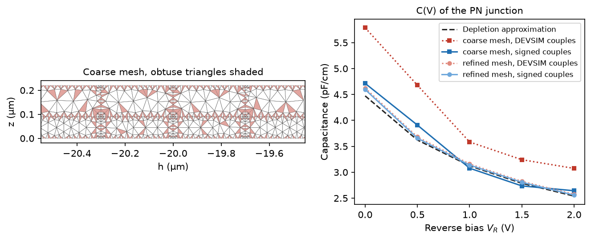
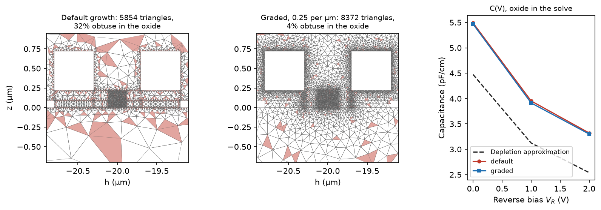
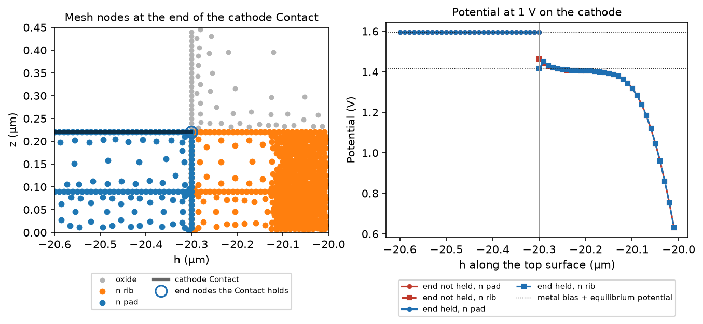
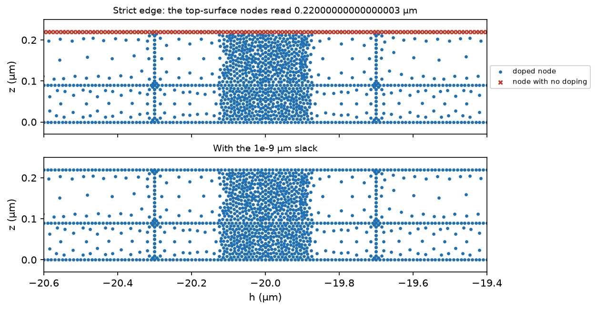

# TCAD guide

`gsim.tcad` solves Poisson and electron/hole drift-diffusion on a 2D cross-section of a doped silicon device with
[DEVSIM](https://devsim.org). Each bias point returns the carrier concentrations, the terminal currents and the
small-signal capacitance and admittance of the swept contact. The cross-section is meshed by the same native-2D pipeline
as the Palace mode solver, so the charge solve and the RF and optical solves see the same mesh.

Use [`Simulation`][gsim.tcad.Simulation] to configure and solve, and [`BiasSweepResult`][gsim.tcad.BiasSweepResult] to
read the result. The [PN junction notebook](../nbs/tcad_pn_junction.md) walks through a complete C(V) extraction.

## Install

DEVSIM is optional. Install the `tcad` extra:

```bash
pip install "gsim[tcad]"
```

It brings `devsim` and `scipy-openblas32`, which gives DEVSIM a BLAS/LAPACK library on Linux, Windows and macOS. On
macOS it needs macOS 15 or later on Apple silicon, the only macOS wheel DEVSIM ships. `import gsim.tcad` works without
DEVSIM; `solve()` and `sweep()` raise an error naming the extra.

### BLAS/LAPACK library

DEVSIM loads its BLAS/LAPACK library once, while it is first imported, from the file named by the `DEVSIM_MATH_LIBS`
environment variable. You normally set nothing. Before gsim first imports DEVSIM it sets three variables, so DEVSIM uses the
OpenBLAS that `scipy-openblas32` ships:

- `DEVSIM_MATH_LIBS`: the first `libscipy_openblas*` shared library in the folder that `scipy_openblas32.get_lib_dir()`
  returns (`.dll` on Windows, `.dylib` on macOS, `.so` otherwise).
- `DEVSIM_BLAS_PREFIX`: `scipy_`.
- `DEVSIM_BLAS_SUFFIX`: `_`.

The prefix and suffix are there because `scipy-openblas32` exports its routines under prefixed names, such as `scipy_dgetrf_`.
DEVSIM 2.11.1 and later looks each routine up as prefix + name + suffix.

gsim leaves all three variables alone in these cases:

- DEVSIM is already imported in the process, for example by your own `import devsim`.
- `DEVSIM_MATH_LIBS` is already set. gsim then sets neither the prefix nor the suffix, so those two are yours to set when your
  library exports prefixed or suffixed names.
- `scipy-openblas32` is not installed, or its folder holds no `libscipy_openblas*` library. DEVSIM then runs its own
  library discovery.

If DEVSIM cannot find a BLAS/LAPACK library, gsim raises an `ImportError` that names these remedies. DEVSIM cannot initialise
twice in one process, so restart Python (or the notebook kernel) after you change any of these variables.

On Windows 11 with DEVSIM 2.11.2, a fresh process with only `DEVSIM_MATH_LIBS` set to scipy-openblas32's
`libscipy_openblas.dll` also worked. If DEVSIM fails to initialise after you set `DEVSIM_MATH_LIBS` by hand, set
`DEVSIM_BLAS_PREFIX=scipy_` and `DEVSIM_BLAS_SUFFIX=_` as well, the values gsim uses for this library.

## Configure and solve

The simulation is set up by physical concern, like [`gsim.fdtd.Simulation`][gsim.fdtd.Simulation]:

```python
from gsim import tcad

sim = tcad.Simulation()
sim.geometry(component, stack=stack)
sim.domain(plane="x=0", window=(-25.0, -15.0), margin_x=3.0, margin_y=3.0, z_above=2.0, z_below=1.0)
sim.materials(temperature_k=300.0, mobility=tcad.MobilityModel.masetti_silicon())
sim.doping.add(tcad.StepDoping(region="p_rib", dopant_type="acceptor", concentration_cm3=1e18))
sim.doping.add(tcad.StepDoping(region="n_rib", dopant_type="donor", concentration_cm3=1e18))
sim.contacts.add(name="anode", semiconductor="p_rib", electrode="metal_p")
sim.contacts.add(name="cathode", semiconductor="n_rib", electrode="metal_n")
sim.interfaces.add(name="junction", region_a="p_rib", region_b="n_rib")
sim.solver(mesh_preset="coarse", refined_mesh_size_um=0.05, relative_error=1e-8)

sim.mesh(output_dir="./tcad")
point = sim.solve(1.0, contact="cathode")  # BiasPoint
sweep = sim.sweep([0.0, 0.5, 1.0, 2.0], contact="cathode")  # BiasSweepResult
```

A positive bias on the n-side contact reverse-biases the junction. The other contacts are at 0 V: one swept by an
earlier solve is ramped back first. Between bias points the swept contact is ramped in `solver.bias_step_v` steps, and
a bias must be a finite voltage.

Calling a concern applies several settings at once and validates them together; a failed call changes nothing. Single
attributes can also be assigned, `sim.solver.relative_error = 1e-8`, and a whole concern replaced by a model or a mapping,
`sim.materials = {"temperature_k": 350.0}`. The constructor takes the same concerns as keyword arguments:

```python
sim = tcad.Simulation(
    domain={"plane": "x=0", "window": (-25.0, -15.0)},
    doping=[tcad.StepDoping(region="p_rib", dopant_type="acceptor", concentration_cm3=1e18)],
    contacts=[{"name": "anode", "semiconductor": "p_rib", "electrode": "metal_p"}],
    solver={"mesh_preset": "coarse"},
)
```

## Concerns

Lengths are in µm, concentrations in cm⁻³, voltages in V, frequencies in Hz and temperatures in K. Field names carry
their unit.

- `geometry(component, *, stack=None)`: the gdsfactory component and its layer stack, a `LayerStack`, a stack YAML
  path, or `None` for the active PDK.
- `domain(...)`: `plane` (`"x=<um>"` or `"y=<um>"`); `window` and `window_z`, `(min, max)` clips of the domain in µm;
  the airbox `margin_x`, `margin_y`, `z_above`, `z_below` in µm.
- `materials(...)`: `temperature_k` (300 K); `semiconductor`, the DEVSIM material of the doped Regions (`"Silicon"`);
  `semiconductor_permittivity`, the static relative permittivity of every doped Region (11.1, DEVSIM's value);
  `mobility`, a `MobilityModel` (Masetti silicon); `insulators`, Region to static relative permittivity.
- `doping`: the doping profiles, with `add(profile)`, `remove(profile)`, `clear()`, iteration and `len()`.
- `contacts`: `add(name=, semiconductor=, electrode=)`, `remove(name)`, `sim.contacts[name]`, iteration.
- `interfaces`: `add(name=, region_a=, region_b=)`, `remove(name)`, `sim.interfaces[name]`, iteration.
- `solver(...)`: mesh resolution (`mesh_preset`, `refined_mesh_size_um`, `max_mesh_size_um`, `refinement_boxes`,
  `mesh_grading`),
  Newton convergence (`absolute_error`, `relative_error`, `max_iterations`, `bias_step_v`, `extended_precision`), the
  small-signal frequencies (`small_signal_freq_hz`, `junction_freq_hz`) and `claim_devsim_namespace`.

Without grading, the mesh refines along every internal curve and the element size grows about 2 per µm from it, whatever
the sizes set; a refinement box holds its size inside and steps to the surrounding size at its edge.
`mesh_grading=MeshGrading(growth_per_um=0.25)` replaces that: the size is `refined_mesh_size_um` on the conductors and
the declared Interfaces, and a box's own size inside each refinement box, and grows from them by `growth_per_um` per µm
of distance up to `max_mesh_size_um`. `sources=` limits the features it grows from (`"conductors"`, `"junctions"`,
`"fine_regions"`). A growth of 0.1 to 0.25 per µm keeps the oxide elements around a small section well shaped; the
[graded meshes](#graded-meshes) subsection has measured node counts. Grading is off by default, so existing meshes and
results do not change.

`refined_mesh_size_um` does not set the same size in the two cases. Without grading, the elements on the internal curves
are half of `refined_mesh_size_um`; with grading, the elements on the conductors and Interfaces are
`refined_mesh_size_um` itself. To keep the same size at the contacts and the junction when you turn grading on, halve
`refined_mesh_size_um`.

A layer with a numeric `mesh_resolution` keeps that size with grading whatever `refined_mesh_size_um` is, as long as
`"fine_regions"` is among the sources; without grading it gets its own size only when it is finer than
`refined_mesh_size_um`. Any size above `max_mesh_size_um` is held at `max_mesh_size_um`.

### Doping

A profile names the mesh Region it applies to and its dopant type. `StepDoping` is uniform inside an optional box,
`GaussianDoping` and `ImplantDoping` are analytic implants, `TableDoping` interpolates a sampled profile (a SIMS depth
profile, a process simulator's output) and `CallableDoping` evaluates a function of `(x, y)` in µm. Profiles on the same
Region add up; donors and acceptors compensate in the net doping and add up as scatterers in the mobility.
Box and window edges, the implant surface and the ends of a zero-fill table are inclusive, with a 1e-9 µm slack that
absorbs DEVSIM's µm to cm rounding. Two boxes on the same Region that abut therefore both dope the nodes on their shared
edge, which then carry the sum; one box covering both dopes that edge once.

### Contacts, interfaces and insulators

Every Region of the device takes one role, and the declarations state it:

- A **doped Region** carries at least one doping profile. It holds the potential and both carrier densities.
- A **Contact** is where an electrode meets a doped Region: an ohmic contact whose bias the solve sets.
  `semiconductor` is the doped Region it injects into; `electrode` is the Region on the other side, the metal or any
  Region that is neither doped nor insulating. Where the Contact ends on another solved Region (an Interface to the
  next doped Region, or the oxide), that Region's node touches the same metal and the Contact holds it too: a doped
  Region's node as an ohmic contact of its own doping, an insulator's at the potential of the Contact's node beside it.
  Its charge and current count towards the Contact. A node on another Contact's curve stays with that Contact, and a
  node two Contacts reach at a shared end goes to the one declared first. Where the doping steps at the end, say a
  contact implant beside a plus implant, each side is neutral at the metal's Fermi level, so the potential steps there
  by the step's built-in voltage, `V_t ln(N_high/N_low)`: the drop a real high-low junction makes over a Debye length.
- An **Interface** is where two doped Regions meet. Potential and carriers are continuous across it; it carries no bias.
  Declare one between every pair of touching doped Regions: two touching doped Regions without one are refused, since
  no carrier would cross between them.
- An **insulator** is a Region in `materials.insulators`. It joins the electrostatic solve with its own permittivity and
  holds no carriers. Without any, Poisson is solved in the doped silicon alone and its boundary is a zero-normal-field
  wall; with the oxide declared, the field may fringe around the junction through it. The interfaces an insulator shares
  with its neighbours are bound automatically.

A Region is doped or insulating, never both. A Contact against a declared insulator is refused: one curve cannot be both
a Contact and a semiconductor-insulator interface.

Each Contact and Interface becomes a line group of that name on the mesh, so contact and interface names are unique
across both.

## Mesh, then solve

`mesh(output_dir=...)` writes the native-2D mesh in µm and its copy in cm that DEVSIM loads, and returns a
[`TCADMesh`][gsim.tcad.TCADMesh] with both paths and the mesh's physical groups. `output_dir` is required on the first
call and remembered afterwards. Resolution comes from the `solver` concern.

The DEVSIM device is built on the first solve, and `mesh()` is never called implicitly. What a later change invalidates
depends on the concern:

- **Mesh inputs**: `geometry`, `domain`, `contacts`, `interfaces`, and the solver's mesh fields. `mesh()` records them.
  A solve after any of them changed raises `ValueError("... changed since mesh(); call mesh() again")`.
- **Device inputs**: `materials`, `doping`, and the other solver fields. A change drops the DEVSIM device and its bias
  state; the next solve builds it again on the existing mesh.

## Results

A DEVSIM 2D device is 1 cm deep, so extensive quantities are per cm of device length; each has a per-metre counterpart.

```python
sweep.voltages  # V
sweep.capacitance_f_per_cm  # small-signal C(V)
sweep.capacitance_f_per_m
sweep.admittance_s_per_cm  # complex admittance at solver.junction_freq_hz
sweep.junction_branch()  # series-RC fit: r_s_ohm_m, c_j_f_per_m

point = sweep.points[-1]
point.currents_a_per_cm  # DC terminal current per contact
point.carriers.electrons_cm3, point.carriers.holes_cm3  # per mesh node
point.carriers.x_um, point.carriers.y_um  # in-plane and vertical node coordinates
```

The capacitance comes from an AC solve at the quasi-static `small_signal_freq_hz`. The admittance comes from a second AC
solve at `junction_freq_hz`, high enough that the capacitive current dominates the junction's DC leakage and far below
the branch's own RC rolloff, so `junction_branch()` reads the series resistance of the doped slab and the junction
capacitance a loaded-line RF model needs.

`tcad.compare_capacitance` evaluates the depletion-approximation capacitance (Sze) at the same biases and reports the
relative deviation; `tcad.estimate_depletion_width_um` reads the depletion width off a 1D cut of the carrier map. The
comparison uses the solve's own silicon constants (below) for whatever the `PNJunctionConfig` leaves at its defaults.

## Silicon constants

The solve takes DEVSIM's silicon parameters, with two changes: the permittivity can be set, and the intrinsic carrier
density follows the temperature.

- **Permittivity:** `materials.semiconductor_permittivity` sets the static relative permittivity of every doped Region.
  It defaults to 11.1, DEVSIM's value (`gsim.tcad.silicon.SILICON_RELATIVE_PERMITTIVITY`), and does not reach the
  insulators, which keep their own. A `BiasSweepResult` records the value it was solved with in
  `semiconductor_permittivity`. The RF and optical stacks use 11.9 for silicon.
- **Intrinsic density:** `n_i(T) = n_i(300 K) (T/300)^1.5 exp(E_g(300)/2kT_300 - E_g(T)/2kT)`, with Varshni's
  band gap and DEVSIM's `n_i(300 K) = 1e10` cm⁻³ (`gsim.tcad.silicon.intrinsic_density_cm3`). A 300 K solve is
  DEVSIM's own; away from 300 K the built-in voltage falls with temperature as it should.
- **Temperature:** `materials.temperature_k` sets the thermal voltage, the intrinsic density and the SRH trap densities.
  The Masetti mobility is its 300 K fit at every temperature.

## Mesh quality

DEVSIM discretises by control volumes, also called finite boxes: each node owns a box, each equation is a flux balance
over one box, each mesh edge carries a couple (the length of the boundary its two boxes share) and each node a volume.
The result is only as good as the mesh it sits on, in two ways. The shape of a triangle decides the sign and size of
its couples, and the size of the elements decides whether a depletion edge, a contact end or a doping step is resolved
at all. `gsim.tcad` handles four cases, one subsection each: obtuse triangles, graded element sizes, the ends of a
Contact and the edges of a doping box. Each has a symptom, the reason in terms of the boxes, what gsim does now, what
you set, and a before and after figure.

The device in every figure is the PN junction of the [PN junction notebook](../nbs/tcad_pn_junction.md): a 220 nm
silicon rib cut into four doped strips, 1e18 cm⁻³ on both sides of the junction, an aluminium electrode on each pad,
and the notebook's mesh settings unless a subsection says otherwise. The figures come from
`docs/assets/tcad/make_mesh_quality.py`, which needs the `tcad` extra and about three minutes, and which prints the
numbers quoted below (DEVSIM 2.12.0 on Windows; other platforms and versions can differ in the last digits). None of
the four changes has a public switch that restores the earlier behaviour, so the "before" runs of that script switch
the new code off by patching private names of `gsim.tcad`. Treat it as a way to reproduce the figures, not as an
interface.

### Signed edge couples and obtuse meshes

**Symptom.** Capacitance comes out too high, by an amount that depends on the mesh and not on the device. On the
coarse mesh of the junction (the notebook's settings without its refinement box, 35 % of the triangles in the doped
silicon obtuse), the signed couples lower C(V) by 14 % to 19 % from DEVSIM's own over 0 to 2 V reverse bias. On the
notebook's refined mesh the same swap moves it by 0.6 % to 0.7 %.

**Why.** Inside a triangle, the boundary shared by the boxes of two of its nodes has length `L cot(θ) / 2`, with `L`
the length of the edge between the nodes and `θ` the triangle's angle opposite it. It is negative when `θ` exceeds 90°,
because the box boundaries are built from the circumcentre and that lies outside an obtuse triangle. DEVSIM's own
couples and volumes take the absolute value, which turns that negative length into coupling the Laplacian does not
have: the potential equation is no longer the finite-element one, and the volumes of a Region add up to more than its
area. The error therefore follows the obtuse triangles of the mesh, not the device.

**What gsim does now.** Each device is assembled with the signed couples and the node volumes that go with them
(the models `SignedEdgeCouple` and `SignedNodeVolume`, set as the device's `edge_couple_model` and `node_volume_model`),
so the potential equation is the P1 finite-element Laplacian on any triangulation and the node volumes of each Region
add up to its area. They are set on the device alone; other DEVSIM devices in the process keep their own.



*Left: the coarse mesh around the junction, obtuse triangles shaded. Right: C(V) with DEVSIM's own couples (dotted) and
the signed ones (solid) on that mesh and on the notebook's refined mesh, against the depletion approximation. The
remaining distance of the coarse-mesh curve from the depletion approximation is resolution, not couples: its elements
are larger than the depletion width.*

**What you set.** Nothing: the correction is always on and has no option. What you control is how many obtuse triangles
the mesh has in the doped Regions. The sizes and boxes of the next subsection refine it, and grading removes most of
them. To count them on a mesh you have made:

```python
import meshio
import numpy as np

msh = meshio.read(str(mesh.mesh_path))  # the mesh, in µm
tag = msh.field_data["n_rib"][0]  # the physical group of a Region
for block, tags in zip(msh.cells, msh.cell_data["gmsh:physical"], strict=True):
    if block.type != "triangle":
        continue
    corners = msh.points[block.data[tags == tag]][..., :2]  # (n, 3, 2)
    sides = np.sum((corners - np.roll(corners, 1, axis=1)) ** 2, axis=-1)  # squared lengths
    print(f"{np.mean(2 * sides.max(axis=1) > sides.sum(axis=1)):.0%} obtuse")
```

The size of the correction on other meshes, as measured with the test suite's meshes:

- A carriers-off capacitor on a mesh with obtuse triangles in both dielectrics now matches an independent P1
  finite-element solve (scikit-fem) to 1e-14; DEVSIM's own couples read 35 % high on that mesh.
- On the padded PN diode of the test suite (0, 0.5 and 1 V reverse bias), the small-signal capacitance falls by 9.3 %
  to 12.8 % and the reverse current by up to 19 %, and the capacitance moves closer to the depletion approximation.
  Carrier totals move by 0.2 %.

This correction lands without a transition period and with no option to restore DEVSIM's own couples, because those
give wrong answers on any mesh with obtuse triangles. It is planned for gsim 0.10.0. Up to 0.9.0, every device was
assembled with DEVSIM's own couples and volumes. Anyone with saved `gsim.tcad` results (capacitance, currents,
admittance) should rerun them: the same mesh and settings now give the corrected values. To reproduce an earlier
result exactly, run it with gsim 0.9.0 or older.

Signed couples can be negative on an edge whose opposite angles add up to more than 180°. The Scharfetter-Gummel flux
takes them as they come; fewer obtuse triangles in the doped Regions keep the solve closer to a monotone scheme. Node
volumes can be negative too, on a node at the end of the long edge of strongly obtuse triangles: two 150° triangles
sharing their long edge of length `L` give each end of that edge `-0.18 L²`. A Region's volumes still add up to its
area, but the space charge, recombination and stored charge of a node are weighted by its volume, so a negative volume
flips their sign at that node. On a 1e17/1e17 cm⁻³ junction meshed with 640 triangles, from 0 to 2 V reverse:

- With about 150 negative couples and no negative volume, the depletion width stays within 0.3 % of a right-angle mesh;
  DEVSIM's own couples read 1.5 % to 3.4 % low.
- With strongly obtuse triangles (about 180 negative couples and 3 to 7 negative volumes), it stays within a few
  percent, depending on the mesh: 0.2 % to 9 % over twelve random meshes, not tied to the number of negative volumes.
  DEVSIM's own couples read 17 % to 39 % low on the same meshes.

### Graded meshes

**Symptom.** The oxide and the silicon around a small feature are meshed with many obtuse triangles. Each one costs a
negative couple, and strongly obtuse ones can stop the Newton solve from converging (see Limits). On the PN junction with
the oxide declared as an insulator, 32 % of the oxide triangles are obtuse, and 19 % of those in the doped silicon even
with the notebook's refinement box.

**Why.** Without grading the pipeline refines along every internal curve and lets the element size grow from it at about
2 per µm, whatever sizes you set: half of `refined_mesh_size_um` on the curve, so with the notebook's 0.02 µm roughly
0.2 µm at 0.1 µm from it. Where the size changes that fast the mesher has to fill the gap between a row of small
elements and a row of large ones, and the triangles that do it tend to be stretched, often with an obtuse angle, which
is the case of the previous subsection. Growing the size slowly keeps neighbouring elements alike.

**What gsim does now.** `mesh_grading` is an opt-in. With a `MeshGrading` (`tcad.MeshGrading`) the element size grows
linearly with the distance from the chosen features, at `growth_per_um` per µm, up to `max_mesh_size_um`, and only those
features refine the mesh. On this device, at the same 0.01 µm on the junction and the contacts:

| Mesh | Triangles in the solved Regions | Obtuse in the oxide | Obtuse in the doped silicon |
| --- | --- | --- | --- |
| Default growth, with the refinement box | 5854 | 32 % | 19 % |
| Graded, 0.25 per µm, with the refinement box | 8372 | 4.1 % | 4.7 % |
| Default growth, no box | 4670 | 32 % | 35 % |
| Graded, 0.25 per µm, no box | 6704 | 4.9 % | 6.3 % |

Grading costs triangles here (43 % more with the box, 44 % without): the size now rises slowly from the 0.01 µm
features instead of jumping, so the oxide beside them is finer too. How many more depends on the sizes and the growth;
a larger `growth_per_um` gives fewer. C(V) with the oxide in the solve moves by 0.4 % to 1.0 % between the two meshes
at 0, 1 and 2 V. On this device grading buys element shape, not a different answer.



*The default mesh (left) and the graded one (middle) of the oxide and the doped silicon around the junction, obtuse
triangles shaded, with the notebook's refinement box. Right: C(V) with the oxide solved on both meshes, against the
depletion approximation. The depletion approximation has no fringing field, so the curves, which include the oxide's,
lie above it.*

**What you set.** All of these are fields of the `solver` concern.

- `mesh_grading`, default `None`: keeps the fixed growth from every internal curve. A `MeshGrading` replaces it.
- `MeshGrading.growth_per_um`, no default, above 0: the size increase per µm of distance. 0.1 to 0.25 keeps the elements
  well shaped; larger gives fewer nodes.
- `MeshGrading.sources`, default `("conductors", "junctions", "fine_regions")`: the features the size grows from, each
  named at most once.
- `refined_mesh_size_um`, default `None`, which takes the preset's size: 5 µm for `mesh_preset=None` or `"default"`,
  10 µm for `"coarse"`, 2 µm for `"fine"`. With grading it is the size on the conductors and the declared Interfaces.
- `max_mesh_size_um`, default `None`, which takes the preset's: 300, 600 and 70 µm for the same three presets. A size
  above it is held at it.
- `refinement_boxes`, default `None`: boxes `(h_min, h_max, z_min, z_max, size)` in µm. Each holds `size` inside, and
  with `"fine_regions"` the size grows from it outside.

The preset sizes are meant for wavelengths, far too coarse for a 220 nm rib: always set the two sizes. Without grading the
elements on the internal curves are half of `refined_mesh_size_um`, and with it they are `refined_mesh_size_um` itself,
so halve it to keep the size when you switch grading on. The figure was made with:

```python
sim.solver(
    mesh_preset="coarse",
    refined_mesh_size_um=0.01,
    max_mesh_size_um=40.0,
    refinement_boxes=[(-20.12, -19.88, 0.0, 0.22, 0.01)],
    mesh_grading=tcad.MeshGrading(growth_per_um=0.25),
)
```

### Contact ends

**Symptom.** Where a Contact ends on another solved Region, an Interface to the next doped Region or the oxide, the node of
that Region at the end of the Contact does not sit at the Contact's potential, although it touches the same metal. The
error is local, and it is largest where the doping steps at the end. With a contact pad at 1e20 cm⁻³ ending on a rib at
1e17 cm⁻³, the oxide solved, and 1 V on the cathode, the rib's end node sat at 1.4629 V when the end was not held, and
sits at 1.4173 V when it is, the bias plus the rib's equilibrium potential. The cathode current changed by 3.3 %
(1.408e-14 to 1.454e-14 A/cm in magnitude) and C by 0.07 %.

**Why.** A Contact fixes the potential of the nodes on its own curve, in its own Region. The node of the neighbouring
Region at the end of the curve is a separate node with a box of its own. The box touches the metal too, but no contact
equation is attached to it, so its potential follows from the flux balance with its neighbours and not from the metal.
An ohmic contact is neutral at the metal's Fermi level on each side, so on a doped side the potential is the bias plus
`V_t asinh(N / 2n_i)`, and across a doping step the two sides differ by the high-low built-in voltage
`V_t ln(N_high / N_low)`.

**What gsim does now.** Each node of another solved Region on a Contact's curve is claimed by that Contact. A doped
Region's node becomes an ohmic contact of its own doping, an insulator's node takes the potential of the Contact's node
beside it, and its charge and current count towards the Contact. A node on another Contact's curve stays with that
Contact, and a node two Contacts reach goes to the one declared first. A test on a carriers-off capacitor with the Contact
ending on an Interface and on the oxide reproduces an independent P1 solve to a relative 1e-5, and one with a 10:1 step
at the end checks the end nodes' potential against the equilibrium value to 1e-9 V.



*Left: the nodes of the n pad, the n rib and the oxide at the end of the cathode Contact; the ring marks the end node
the Contact now holds (the rib's and the oxide's lie at the same point). Right: the potential along the top surface
through the end at 1 V on the cathode, pad 1e20 cm⁻³ and rib 1e17 cm⁻³, with the oxide solved; dotted lines mark the
equilibrium potentials of the two sides.*

**What you set.** Nothing to switch on: the ends are found from the mesh wherever a Contact's curve reaches a node of
another solved Region. What you control is the declarations. The order of the `sim.contacts.add(...)` calls decides who
keeps a node that two Contacts reach. A Contact may not be declared against an insulator, and an Interface is declared
between every pair of touching doped Regions (see Contacts, interfaces and insulators). The end nodes are mesh groups
named `<contact>_end_<region>_<node>`, written to `devsim_contact_ends.msh` beside the DEVSIM mesh when there are any.

### Doping edges

**Symptom.** Nodes on the edge of a doping box, or on an implant's surface, come out undoped. On the PN junction with each
`StepDoping` given `y_range=(0.0, 0.22)`, the whole top surface of the silicon (164 of its 1617 nodes, among them the
ones under both electrodes) read a net doping of zero. With the edge handled, none do. At 1 V on the cathode that moves
C from 3.1098 to 3.1388 pF/cm (0.9 %) and the cathode current from -4.360e-15 to -4.200e-15 A/cm (3.7 % in magnitude).

**Why.** DEVSIM holds the mesh in cm, and gsim reads the node coordinates back from it into µm. The round trip is not
exact: a node at 0.22 µm returns as 0.22000000000000003. A hard window `y <= 0.22` then excludes the very nodes that lie
on the edge, however the box was drawn. A node's doping sets the charge of its box, and the ohmic condition of a Contact
reads the node's net doping to pick the equilibrium potential, so an undoped node under an electrode sits at the
equilibrium potential of undoped silicon, not of the pad.

**What gsim does now.** Every hard edge is inclusive with a slack of 1e-9 µm: the bounds of `x_range` and `y_range`, the
implant surface of `ImplantDoping`, and the ends of a zero-fill `TableDoping`. That is far above the rounding of the
round trip (about 3e-17 µm here) and far below any mesh spacing, so a node 1 nm outside a box stays undoped. The slack
is a module constant, not a setting.



*The nodes of the four doped strips around the junction, each doped by a box that reaches the top surface. Top: with a
strict edge, the top row of nodes (red crosses) has no doping. Bottom: with the slack, every node is doped.*

**What you set.** Draw box edges where the geometry is: the edge of the doped layer, not a hair inside or outside it. The
edges are closed, so two boxes on the same Region that abut both dope the nodes on their shared edge, and those nodes carry
the sum. Cover the span with one box to dope the edge once. You can check what a profile does to a node before you solve:

```python
step = tcad.StepDoping(region="n_rib", dopant_type="donor", concentration_cm3=1e18, y_range=(0.0, 0.22))
y_node = (0.22 * 1e-4) / 1e-4  # a node on the top surface, as DEVSIM returns it: 0.22000000000000003 µm
step.concentration(-20.1, [y_node, 0.221])  # array([1.e+18, 0.e+00])
```

## Limits

- DEVSIM keeps meshes, devices and its circuit in one process-wide namespace. By default each device setup claims it
  (`solver.claim_devsim_namespace`), so one charge-transport device is live at a time.
- The physics is DEVSIM's Scharfetter-Gummel drift-diffusion for silicon, with Shockley-Read-Hall recombination and the
  doping-dependent mobility of `materials.mobility`. There is no field-dependent mobility (velocity saturation), no
  impact ionisation and no quantum correction.
- Contacts, interfaces and insulators are declared, never inferred from the layer stack.
- Strongly obtuse triangles in a doped Region can stop the Newton solve from converging with the signed couples, on
  meshes where DEVSIM's own couples converge (to a less accurate answer). Keep such triangles out of doped Regions.
