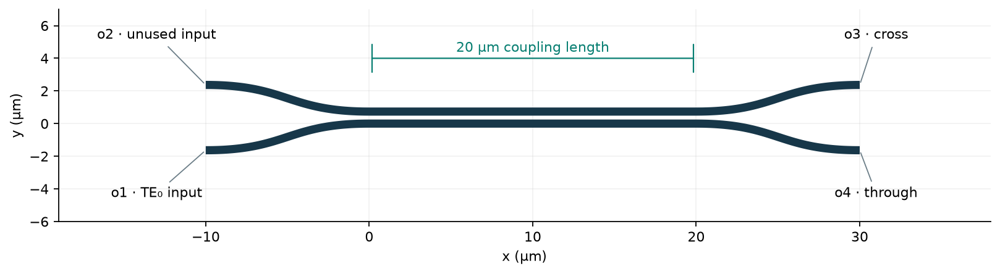
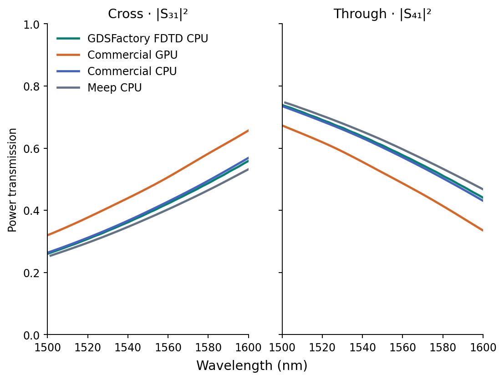
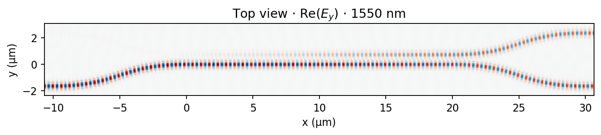
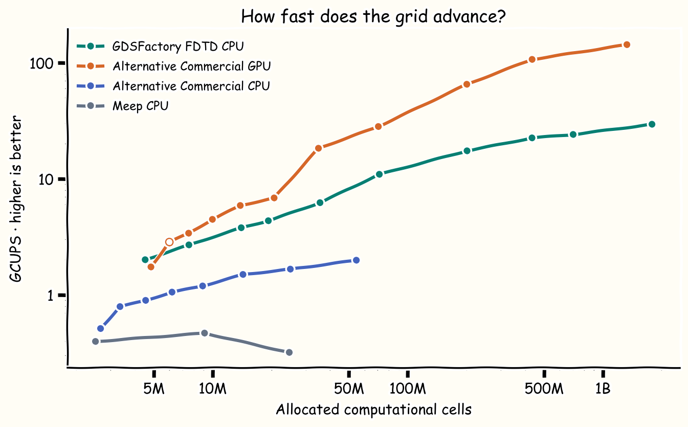
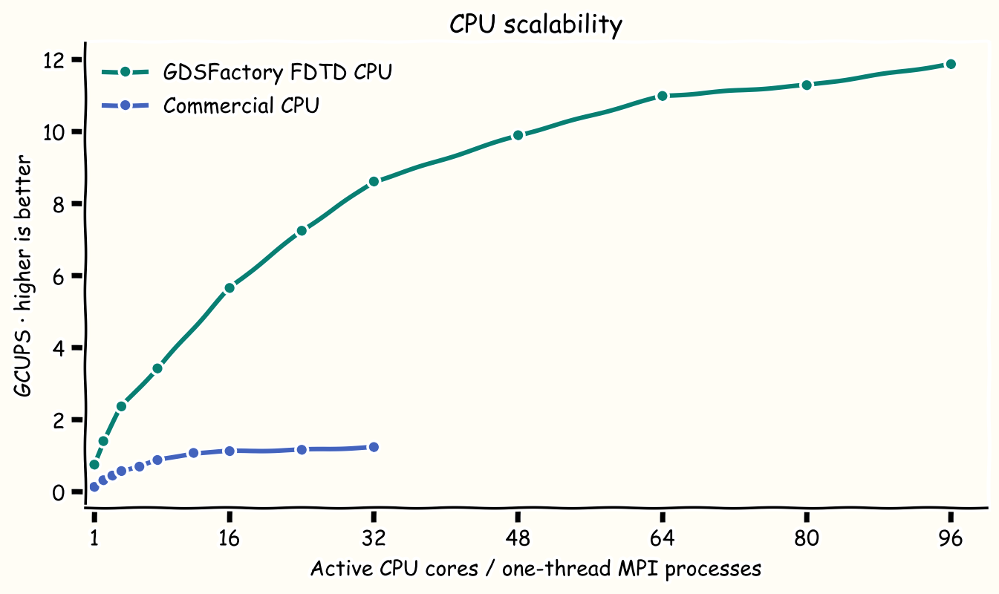
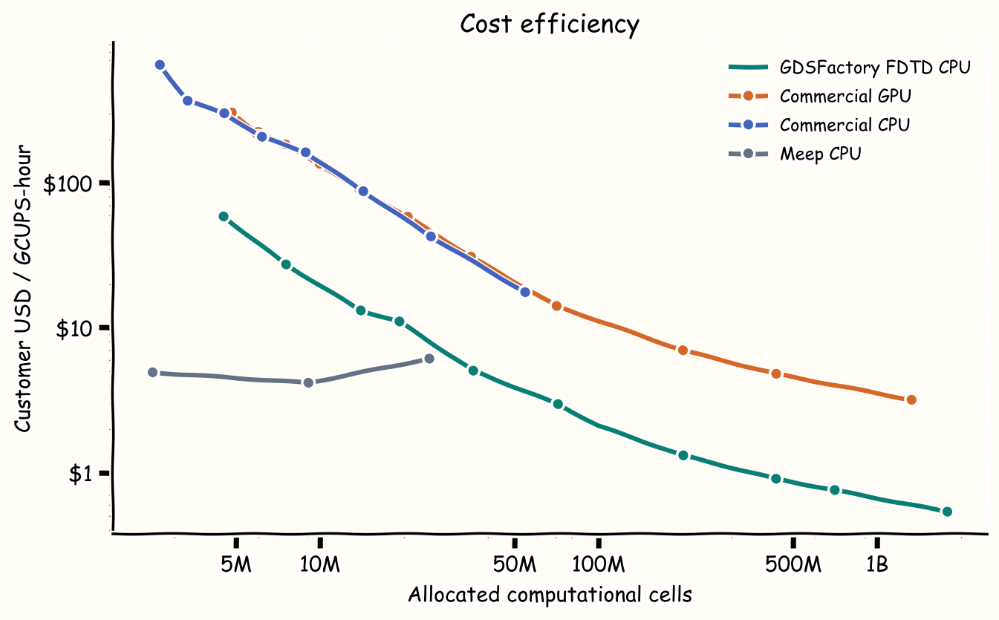

# Directional coupler: four FDTD solvers

<!-- markdownlint-disable MD033 -->

**Broadband photonic simulation in just over a minute.**
GDSFactory FDTD solved this 37-million-cell directional coupler on cloud CPUs
in 75 seconds. See how its optical response, throughput and cost compare with
commercial CPU, commercial GPU and Meep solvers.

## The problem

A directional coupler controls how much light passes straight through and how
much transfers to a neighboring waveguide. Getting that split right is central
to designing splitters, interferometers and photonic circuits.

This benchmark uses two **500 × 220 nm silicon waveguides**, a **236 nm gap**
and a **20 µm coupling section**, with SiO₂ cladding. Light enters at **o1**;
the **cross port o3** measures |S31|² and the **through port o4** measures |S41|².

Based on a published photonic device

Z. Liu and J. K. S. Poon (2025), <em>Comparison of Lumerical FDTD and Tidy3D for three-dimensional FDTD simulations of passive silicon photonic components</em>. 
<a href="https://arxiv.org/abs/2506.16665">Read the original paper</a>

The device geometry comes from this study. The four-solver comparison below is a separate benchmark.

## Cross and through transmission

**Close agreement with the commercial CPU result.** At 1550 nm, GDSFactory
predicts **39.1% cross transmission** and **60.9% through transmission**, each
within 0.7 percentage points of the commercial CPU result. The plots show the
full 1500–1600 nm response for all four solvers at 40 nm nominal cell size.

## Throughput

**High throughput on CPUs.** GDSFactory FDTD reaches **29.5 GCUPS** on the
largest measured grid. Compare how throughput changes as the simulation grows
from millions to billions of cells.

What is GCUPS?

<strong>GCUPS means giga cell updates per second</strong>: billions of simulation cells advanced by one timestep, every second.

<strong>GCUPS = cells × timesteps / (seconds × 10⁹)</strong>

Higher throughput means more grid updates per second. One GCUPS-hour is 3.6 trillion cell updates.

## CPU scalability

**Put more CPU cores to work.** See how each solver's throughput changes as
more CPU cores are used.

## How much does it cost?

**$1.95 per run for this directional coupler**, including the allocated annual
subscription and usage charges. The table compares the cost of a run; the chart
below shows the cost per GCUPS-hour as simulation size increases.

### Cost of the directional-coupler run

| Solver | Recorded runtime | Customer cost / run |
| --- | ---: | ---: |
| GDSFactory FDTD CPU | 75 s | $1.95 |
| Commercial GPU | 31.2 s | $4.90 |
| Commercial CPU | 221.4 s | $4.36 |
| Meep CPU · self-managed | 1,239.3 s | $0.67 |

Meep uses self-managed compute without a solver license fee.

Lower dollars per GCUPS-hour means more grid updates for the same budget.
Above 100M cells, the GDSFactory curve illustrates a hypothetical cost scenario
following the commercial GPU trend. Values through 100M cells use the benchmark's
customer rates.

Alternative commercial offerings combine annual subscriptions with pay-as-you-go
usage rates, similarly to GDSFactory+.

## Try it on your next design

Use these notebooks as a starting point for your own photonic layouts.

<ul>
<li><a href="nbs/fdtd_directional_coupler.md"><strong>Directional coupler</strong>View notebook →</a></li>
<li><a href="nbs/fdtd_sacher_visible_mmi.md"><strong>Visible-light MMI</strong>View notebook →</a></li>
</ul>

