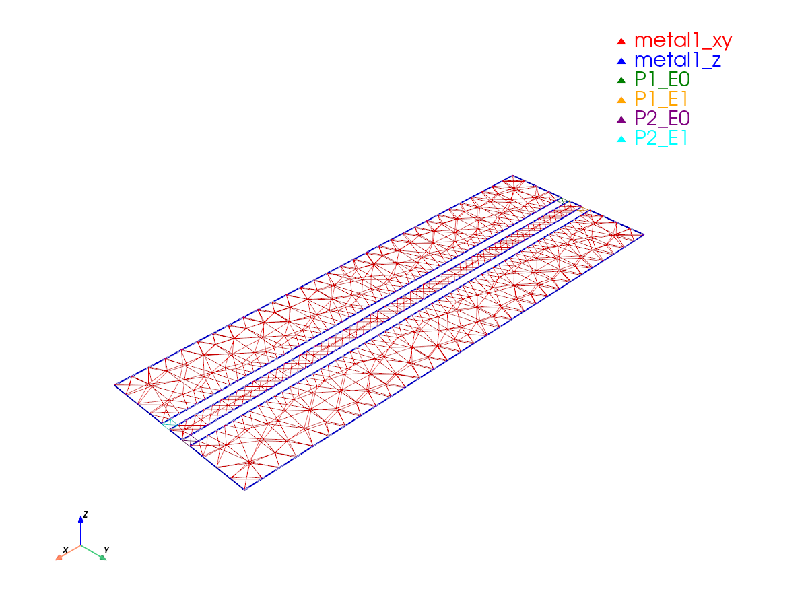

# Getting started with Palace

This page takes you from a gdsfactory component to S-parameters with [`gsim.palace`][gsim.palace]. You build the
geometry, stack, ports and mesh on your own machine, look at the mesh, solve on GDSFactory+ cloud, and read the result
as a `SParams` object or a Touchstone file. The last section shows how to run the same inputs on a Palace you run
yourself.

The example is a 300 µm coplanar waveguide (CPW) in the generic PDK, so everything below runs without a foundry
PDK. The same steps are used by the [CPW tutorial](nbs/palace_cpw_lumped.md), which runs an 800 µm line in the open IHP
PDK and shows the results of its cloud run.

## What you need

- Python 3.12. gsim declares `requires-python = "~=3.12.0"`.
- `pip install gsim`. This brings in gdsfactory (with its generic PDK, `gf.gpdk`), the Gmsh mesher and the
  `gdsfactoryplus` client that submits cloud jobs. You do not need a local Palace installation for the cloud route.
- A [GDSFactory+](https://gdsfactory.com) account, for the cloud solve in step 5. Everything before `run()` works
  without one.

For the IHP open PDK used by the tutorial notebooks, also install `ihp-gdsfactory`.

## 1. A component

Palace needs the metal geometry and one gdsfactory port per electrical port. Put the port at the centre of the signal
conductor, on the conductor's layer, with the signal width, and mark it `port_type="electrical"`.

```python
import gdsfactory as gf

from gsim.palace import DrivenSim

gf.gpdk.PDK.activate()


@gf.cell
def gsg_line(length=300, s_width=10, g_width=40, gap_width=6, layer=gf.gpdk.LAYER.M1):
    """Ground-signal-ground line with one port at each end of the signal."""
    c = gf.Component()
    ground_top = c << gf.c.rectangle((length, g_width), centered=True, layer=layer)
    ground_top.move((0, (g_width + s_width) / 2 + gap_width))
    c << gf.c.rectangle((length, s_width), centered=True, layer=layer)
    ground_bottom = c << gf.c.rectangle((length, g_width), centered=True, layer=layer)
    ground_bottom.move((0, -(g_width + s_width) / 2 - gap_width))
    for name, x, orientation in (("o1", -length / 2, 180), ("o2", length / 2, 0)):
        c.add_port(name=name, center=(x, 0), width=s_width, orientation=orientation, port_type="electrical", layer=layer)
    return c
```

## 2. Stack and airbox

`set_stack()` reads the layer stack of the active PDK, here the generic one. `set_airbox()` pads the model with air.
All lengths are in µm.

```python
sim = DrivenSim()
sim.set_output_dir("./palace-gsg-line")
sim.set_geometry(gsg_line())
sim.set_stack(substrate_thickness=2.0)
sim.set_airbox(margin_x=0, margin_y=50.0, z_above=100.0, z_below=100.0)
```

- `substrate_thickness` is the depth below `z=0` of the oxide fill. By default the PDK's own silicon substrate layer is
  left out of the model (`include_substrate=False`), and gsim logs a warning saying so when the PDK has one. Pass
  `include_substrate=True` to mesh it as lossy silicon. To take the PDK's layer stack verbatim, as the IHP notebooks do,
  use `set_stack(pdk_authoritative=True)`.
- `set_airbox()` adds `margin_x` and `margin_y` around the layout and `z_above` and `z_below` above and below the stack.
  Here `margin_x=0` keeps the domain ends flush with the ends of the line, where the ports sit: the example's mesh
  spans x = ±150 µm, the length of the line, and y = ±101 µm, the 51 µm half-width of the three conductors plus the
  50 µm margin.
- Without an airbox the outer boundary would touch the dielectric directly, and gsim warns about it when you mesh.
  The outer wall of a driven model with lumped ports is absorbing by default.

## 3. Ports

Lumped CPW ports, one per end of the line:

```python
for port in ("o1", "o2"):
    sim.add_cpw_port(port, layer="metal1", s_width=10, gap_width=6, length=5.0)
sim.set_driven(fmin=1e9, fmax=100e9, num_points=40)
print(sim.validate_config())
```

`add_cpw_port` takes the layout's signal width and gap width and builds two lumped elements, one in each gap, driven
with opposite sign to excite the coplanar mode. `length` is the port's extent along the line, `offset` shifts it
inwards (it defaults to `length / 2`, which puts the port flush with the conductor end), and `impedance` is the
reference impedance, 50 Ω by default. Every port is excited in turn, so a two-port model gives the full S-matrix.
`set_driven()` sets the frequency sweep, and `validate_config()` lists configuration errors before you spend time
on meshing.

A **wave port** instead solves the actual 2D mode of the port face. It replaces `add_cpw_port` like this:

```python
wave = DrivenSim()
wave.set_output_dir("./palace-gsg-line-wave")
wave.set_geometry(gsg_line())
wave.set_stack(substrate_thickness=2.0)
wave.set_airbox(margin_x=0, margin_y=50.0, z_above=100.0, z_below=100.0)
for port in ("o1", "o2"):
    wave.add_wave_port(port, layer="metal1", max_size=True)
wave.set_driven(fmin=1e9, fmax=100e9, num_points=40)
```

`max_size=True` makes the port face fill the airbox boundary on that side. With wave ports, gsim makes the outer wall PEC
instead of absorbing, because Palace solves the port mode with PEC outer edges; see
[Numeric wave-port boundaries](api/palace.md#numeric-wave-port-boundaries) for the rule and for `absorbing_boundary=True`.
The wave-port version of this example is a larger model (10,362 tetrahedra at the `coarse` preset, against 7,897 for the
lumped one; see step 4). To compare both port types on a real line, see the
[lumped-port](nbs/palace_cpw_lumped.md) and [wave-port](nbs/palace_cpw_waveport.md) tutorials, and for multimode and
terminal ports see [Terminal wave ports](terminal_wave_ports.md).

## 4. Mesh, and look at it

```python
result = sim.mesh(preset="coarse")
print(result.mesh_stats["tetrahedra"])
print(result.mesh_stats["field_dofs"]["estimated_field_dofs"])
sim.plot_mesh(show_groups=["metal", "P"])
```

`mesh()` writes `palace.msh` and `metadata.json` (the sizing counts) to the output directory; the Palace configuration
comes later, from `write_config()` or `run()`. The three presets set the element size near conductors
(`refined_mesh_size`) and in the bulk (`max_mesh_size`), both in µm. Pass either as a keyword to override the preset.
The counts below are for this example with lumped ports, measured with gsim 0.9.0; a different Gmsh version can change
them slightly.

| Preset | `refined_mesh_size` | `max_mesh_size` | Tetrahedra | Estimated field DOFs (order 2) |
| --- | --- | --- | --- | --- |
| `"coarse"` | 10 | 600 | 7,897 | 50,992 |
| `"default"` | 5 | 300 | 20,220 | 129,804 |
| `"fine"` | 2 | 70 | 55,061 | 353,272 |

Use `coarse` to check that the geometry, ports and boundaries are what you meant. It is not meant for results. On this
example `coarse` and `default` both log `Small conductor feature detected (6.000 um) may be under-resolved by
refined_mesh_size=...`, because the gaps are 6 µm wide and the heuristic asks for elements of at most 3 µm; `fine` does
not log it. The warning is a heuristic, and a mesh without it is not thereby converged: compare two meshes before you
trust a number (see [Mesh](api/palace.md#mesh)).



*The `coarse` mesh, drawn with `show_groups=["metal", "P"]`: the `metal1` surfaces and the port sheets `P1_E0`, `P1_E1`,
`P2_E0`, `P2_E1`, one pair of sheets per port. `plot_mesh()` writes a PNG to `mesh.png` in the output directory; pass
`interactive=True` to open a 3D view.*

The estimated field DOFs are what the cloud uses to size the job, together with the tetrahedron count. Read them before
you submit: see [Cloud sizing metadata](api/cloud.md#sizing-metadata).

## 5. Run on the cloud

```python
results = sim.run(check_cache=True)
```

`run()` writes `config.json` from the current settings, uploads the mesh and configuration, starts the job, waits for
it, downloads the results into `sim-data-<job name>/` in the current directory and parses them into a `SParams` object.
So after `mesh()` you do not have to call `write_config()` yourself; call it if you want to inspect the configuration
before submitting.

`check_cache=True` first looks for a finished job whose inputs are byte-identical to yours and reuses its results
instead of starting a new one; when none matches, a new job starts. See [Result caching](api/cloud.md#result-caching).

If a job is rejected as too large, or fails with exit code 137 (SIGKILL, often out of memory), coarsen the mesh or
shrink the model; see
[Palace size limits and out-of-memory failures](api/cloud.md#palace-size-limits-and-out-of-memory-failures).

## 6. Read the results

`SParams` indexes by port-name pair as `results["to", "from"]`, and `s11`, `s21`, `s12`, `s22` are shorthand on a
two-port model. Frequencies are in GHz.

```python
results.freq  # GHz
results.s21.db  # |S21| in dB
results["o2", "o1"].deg  # phase of S(o2, o1) in degrees

results.plot()  # matplotlib: magnitude and phase
results.plot_interactive()  # plotly, toggle traces in the legend

network = results.to_skrf()  # scikit-rf Network, frequency in Hz
network.plot_s_db(1, 0)  # |S21| in dB
results.write_touchstone("gsg_line")  # gsg_line.s2p
```

`write_touchstone()` adds the `.s2p` suffix when the name has none and writes frequencies in Hz with the port names in
`! Port[i]` comments. `save_npz()` and `SParams.from_file()` store and reload the same data without Touchstone's
text format. For length sweeps, de-embedding and RLGC extraction with scikit-rf, see
[Transmission-line analysis](transmission_line_analysis.md).

## 7. Check the run

A job that finished is not a result you can trust yet. gsim reads the solver log and the run metadata and reports
convergence, adaptive-sweep and port-mode checks separately: see
[Palace: Checking a Run](palace-validation.md).

## Run Palace locally

`run_local()` solves the same mesh and `config.json` on your own machine, with a Palace you run yourself. It returns
the same `SParams` object as the cloud run for a driven simulation.

```python
sim.mesh(preset="default")
sim.write_config()  # run_local() does not write config.json; run() does
results = sim.run_local(log_path="palace.log")
```

`run_local()` needs `mesh()` and `write_config()` first. Without `config.json` it raises `FileNotFoundError` and tells you
to call `write_config()`, so call it again after you change a setting. Palace writes its tables to
`<output directory>/output/palace/` (`palace` is the default `model_name` of `mesh()`). `log_path` keeps the solver log
even when the run fails; hand its text to
[`validate_solution`](palace-validation.md) as in step 7.

### Which Palace runs

`run_local()` takes the first of these that exists:

1. The `palace_executable=` argument.
2. The `PALACE_EXECUTABLE` environment variable.
3. `bin/palace` under the current directory, the output directory or its parent.
4. With `use_apptainer=True` (it defaults to `False`) and none of the above: an Apptainer image, from `palace_sif_path=`,
   `PALACE_SIF` or a `Palace.sif` in those same places.
5. Otherwise the first Palace that gsim finds: `PALACE_BIN`, then `palace` on `PATH`, then gsim's own cached runtime and,
   if there is none, a download of it. (A runtime from an installed `palace-toolkit` package comes after those.)

The download is the part that is easy to trip over:

- It exists **only for Linux on x86_64**. It fetches a prebuilt CPU runtime of Palace **0.18.0** from the PalaceToolkit
  project's GitHub releases the first time you need it and caches it under `~/.cache/palacetoolkit/runtime`.
  `PALACETOOLKIT_RUNTIME_DIR` moves the cache, `PALACETOOLKIT_AUTO_DOWNLOAD_BINARY=0` turns the download off and
  `PALACETOOLKIT_PALACE_CPU_TAG` names another release tag.
- On **Windows** and **macOS** gsim downloads nothing. With no Palace found, `run_local()` raises a `FileNotFoundError`
  that starts "Palace executable not found", as it does on a Windows machine with nothing installed.
- **On Windows, use WSL2**: install gsim in a Python 3.12 environment inside a WSL2 Linux distribution and run your
  script there. That is the Linux x86_64 path, with the download above. The authors have not run these WSL2 steps; the
  code path is the one any Linux x86_64 machine takes.
- To use a Palace you built or installed, pass `palace_executable=` or set `PALACE_EXECUTABLE`. gsim starts it as
  `palace -np <ranks> [-nt <threads>] config.json`, so it must accept the Palace launcher's arguments.

The number of MPI ranks is chosen from the problem size: at most 4 for a 3D model, fewer for a small one, and one rank
with OpenMP threads for a 2D cross-section. Pass `num_processes=` or `num_threads=` to override it; gsim warns when you
ask for more ranks than the direct solver can use on a problem of that size.

### Local and cloud runs differ

- **`Crack` on conductors.** For a 3D model gsim writes `"Crack": true` on every `Boundaries.Conductivity` entry in
  `config.json`, so that Palace 0.19 and later keeps the conductor as a thick conductor instead of reading its boundary
  as a thin film. Palace 0.18 rejects the key and always treats such a boundary as cracked, so the model is the same
  without it. When the Palace that `run_local()` starts is known to be older than 0.19, it gets a temporary copy of the
  configuration without the key, which is deleted after the run. `config.json` keeps the key, and so does what you upload to
  the cloud. gsim knows the version of its own runtime; for a Palace you installed it asks `palace --version`, and if
  the answer is not a release number such as `v0.18.0` it keeps the key and leaves Palace to accept or reject it.
- **Palace version.** The auto-downloaded runtime is Palace 0.18.0, and the cloud runs a different build, a specific
  Palace commit. The difference documented so far is the line integration behind voltage and impedance paths: the local
  0.18.0 runtime samples the path with its default count of 100 and does not gain the element-wise integration of the
  cloud runtime (see [Boundary-mode path integration](api/palace.md#boundary-mode-path-integration)). Compare a local
  and a cloud run of the same model before you combine them in one study.

## Next steps

- [CPW tutorial, lumped ports](nbs/palace_cpw_lumped.md): this page's steps on an 800 µm IHP line, 300 frequency points
  from 1 to 100 GHz.
- [CPW tutorial, wave ports](nbs/palace_cpw_waveport.md): the same line with wave ports.
- [Microstrip](nbs/palace_microstrip.md) and [branch-line coupler](nbs/palace_branch_line_coupler.md): other layouts.
- [Width sweep](nbs/palace_width_sweep.md): several simulations in parallel.
- [Length sweep and de-embedding](nbs/palace_cpw_deembedding.md): extract line parameters from lumped- and wave-port runs.
- [Palace guide](api/palace.md): solver settings, mesh options and result handling.
- [Cloud guide](api/cloud.md): sizing, caching and failed jobs.
