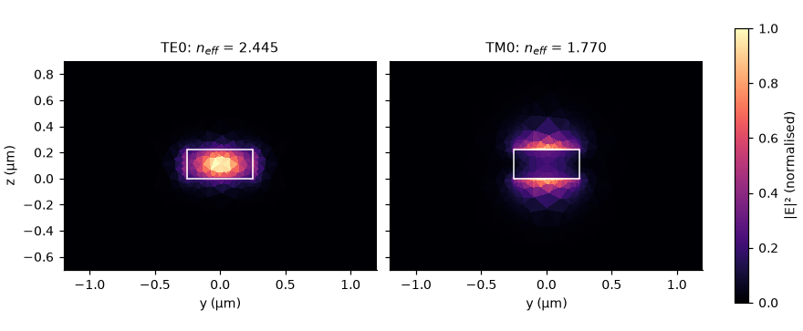

# Simulation guide

The pages in this section are organised by task: what you want to know about a device, which gsim solver answers it, the
minimum setup, the settings that matter and their defaults, and what to check before you use the result. They link to the
API guides for the full option lists and to the notebooks for complete worked examples.

Start with [choosing a solver](choosing-a-solver.md) if you do not yet know which engine fits your question.

## What a solve returns

*Fundamental TE0 and TM0 modes of a 500 × 220 nm silicon strip in SiO₂ at 1.55 µm: |E|² normalised to its peak, the silicon core
outlined in white, n_eff in the panel titles. Local `gsim.femwell` run on the generic-PDK stack (silicon index 3.476, oxide 1.444),
2026-11-25. The benchmark cases `mode.strip_te0.convergence` and `mode.strip_tm0.convergence` give 2.4451 and 1.7701 for the
same strip on a finer mesh.*

## Task pages

| Task | Solver | Page |
| --- | --- | --- |
| S-parameters of a directional coupler, MMI or Y-branch | GDSFactory FDTD | [Couplers and MMIs](couplers-and-mmis.md) |
| Carrier-depletion phase shifter: VπL and loss | TCAD (DEVSIM) and femwell | [Phase shifters](phase-shifters.md) |
| Frequency and Q of a superconducting coplanar resonator | Palace eigenmode and driven | [Superconducting resonators](superconducting-resonators.md) |
| Thermal tuning | Not covered | [Thermal tuning](thermal-tuning.md) |

## Reference pages

- [Choosing a solver](choosing-a-solver.md): the question, the class that answers it, where it runs and what drives the cost.
- [Validation and benchmarks](validation.md): the evidence in this repository, by kind, and what it does not show.

## Tasks without a guide page yet

These have no guide page. The existing material is:

- **Waveguide mode, n_eff and loss.** The local mode solver `gsim.femwell` is used in step 3 of the
  [travelling-wave MZM notebook](../nbs/tcad_twmzm.md). It has no API guide page yet.
- **Ring resonators.** No example exists. The S-matrix export that a ring model would use is described in the
  [FDTD guide](../api/fdtd.md#export-to-sax-and-touchstone).
- **RF transmission lines.** See the Palace tutorials: [CPW with lumped ports](../nbs/palace_cpw_lumped.md),
  [CPW with wave ports](../nbs/palace_cpw_waveport.md), [microstrip](../nbs/palace_microstrip.md),
  [length sweep and de-embedding](../nbs/palace_cpw_deembedding.md), and
  [line analysis with scikit-rf](../transmission_line_analysis.md).
- **Grating couplers.** [3D grating coupler (FDTD)](../nbs/fdtd_focusing_grating_coupler_gpdk.md) and
  [2D grating coupler (Meep)](../nbs/meep_2d_xz_gc.md).
- **Inductors and transformers.** [Inductor](../nbs/palace_inductor.md) and
  [inductance matrix](../nbs/palace_magnetostatic.md).
- **Capacitance.** [Palace guide: capacitance](../api/palace.md#capacitance).
- **Signal integrity.** [Differential interconnect, crosstalk and TDR](../nbs/palace_signal_integrity.md).

## How the task pages are laid out

Each task page uses the same headings:

1. When to use, and which solver and why
2. Minimal setup
3. Key settings and defaults
4. What to check
5. Known pitfalls
6. Examples
7. Related API

The defaults on these pages were read from the source of the version in this repository, and they change between releases.
Where a page quotes a number that the page's author measured rather than took from a test or a stored result, it says so.

## Figures

Each figure has a caption that says what is drawn and where the numbers come from: a local run with its date, or a stored
benchmark case. The scripts that draw them are in `docs/guide/figures/` (one per page) and write to `docs/guide/images/`.

## Cloud use

Meshing and input export run locally. FDTD, Meep and Palace solves run on GDSFactory+ cloud and need an account. The code on
these pages stops before any cloud call, or marks the cloud line. Use `run(check_cache=True)` so that identical inputs reuse a
finished job. Check the problem size before you submit: see [cloud sizing](../api/cloud.md#sizing-metadata).
