# Simulation guide

This guide is one page, organised by task: what you want to know about a device, which gsim solver answers it, the minimum
setup, the settings that matter and their defaults, and what to check before you use the result. Read it from the top once, or
jump with the cards and the contents below. Each device section goes from the object to the solver, the settings, the steps,
the result and the checks. The full option lists are in the API guides and complete worked examples are in the notebooks.

<!-- markdownlint-disable MD033 -->
<div class="grid cards">
<ul>
<li><p><a href="#your-first-simulation"><strong>Getting started</strong></a></p><p>Seven steps to a checked result.</p></li>
<li><p><a href="#which-simulation-answers-which-question"><strong>Choosing a solver</strong></a></p><p>Question to solver.</p></li>
<li><p><a href="#waveguide-modes"><strong>Devices</strong></a></p><p>Modes, couplers, gratings, rings, RF lines.</p></li>
<li><p><a href="#mesh-and-resolution"><strong>Settings that matter</strong></a></p><p>Mesh, domain, ports, order.</p></li>
<li><p><a href="#validation-and-benchmarks"><strong>Results and trust</strong></a></p><p>The evidence, and the checks.</p></li>
<li><p><a href="#parameter-sweeps"><strong>Sweeps and cost</strong></a></p><p>Size a job before you submit.</p></li>
<li><p><a href="#known-pitfalls"><strong>Help</strong></a></p><p>Pitfalls, questions, figures.</p></li>
</ul>
</div>
<!-- markdownlint-enable MD033 -->

**Getting started:** [Your first simulation](#your-first-simulation)

**Choosing a solver:** [Which simulation answers which question](#which-simulation-answers-which-question) ·
[Which solver for which device](#which-solver-for-which-device) · [FDTD or Meep](#fdtd-or-meep)

**Devices:** [Waveguide modes](#waveguide-modes) · [Directional couplers and MMIs](#directional-couplers-and-mmis) ·
[Grating couplers](#grating-couplers) · [Rings and circuits](#rings-and-circuits) ·
[Carrier-depletion phase shifters](#carrier-depletion-phase-shifters) · [RF transmission lines](#rf-transmission-lines) ·
[Superconducting resonators](#superconducting-resonators) · [Inductors and capacitance](#inductors-and-capacitance) ·
[Thermal tuning](#thermal-tuning)

**Settings that matter:** [Mesh and resolution](#mesh-and-resolution) ·
[Domain and absorbing boundaries](#domain-and-absorbing-boundaries) · [Ports sources and monitors](#ports-sources-and-monitors) ·
[Element order and tolerances](#element-order-and-tolerances) · [Stopping and convergence](#stopping-and-convergence)

**Results and trust:** [Validation and benchmarks](#validation-and-benchmarks) · [Checks for every result](#checks-for-every-result) ·
[Convergence study of any setting](#convergence-study-of-any-setting)

**Sweeps and cost:** [Parameter sweeps](#parameter-sweeps) · [Estimating cost before you submit](#estimating-cost-before-you-submit) ·
[Cloud runs and caching](#cloud-runs-and-caching)

**Help:** [Known pitfalls](#known-pitfalls) · [Questions and answers](#questions-and-answers) ·
[How the figures are made](#how-the-figures-are-made)

The defaults on this page were read from the source of the version in this repository (gsim 0.10.0), and they change between
releases. Where a number is one that the page's author measured, rather than took from a test or a stored result, the text says
so. Meshing and input export run locally. FDTD, Meep and Palace solves run on GDSFactory+ cloud and need an account; the code
here stops before any cloud call, or marks the cloud line.

## Your first simulation

1. **Find your device** in [Which solver for which device](#which-solver-for-which-device). The row names the solver and the
   section that holds its settings.
2. **Install what the solver needs.** `pip install gsim` brings gdsfactory with its generic PDK (`gf.gpdk`), the Gmsh mesher and
   the client that submits cloud jobs. TCAD and the mode solver are extras: `pip install "gsim[tcad,femwell]"`. SAX is
   installed separately with `pip install sax`.
3. **Build the inputs locally.** Activate a PDK (`gf.gpdk.PDK.activate()`), take or draw a gdsfactory component, and call the
   solver's configuration methods from the device section. Nothing is submitted before `run()`.
4. **Look at the set-up before you solve.** `Simulation.plot_2d_static()` for FDTD, `Simulation.plot_2d()` for Meep and
   `plot_mesh()` for Palace draw what the solver will see. The figures of this guide are made this way.
5. **Read the size.** FDTD `write()` writes `metadata.json` with the estimated grid, Palace `mesh()` reports tetrahedra and
   field DOFs. See [Estimating cost before you submit](#estimating-cost-before-you-submit).
6. **Run.** `sim.run(check_cache=True)` on the cloud, `run_local()` for Meep and Palace if the binary is installed. femwell and
   TCAD run on your machine. See [Cloud runs and caching](#cloud-runs-and-caching).
7. **Check the result** with [Checks for every result](#checks-for-every-result) and the checks of the device section, then
   read [Known pitfalls](#known-pitfalls).

## Which simulation answers which question

Pick the row that matches the question. Each row names the gsim class that answers it, where it runs and the section that
holds the settings. What drives the cost is in [Estimating cost before you submit](#estimating-cost-before-you-submit).

| Question | Solver and class | Runs | Section |
| --- | --- | --- | --- |
| S-parameters of a splitter, coupler, MMI or crossing | FDTD, `gsim.fdtd.Simulation` | Cloud solve | [Directional couplers and MMIs][dc] |
| Same, for a feature FDTD lacks (2D XZ grating coupler) | Meep, `gsim.meep.Simulation` | Cloud solve, or local | [Grating couplers][gc] |
| Fibre coupling of a grating coupler | Meep 2D XZ with a fibre source, or 3D FDTD | Cloud solve | [Grating couplers][gc] |
| Waveguide mode: n_eff, loss, mode profile | femwell, `gsim.femwell.solve_modes` | Local | [Waveguide modes][wm] |
| Same, as a cross-check on one mesh | Palace, `BoundaryModeSim` | Cloud solve, or local | [Waveguide modes][wm] |
| Ring resonator | FDTD for the coupler section, loop in SAX | Cloud solve, SAX local | [Rings and circuits][rc] |
| Carrier-depletion phase shifter: VπL, loss | TCAD (DEVSIM), then femwell | Local | [Carrier-depletion phase shifters][ps] |
| Transmission line: S-parameters, Z₀, loss | Palace `DrivenSim`, CPW or wave ports | Cloud solve, or local | [RF transmission lines][rf] |
| Z₀ of a 2D line cross-section | `BoundaryModeSim.add_impedance_path`, femwell `z0_power_current` | Local | [RF transmission lines][rf] |
| Resonant frequency and Q of a resonator | Palace `EigenmodeSim` and `DrivenSim` | Cloud solve, or local | [Superconducting resonators][sr] |
| Capacitance matrix | Palace `ElectrostaticSim` | Cloud solve, or local | [Inductors and capacitance][ic] |
| Inductance of a coil or transformer | Palace `MagnetostaticSim`, or `DrivenSim` | Cloud solve, or local | [Inductors and capacitance][ic] |
| Thermal tuning | Not covered | None | [Thermal tuning][tt] |

"Cloud solve" means that mesh and inputs run locally and the solve runs on GDSFactory+ cloud, which needs an account. "Or local"
means meep or a Palace binary that you run yourself (`run_local()`). `run(check_cache=True)` reuses a finished job with
byte-identical inputs instead of submitting a new one.

## Which solver for which device

| Device | Recommended | Why |
| --- | --- | --- |
| Waveguide cross-section | femwell on a 2D mesh | Local and cheap; complex n_eff and the field |
| Directional coupler, MMI, Y-branch, crossing | GDSFactory FDTD | S-parameters from guided-port monitors |
| Grating coupler | Meep 2D XZ to design, FDTD 3D to confirm | Tilted fibre source in 2D; 3D has the lateral shape |
| Ring, circuit with delay lines | FDTD for the coupler, SAX for the rest | Only the coupler section is simulated |
| Carrier-depletion phase shifter | TCAD (DEVSIM) with femwell | Carriers first, then n_eff(V) |
| RF line (CPW, microstrip) | Palace driven; femwell for 2D Z₀ | Full-wave S-parameters; cheap Z₀ |
| Superconducting resonator | Palace eigenmode and driven on one mesh | f and Q, and the notch, from one mesh |
| Inductor, capacitor, transformer | Palace magnetostatic, electrostatic, driven | Matrices from one solver family |
| Thermal tuning | None | gsim has no heat solver |

**Rule of thumb.** Screen on the cheapest solver that sees the effect, confirm on the field solver, and run the checks of the
device section before you quote a number. [Validation and benchmarks](#validation-and-benchmarks) says what evidence exists for
each solver, and what it does not cover.

## FDTD or Meep

GDSFactory FDTD is the primary engine for new photonic simulations. Meep stays supported for workflows FDTD does not cover
yet, and it will be deprecated only after FDTD reaches the required feature coverage and a migration path is documented.
The [home page](../index.md) states this, together with the FDTD roadmap.

At the time of writing, material dispersion is not accepted by the deployed FDTD solver: with `dispersion=False` each
material enters at its index at the source centre wavelength, so a broadband result carries that approximation. Read the
[FDTD guide](../api/fdtd.md) for the current state before relying on a wide band.

## Waveguide modes

A waveguide cross-section has guided modes, each with an effective index n_eff, a field and a loss, and a 2D finite-element
solve of the cross-section finds them.

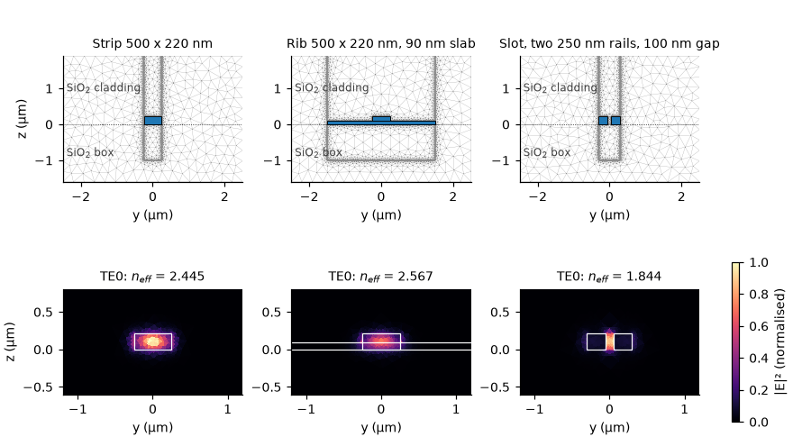

*Three cross-sections of the generic-PDK stack as `BoundaryModeSim` meshes them and femwell solves them at 1.55 µm (silicon
index 3.476, oxide 1.444). Top: the 5 × 3.5 µm solver window with its mesh and the 220 nm silicon core in blue (the rib has a
90 nm slab, the slot two 250 nm rails 100 nm apart). Bottom: TE0 |E|² normalised to its peak, with n_eff 2.4449 (strip,
500 × 220 nm), 2.5670 (rib) and 1.8442 (slot). The boundary field ratio is 4.1e-6, 1.5e-6 and 2.6e-4. Local femwell run,
2026-11-25.*

**When to use which solver.** Use `gsim.femwell.solve_modes` on a mesh that `BoundaryModeSim` makes of the cross-section. It
runs on your machine, costs the number of 2D mesh elements, and returns a complex n_eff and the field. `BoundaryModeSim` can also
solve the same mesh with Palace (local with a Palace binary, or cloud), which is a cross-check on one mesh. A device whose mode
changes along the propagation direction needs a 3D solver instead.

**Settings.**

| Call | Setting | Default | What it changes |
| --- | --- | --- | --- |
| `set_cross_section` | `plane` (`"x=<value>"` or `"y=<value>"`) | none | The cut plane of the layout |
| `set_cross_section` | `window`, `window_z` (µm) | `None` | Clips the meshed domain in-plane and vertically |
| `mesh` | `preset` | `None`, the same as `"default"` | Element size near conductors and in the bulk |
| `mesh` | `refined_mesh_size`, `max_mesh_size` (µm) | From the preset (5 and 300 for `"default"`) | Overrides the preset |
| `epsilon_by_region` | `wavelength_um` | none | Permittivity of each stack region at that wavelength |
| `solve_modes` | `num_modes` | `1` | Number of modes returned |
| `solve_modes` | `order` | `2` | Finite-element order |
| `solve_modes` | `metallic_boundaries` | `False` | A perfect-conductor wall at the window edge |
| `solve_modes` | `n_guess` | `None` | Where the eigenvalue search starts |

**Steps.**

1. Draw the cross-section as long rectangles on the PDK layers and cut it at `x = 0`.
2. Mesh the window with `BoundaryModeSim` (used only to mesh here).
3. Take the permittivity of each region from `epsilon_by_region`.
4. Solve with `solve_modes` and pick the mode by `te_fraction` and by n_eff above the cladding index, not by its position.
5. Check the boundary field ratio of the mode before you use it.

```python
import tempfile

import gdsfactory as gf
import numpy as np

from gsim.femwell import boundary_field_ratio, epsilon_by_region, solve_modes
from gsim.palace import BoundaryModeSim

gf.gpdk.PDK.activate()
component = gf.Component()
component << gf.c.rectangle((10.0, 0.5), centered=True, layer=gf.gpdk.LAYER.WG)  # 500 nm wide strip

sim = BoundaryModeSim()  # used here only to mesh
sim.set_output_dir(tempfile.mkdtemp())
sim.set_stack(substrate_thickness=1.0)
sim.set_geometry(component)
sim.set_airbox(margin_x=3.0, margin_y=3.0, z_above=3.0, z_below=1.0, material="sio2")
sim.set_cross_section("x=0", window=(-2.5, 2.5), window_z=(-1.6, 1.9))
sim.mesh(preset="coarse", refined_mesh_size=0.02, max_mesh_size=0.3, verbose=False)

eps = epsilon_by_region(sim.mesh_path, sim.stack, wavelength_um=1.55)
modes = solve_modes(sim.mesh_path, epsilon=eps, wavelength_um=1.55, num_modes=4)
n_clad = float(np.sqrt(eps["sio2"].real))
guided = [m for m in modes if m.te_fraction > 0.5 and m.n_eff.real > n_clad]
te0 = max(guided, key=lambda m: m.n_eff.real)
print(te0.n_eff.real, boundary_field_ratio(te0))  # 2.4449 and 4.1e-06 in the run behind the figure
```


*Fundamental TE0 and TM0 modes of a 500 × 220 nm silicon strip in SiO₂ at 1.55 µm: |E|² normalised to its peak, the silicon core
outlined in white, n_eff in the panel titles. Local `gsim.femwell` run on the generic-PDK stack (silicon index 3.476, oxide 1.444),
2026-11-25. The benchmark cases `mode.strip_te0.convergence` and `mode.strip_tm0.convergence` give 2.4451 and 1.7701 for the
same strip on a finer mesh.*

**What to check.**

1. **Window.** `boundary_field_ratio(mode)` is the peak field at the window edge over the peak field. The figure scripts stop
   above 0.01. In the script behind the overview figure, a ±1.5 µm window clipped the TM0 tail (ratio 1.0e-2), so it uses ±2.5 µm.
2. **Mesh.** Repeat on a finer mesh. The strip above gives 2.4449 here and 2.4451 on the benchmark's finer mesh.
3. **Order.** The femwell order is 2 by default. At order 1, femwell and Palace n_eff differed by about 9e-3 on the same mesh in
   the project's cross-check (see [Validation and benchmarks](#validation-and-benchmarks)).
4. **Mode choice.** A cross-section can return modes that are not guided. The slot solve above returns, among its four modes, one
   below the cladding index with a boundary field ratio of 0.75. Do not take mode 0 by position.
5. **Units.** A lossy mode has Im n_eff < 0 in femwell's exp(+iωt) convention. Power loss is 4π |Im n_eff| / λ per unit length.

**Notebooks.** The mode solver is used in step 3 of [TCAD: travelling-wave MZM](../nbs/tcad_twmzm.md). It has no API guide
page yet. The Palace guide covers [`BoundaryModeSim`](../api/palace.md).

## Directional couplers and MMIs

A directional coupler, a Y-branch, an MMI or a crossing splits or routes light between guided ports, and the result is its
S-matrix.

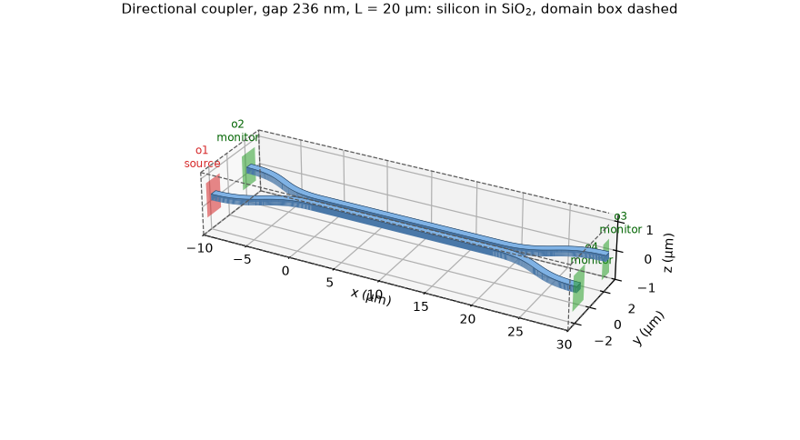

*The directional coupler of the benchmark below (236 nm gap, L = 20 µm, silicon in SiO₂) with the physical FDTD domain of
`Simulation.write()` as a dashed box (x from −10 to 30 µm, y from −2.88 to 3.62 µm, z from −1 to 1.22 µm, PML outside it), the
source plane on o1 and a monitor plane on each other port. y is stretched by 1.7 and z by 3.2 for legibility. Drawn locally from
the gdsfactory component and the `metadata.json` of `write()`, 2026-11-25; no cloud call.*

**When to use which solver.** Use [`gsim.fdtd`](../api/fdtd.md). It is the primary photonic engine in gsim (see the engine table
on the [home page](../index.md)) and it returns S-parameters from guided-port monitors, one source port per run. A directional
coupler, a Y-branch, an MMI and a waveguide crossing are all this kind of device. Use [`gsim.meep`](../api/meep.md) only for
something FDTD does not do yet, for example the 2D XZ grating coupler (see [Grating couplers](#grating-couplers)). If the
device is a ring or contains a long delay line, simulate the coupler section here and compose the rest as a circuit (see
[Rings and circuits](#rings-and-circuits)). The simulation runs on GDSFactory+ cloud. Meshing and input export run locally.

**Settings.**

| Call | Setting | Default |
| --- | --- | --- |
| `source` | `waveform` | `"pulse"` |
| `source` | `wavelength_um` | `1.55` |
| `source` | `wavelength_span_um` | `0.1` |
| `source` | `num_wavelengths` | `101` |
| `materials` | `background` | `"Air"` since 0.10.0 |
| `materials` | `dispersion` | `False` |
| `domain` | `padding` | `1.0` um on every side |
| `domain` | `pml_cells` | `32` |
| `solver` | `cell_size_nm` | `60` |
| `solver` | `energy_decay_fraction` | `1e-6` |
| `solver` | `max_wall_seconds` | `3600` |
| `geometry` | `mesh_size_nm` | `1000` |
| `geometry` | `geometry_tolerance_nm` | `10` |

`cell_size_nm` sets the Yee grid of the FDTD solver. `mesh_size_nm` and `geometry_tolerance_nm` only control the
tetrahedral transfer mesh that carries the geometry to the solver; they do not change the Yee grid.

With `dispersion=False` each material enters the solver as its index at the source wavelength, and a broadband run uses
that one index at every wavelength. gsim warns when a material card varies over the source band. `dispersion=True` is
rejected by the deployed solver.

To excite a higher-order mode, pass `mode={"kind": "mode_order", "mode_order": 2}` to `source()`. `"te_like"` and
`"tm_like"` need a transverse `te_axis`. With no selector the fundamental mode is used, and the guided-port monitors use
the same selection as the source.

**Steps.** The example is the generic-PDK 1x2 MMI. It builds the inputs for one source port at a time and writes them to
disk. The cloud call is the last step of each loop pass.

```python
import gdsfactory as gf

from gsim import fdtd

gf.gpdk.PDK.activate()
component = gf.get_component("mmi1x2")

sim = fdtd.Simulation()
sim.materials(background="SiO2", overrides={"si": 3.4757})
sim.geometry(component)
sim.source(port="o1", wavelength_um=1.55, wavelength_span_um=0.1, num_wavelengths=101)
sim.domain(padding=1.0)
sim.solver(cell_size_nm=60)

results = []
for port in ("o1", "o2", "o3"):
    sim.source(port=port)
    sim.write(f"./mmi-{port}")  # mesh.msh, config.json, metadata.json; nothing is submitted
    results.append(sim.run(check_cache=True))  # one cloud job per port

matrix = fdtd.s_matrix(results)  # S(receive, source), one source column per run
model = matrix.sax_model()  # needs no SAX install to build; see the FDTD guide for sax.circuit
matrix.write_touchstone("mmi")  # mmi.s3p
```

1. `fdtd.Simulation()` with no arguments uses the active PDK.
2. `materials(background=..., overrides=...)` sets the material around the device and index overrides at the source
   wavelength.
3. `geometry(component)` resolves the component through the PDK layer stack.
4. `source(port=...)` selects the port to excite. Without it, `write()` and `run()` refuse to continue.
5. `domain(...)` and `solver(...)` are optional. Their defaults are in the table above.
6. `write(path)` builds the inputs locally. `run(check_cache=True)` uploads them, or reuses a finished job with identical
   inputs.
7. One run measures one column of the S-matrix. `fdtd.s_matrix([...])` combines runs and raises when an entry was not
   measured, unless you pass `assume_reciprocal=True` or `assume_unmeasured_zero=True`.

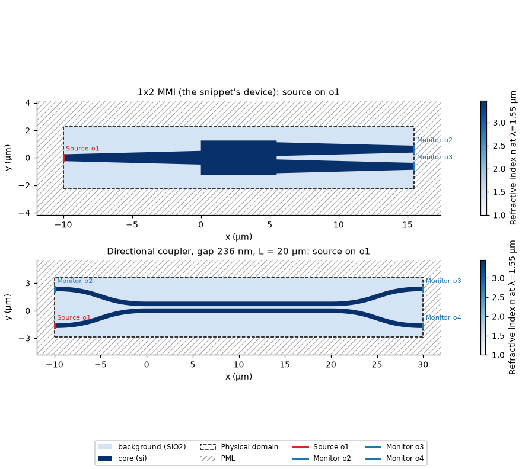

*What the snippet sets up, drawn by `Simulation.plot_2d_static()` on the XY plane at mid-height, with no cloud call: the
refractive index at the source wavelength, the physical domain (1 µm padding), the PML outside it, the source on `o1` and
the monitors on the other ports. Top: the snippet's 1x2 MMI. Bottom: a directional coupler with a 236 nm gap and
L = 20 µm, the device of the benchmark below. Local run with gsim 0.10.0 and 60 nm cells, 2026-11-25.*

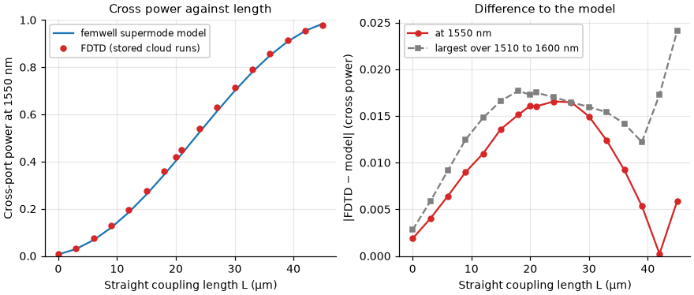

*Cross-port power of a silicon directional coupler (500 × 220 nm guides, 236 nm gap) against its straight coupling length L.
Left: FDTD at 1550 nm (17 cloud runs, 40 nm cells, all converged) and a femwell supermode model that integrates the index
difference of the two supermodes along the coupler's gap profile. Right: the absolute difference at 1550 nm, and its largest
value over 1510 to 1600 nm (1500 nm is below the noise floor in every run and is left out). Benchmark cases
`coupler.cmt_vs_fdtd_1550` and `coupler.cmt_vs_fdtd_band`, cloud runs stored with the case dated 2026-11-13. The largest
differences are 0.017 (1550 nm, L = 24 µm) and 0.024 (1600 nm, L = 45 µm). The model is not a measurement.*

**What to check.** Run these on the result of every device, not only on the first one.

1. **Cell size.** Run again with a finer `cell_size_nm` (for example 40 instead of 60) and compare the S-parameters you
   report. The [FDTD benchmark](../fdtd-benchmark.md) uses 40 nm nominal. A change in the quantity you care about, such
   as the split ratio at the centre wavelength, is the convergence error of the coarse run.
2. **Power.** For each source port, the power summed over all ports cannot exceed 1 in a passive device. A value clearly
   above 1 points to a setup problem (mode, reference plane, grid), not to gain. A value below 1 is loss, radiation or
   power in a port you did not simulate.
3. **Reciprocity.** A passive device without magnetic or non-reciprocal materials has S(a,b) = S(b,a). With one run per
   port you have both entries measured, so compare them. Do not pass `assume_reciprocal=True` if you want to test this,
   because that flag copies one entry into the other.
4. **Noise floor.** Samples below the source noise floor are flagged. `s_matrix` drops them with a warning, which can narrow
   the band that `sax_model()` accepts. Look at the band edges.
5. **Wavelength step.** The SAX model interpolates unwrapped phase, which needs a phase change below pi between samples:
   a step below λ²/(2·n_g·L) for the longest path L in your circuit. `s_matrix` warns from 3/4 of that limit for entries
   with at least a tenth of the strongest peak. It cannot catch every aliased delay, so choose the step from the longest
   path.
6. **Mode.** If the port is multimode, confirm that the mode you excited is the one you meant (`mode_order` or `te_like`).

A small helper for checks 2 and 3 on the `matrix` built above:

```python
import numpy as np

power_out = (np.abs(matrix.s) ** 2).sum(axis=1)  # [wavelength, source port]
print("largest power out of any source:", power_out.max())
print("largest |S(a,b) - S(b,a)|:", np.abs(matrix.s - matrix.s.transpose(0, 2, 1)).max())
```

`matrix.s[f, i, j]` is S(receive i, source j) in time convention exp(+jωt) (`gsim.common.s_matrix.SMatrix`).

**Pitfalls.**

- **Background.** The default background is `"Air"`. A device that is cladded in oxide in the real stack needs
  `background="SiO2"`, as above. Declaring oxide in the layer stack does not create oxide geometry.
- **Material names.** With gdsfactory 9.x the silicon layer is called `si`. If the PDK has no material card for it, pass
  `overrides={"si": <index>}`. The value `3.4757` above is the one the [home page](../index.md) quick start uses; choose
  your own value for your wavelength.
- **Padding at ports.** Explicit axis padding (`padding_x`, `padding_y`, `padding_z`) must be zero on a side that holds a
  guided port. The shared `padding` fallback keeps the automatic port alignment.
- **One column per run.** A single run is not an S-matrix. Without one run per port, `s_matrix` raises and lists the
  missing entries.
- **Phase reference.** Phases are referenced where the solver's port monitors sit. gsim does not de-embed them.
- **SAX conventions.** `sax_model()` keys entries `(in, out)` and conjugates the stored values to SAX's phase convention.
  A Touchstone file keeps gsim's convention. Read the table at the end of the
  [FDTD guide's export section](../api/fdtd.md#export-to-sax-and-touchstone) before mixing the two.
- **Cost.** The run time grows with the number of Yee cells. `metadata.json`, written by `write()`, holds the estimated grid
  in `grid.cell_counts` and the monitor memory in `memory.estimated_monitor_memory_bytes`; read both before you launch a
  finer run. For the snippet above, `write()` reported `total_cells` = 9,969,264 and a monitor-memory estimate of
  810,662,160 bytes. For the coupler of the isometric figure (236 nm gap, L = 20 µm, the same settings), it reported
  18,471,600 cells and 1,263,369,600 bytes. These are client estimates from a local `write()` with gsim 0.10.0, not
  measured run times.

**Notebooks.** Published notebooks, all on the generic PDK unless stated:
[MMI quick start](../nbs/fdtd_mmi_gpdk.md), [Directional coupler](../nbs/fdtd_directional_coupler.md),
[Broadband directional coupler](../nbs/fdtd_broadband_directional_coupler.md),
[Waveguide crossing](../nbs/fdtd_waveguide_crossing.md), [Four-solver directional coupler benchmark](../fdtd-benchmark.md),
[Meep: 3D directional coupler](../nbs/meep_dc.md). Paper reproductions: [Lu broadband coupler](../nbs/fdtd_lu_broadband_coupler.md),
[Sattari suspended coupler](../nbs/fdtd_sattari_suspended_coupler.md),
[Romero-García visible MMI](../nbs/fdtd_romero_visible_mmi.md), [Sacher visible MMI](../nbs/fdtd_sacher_visible_mmi.md).

**API.** [GDSFactory FDTD guide](../api/fdtd.md), [`fdtd.Simulation`][gsim.fdtd.Simulation],
[`fdtd.s_matrix`][gsim.fdtd.s_matrix], [`SMatrix`][gsim.common.s_matrix.SMatrix].

## Grating couplers

A grating coupler turns a guided mode into a beam above the chip and back, and the result is the coupling efficiency against
wavelength and fibre position.

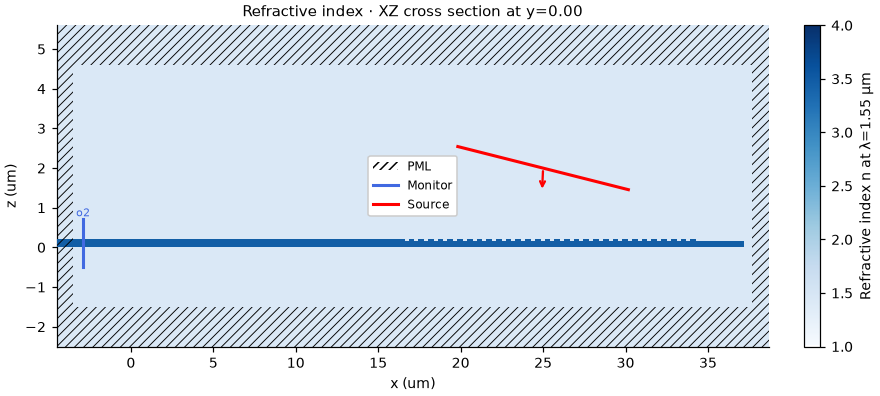

*XZ side view of the generic-PDK elliptical grating coupler with a 3 µm feed straight, as `meep.Simulation.plot_2d` draws the 2D
set-up of the Meep notebook: refractive index at 1.55 µm, the PML, the waveguide monitor on `o2` and the Gaussian fibre source
(waist 5.2 µm, −6° tilt, TE) at z = 2 µm above x = 25 µm. The z axis is stretched. Resolution 25 pixels per µm. Drawn locally,
2026-11-25; nothing is solved.*

**When to use which solver.** Two routes exist, and both run on GDSFactory+ cloud.

- **Meep, 2D XZ cut** (`gsim.meep.Simulation`, `solver(mode="2d", y_cut="auto")`). The cut models the vertical stack and a tilted
  Gaussian-beam source (`source_fiber`), the usual design loop. Meep can also run locally with `run_local()` if meep is
  installed. A 2D cut has no y direction, so it cannot describe the lateral shape of a focusing grating: use it to screen period,
  fill and angle, then confirm in 3D. This is a textbook statement, not tested here.
- **FDTD, 3D** (`gsim.fdtd.Simulation`). The [3D grating coupler notebook](../nbs/fdtd_focusing_grating_coupler_gpdk.md)
  launches the guided mode from the feed port and records tangential fields on a plane above the grating. It projects them onto a
  10° Gaussian fibre mode with a small helper, using `P_incident = P_net / (1 - |S11|²)` and CE = |amplitude|² / P_incident. It
  keeps the 3 µm buried oxide and the silicon substrate, and says to check mesh and domain convergence before relying on an
  efficiency.

**Settings** of the Meep route (stopping is covered in [Stopping and convergence](#stopping-and-convergence)):

| Call | Setting | Default | What it changes |
| --- | --- | --- | --- |
| `solver` | `mode` | `"3d"` | `"2d"` with a cut selects a plane |
| `solver` | `y_cut` | `None` | `"auto"` is the y centre of the component, a float sets y (µm) of the XZ cut |
| `solver` | `resolution` | `32` | Pixels per µm; the notebook uses 25 |
| `solver` | `stopping`, `stopping_threshold` | `"energy_decay"`, `0.01` | When the run stops |
| `domain` | `pml` | `1.0` | PML thickness in µm |
| `domain` | `margin_x`, `margin_y` | `0.5` | Air gap between geometry and PML in µm |
| `domain` | `z_bounds` | `"auto"` | PML-inner z interval in absolute µm; replaces the deprecated `margin_z` |
| `domain` | `extend_into_pml` | `True` | Extends background slabs through the adjacent PML |
| `source_fiber` | `x`, `z`, `waist` | none | Beam centre x, absolute z of the beam plane, 1/e² intensity radius (MFD / 2) |
| `source_fiber` | `angle_deg` | `0.0` | Tilt from the +z normal; positive tilts toward +x |
| `source_fiber` | `wavelength`, `wavelength_span`, `polarization` | `1.55`, `0.05`, `"TE"` | The beam; `"TE"` puts E out of the XZ plane |
| `Simulation` | `num_freqs` | `11` | Frequency points of the flux and DFT monitors |

**Steps.**

1. Draw the grating and a feed straight as one component with a port `o2` at the end of the straight.
2. Set the stack, the two indices and an XZ 2D solver with an energy-decay stop.
3. Place the fibre source and name the monitor.
4. Set the domain, validate, and look at the set-up plot. Check the sign of the tilt and that the beam plane lies inside the
   domain.
5. Run on the cloud (the line is commented out here).

```python
import gdsfactory as gf

from gsim import meep
from gsim.common.stack import get_stack
from gsim.meep.models.api import Material

gf.gpdk.PDK.activate()
c = gf.Component()
grating = c.add_ref(gf.components.grating_coupler_elliptical(fiber_angle=0.0))
straight = c.add_ref(gf.components.straight(length=3))
straight.connect("o1", grating.ports["o1"])
c.add_port("o2", port=straight.ports["o2"])

sim = meep.Simulation()
sim.geometry(component=c, stack=get_stack())
sim.materials = {"si": Material(refractive_index=3.47), "SiO2": Material(refractive_index=1.44)}
sim.solver(resolution=25, mode="2d", y_cut="auto", save_animation=True)
sim.solver.stop_when_energy_decayed()
sim.source_fiber(x=25.0, z=2, angle_deg=-6.0, waist=5.2, wavelength=1.55, wavelength_span=0.06, polarization="TE")
sim.monitors = ["o2"]
sim.domain(pml=1.0, margin_x=0.5, margin_y=0.5, z_bounds=(-1.5, 4.6), extend_into_pml=True)
sim.num_freqs = 21

print(sim.validate_config())  # Stack validation: PASSED
sim.plot_2d(slices="y", aspect="auto")  # the set-up figure above
# result = sim.run(check_cache=True)  # cloud job
```

**What to check.**

1. **Where the light goes.** In the set-up plot, the source arrow points to the grating and the tilt has the sign you meant.
2. **Normalisation.** Efficiency needs the incident power in the feed, not the power at the monitor. The FDTD notebook corrects
   for the input reflection with `P_incident = P_net / (1 - |S11|²)`.
3. **Resolution and domain.** Repeat at a higher `resolution` and with larger margins and PML distance, as in
   [Convergence study of any setting](#convergence-study-of-any-setting). The notebooks do not state a converged efficiency.
4. **Stack.** Both routes keep the buried oxide and the substrate of the stack. Their thickness changes the result, so use your
   own stack for a real device.

**Pitfalls.**

- **Deprecated margin.** `margin_z` in `domain()` is deprecated. The notebook's `margin_z=(1.5, 0)` resolves to
  `z_bounds=(-1.5, 4.6)` for this stack, which is the value above.
- **Fibre plane outside the domain.** An explicit `z_bounds` must contain the fibre source, or gsim refuses it.
- **Dispersion warnings.** Building the set-up logs two `DispersionCoverageWarning`s at 1.55 µm, because the Sellmeier model that
  is available covers 2.5 to 12 µm. The indices come from the constants you set.
- **Run time.** The published Meep notebook records 264 s for its cloud run cell at resolution 25. That is one stored
  value, not an estimate for your device.

**Notebooks.** [3D grating coupler (FDTD)](../nbs/fdtd_focusing_grating_coupler_gpdk.md) and
[2D grating coupler (Meep)](../nbs/meep_2d_xz_gc.md). **API.** [Meep guide](../api/meep.md), [FDTD guide](../api/fdtd.md).

## Rings and circuits

A ring, an MZI or a filter is a circuit of parts. gsim simulates a part, for example the coupler, in the field and composes the
circuit from its S-matrix.

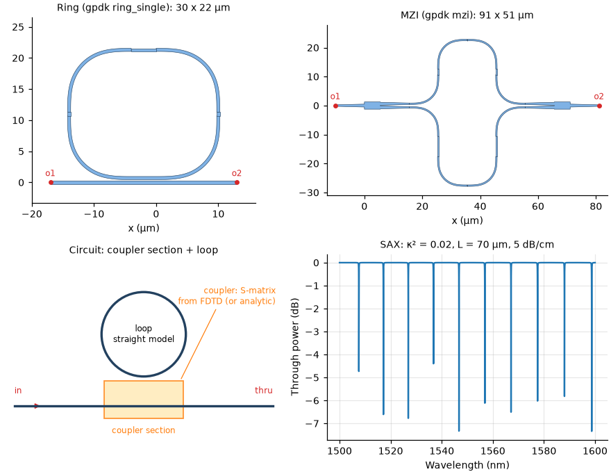

*Top: gdsfactory `ring_single` (30 × 21.8 µm, gap 0.2 µm) and `mzi` (91.1 × 50.75 µm) of the generic PDK, ports in red.
Bottom left: the circuit idea, a coupler section plus a loop of waveguide. Bottom right: through-port power of that circuit from
SAX, with an ideal coupler (κ² = 0.02) and a 70 µm loop (n_eff 2.34, n_g 3.4, 5 dB/cm). These values are illustrative: they are
not extracted from the layouts and not from an FDTD run. The 10 dips between 1500 and 1600 nm are 10.13 nm apart on average,
7.34 dB deep, against 10.09 nm from λ²/(n_g L). Computed locally, 2026-11-25.*

**When to use which solver.** FDTD for the coupler section, one run per port, then SAX for the rest. The cost is that of the
coupler section only. The export that a ring model uses is described in the
[FDTD guide](../api/fdtd.md#export-to-sax-and-touchstone). No end-to-end ring result is checked in this repository: only the
arithmetic of the export is tested (see [Validation and benchmarks](#validation-and-benchmarks)).

**Settings.**

| Call | Setting | Default | What it changes |
| --- | --- | --- | --- |
| `fdtd.s_matrix` | `assume_reciprocal` | `False` | Copies S(b,a) into S(a,b) for entries not measured |
| `fdtd.s_matrix` | `assume_unmeasured_zero` | `False` | Sets what is left to zero |
| `sax_model()` | `wl` in µm | the simulated band only | A wavelength outside the band raises |
| `sax.models.straight` | `length`, `neff`, `ng`, `loss_dB_cm` | `10.0`, `2.34`, `3.4`, `0.0` | The loop |
| `sax.models.coupler_ideal` | `coupling` | `0.5` | Power coupling of a lossless stand-in |

**Steps.**

1. Simulate the coupler section: one run per port and `fdtd.s_matrix` (see [Directional couplers and MMIs](#directional-couplers-and-mmis)).
2. Build `matrix.sax_model()`. Its ports have the layout's names.
3. Wire the loop in a SAX netlist. For `gf.components.coupler`, `o1` and `o4` are the two ends of one guide and `o2` and `o3`
   the two ends of the other, so the bus is `o1` to `o4` and the loop joins `o3` to `o2`.
4. Choose the wavelength step from the loop length (check 1 below).
5. Compare the spectrum with the ideal-coupler version before you trust the FDTD one.

```python
import numpy as np
import sax

netlist = {  # ideal coupler (ports in0, in1, out0, out1) and a loop of straight waveguide
    "instances": {
        "dc": {"component": "coupler", "settings": {"coupling": 0.02}},
        "loop": {"component": "straight", "settings": {"length": 70.0, "loss_dB_cm": 5.0}},
    },
    "connections": {"dc,out1": "loop,in0", "loop,out0": "dc,in1"},
    "ports": {"in": "dc,in0", "thru": "dc,out0"},
}
models = {"coupler": sax.models.coupler_ideal, "straight": sax.models.straight}
circuit, _ = sax.circuit(netlist, models)
wl = np.linspace(1.50, 1.60, 4001)
through = np.abs(np.asarray(circuit(wl=wl)[("in", "thru")])) ** 2  # min 0.1846, 10 dips, 10.13 nm apart
```

To use the FDTD coupler, replace the first instance by `"dc": "dut"` and the model by `"dut": matrix.sax_model()`, and connect
the ports by their layout names (`"dc,o3": "loop,in0"`, `"loop,out0": "dc,o2"`, ports `"dc,o1"` and `"dc,o4"`). This
variant needs the cloud runs and was not executed for this page.

**What to check.**

1. **Wavelength step.** The model needs a phase change below π between samples: a step below λ²/(2·n_g·L). For the 70 µm loop at
   n_g = 3.4 and 1.55 µm that is 5.05 nm, and `s_matrix` warns from 3/4 of it, 3.79 nm (arithmetic from the
   [FDTD guide](../api/fdtd.md#export-to-sax-and-touchstone)'s rule). The default source has 101 points over 100 nm, a 1 nm step.
2. **Free spectral range.** The dip spacing should match λ²/(n_g L), as it does above. If not, the loop length or n_g is wrong.
3. **Coupling against loss.** The notch depth is set by the power coupling against the round-trip loss, and the dip is deepest when
   the two are equal (a textbook statement, not tested here).
4. **Noise floor and band edges.** `s_matrix` drops samples below the noise floor, which narrows the band the SAX model accepts.
5. **Conventions.** `sax_model()` and Touchstone use different phase conventions. Do not feed a Touchstone file to SAX's photonic
   models.

**Pitfalls.** The loop in the figure is a model with chosen numbers. For a real ring take n_eff and n_g from
[Waveguide modes](#waveguide-modes) and the loss from your process, and do not reuse the illustrative values.

**Notebooks and API.** No notebook simulates a ring end to end. See the [FDTD guide](../api/fdtd.md#export-to-sax-and-touchstone).

## Carrier-depletion phase shifters

A lateral pn junction in a silicon rib changes its free-carrier density with reverse bias, which changes the effective index
(modulation efficiency VπL) and the absorption (loss).

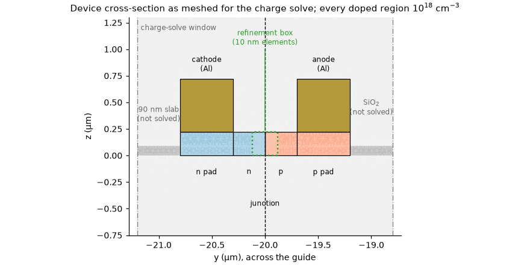

*The device behind the outline below, drawn from the mesh of `sim.mesh()` (the device of the PN junction notebook, generic PDK):
four doped strips 220 nm tall over a 90 nm slab, every doped region at 10¹⁸ cm⁻³, an aluminium electrode on each pad, the junction
at the centre, the charge-solve window, and the refinement box that holds 10 nm elements across the junction. Regions that are
neither doped nor declared insulating, here the slab and the oxide, take no part in the carrier solve. Local run, 2026-11-25.*

**When to use which solver.** This workflow is a chain of cross-section solves. All of them run locally and none needs the cloud:

1. **Carriers against bias.** [`gsim.tcad`](../api/tcad.md) solves Poisson and electron/hole drift-diffusion with DEVSIM on a
   2D cross-section of the doped silicon.
2. **Carriers to material properties.** Closed-form plasma-dispersion and mobility models in `gsim.common.carriers` turn each
   carrier map into an index shift Δn, an absorption Δα and an RF conductivity.
3. **Optical mode against bias.** `gsim.femwell`, a local finite-element mode solver, solves the guided mode on a mesh with
   the carrier-dependent permittivity, giving a complex n_eff per bias (see [Waveguide modes](#waveguide-modes)).
4. **Figures of merit.** `gsim.common.twmzm.vpi_length_vcm` turns n_eff(V) into VπL. The travelling-wave modulator report in
   `gsim.common.twmzm_report` adds the RF line.

TCAD and the mode solver are optional extras: `pip install "gsim[tcad,femwell]"`. A thermal phase shifter is a different device;
see [Thermal tuning](#thermal-tuning).

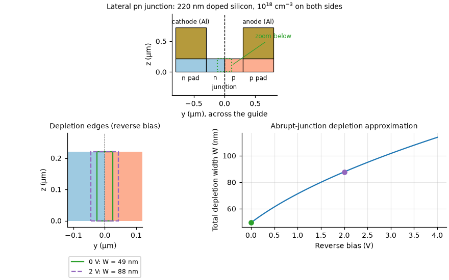

*The lateral pn junction of the PN junction notebook (two 0.3 µm rib halves and two 0.5 µm pads, 220 nm tall, 10¹⁸ cm⁻³ on both
sides, aluminium electrodes) with the depletion edges of the abrupt depletion approximation. Zoom: the total width is 49.5 nm at
0 V and 87.8 nm at 2 V reverse bias (built-in voltage 0.931 V, silicon permittivity 11.9). Right: width against bias. These are
closed-form values from `gsim.common.stack.pn_junction`, not a carrier solve, so they differ from the 17 nm and 58 nm below, which
use a different width criterion (both densities under 10¹⁶ cm⁻³). Computed locally, 2026-11-25.*

**Settings.**

| Call | Setting | Default |
| --- | --- | --- |
| `tcad` `materials` | `temperature_k` | `300.0` K |
| `tcad` `materials` | `semiconductor_permittivity` | `11.1` (DEVSIM's value; the RF and optical stacks use `11.9`) |
| `tcad` `materials` | `mobility` | Masetti silicon (`MobilityModel.masetti_silicon()`) |
| `tcad` `solver` | `bias_step_v` | `0.1` V |
| `tcad` `solver` | `relative_error` | `1e-6` |
| `tcad` `solver` | `max_iterations` | `100` |
| `tcad` `solver` | `mesh_grading` | `None` (off) |
| `tcad` `solver` | `junction_freq_hz` | `1e9` |
| `solve_modes` | `num_modes` | `1` |
| `solve_modes` | `order` | `2` |
| `solve_modes` | `metallic_boundaries` | `False` |
| `solve_modes` | `n_guess` | `None` |

The values above were read from `sim.materials` and `sim.solver` of a freshly configured `tcad.Simulation`, and from the
signature of `solve_modes`. The notebooks set `metallic_boundaries=True` and `refined_mesh_size_um=0.02` explicitly.

The sweep takes positive bias on the n-side contact as reverse bias. Without mesh grading, the mesh refines along every
internal curve, and the element size grows about 2 per um from there. A `refinement_boxes` entry holds a size over the strip the
depletion edges move through. See the [TCAD guide](../api/tcad.md#configure-and-solve).

**Steps.** The complete worked example is the [travelling-wave MZM notebook](../nbs/tcad_twmzm.md), which also covers the RF
line and the bandwidth. The carrier solve alone is in the [PN junction notebook](../nbs/tcad_pn_junction.md). Both use the
generic PDK. The outline below is not self-contained: `component` and `stack` come from the notebook's device definition, and
the doping profiles, contacts and interfaces name regions of that device.

```python
import numpy as np

from gsim import tcad
from gsim.common.carrier_transfer import transfer_carriers
from gsim.common.carriers import (
    PlasmaDispersionModel,
    carrier_absorption_cm,
    carrier_index_shift,
    permittivity_perturbation,
)
from gsim.common.modes import select_line_mode
from gsim.common.twmzm import vpi_length_vcm
from gsim.femwell import boundary_field_ratio, epsilon_by_region, solve_modes

# 1. Carriers against reverse bias (DEVSIM, local).
sim = tcad.Simulation()
sim.geometry(component, stack=stack)
sim.domain(plane="x=0", window=(-21.2, -18.8), margin_y=0.5, z_above=1.0, z_below=1.0)
for region in ("n_pad", "n_rib"):
    sim.doping.add(tcad.StepDoping(region=region, dopant_type="donor", concentration_cm3=1e18))
for region in ("p_rib", "p_pad"):
    sim.doping.add(tcad.StepDoping(region=region, dopant_type="acceptor", concentration_cm3=1e18))
sim.contacts.add(name="cathode", semiconductor="n_pad", electrode="cathode_metal")
sim.contacts.add(name="anode", semiconductor="p_pad", electrode="anode_metal")
sim.interfaces.add(name="n_link", region_a="n_pad", region_b="n_rib")
sim.interfaces.add(name="junction", region_a="n_rib", region_b="p_rib")
sim.interfaces.add(name="p_link", region_a="p_rib", region_b="p_pad")
sim.solver(
    mesh_preset="coarse",
    refined_mesh_size_um=0.02,
    max_mesh_size_um=40.0,
    # (y_min, y_max, z_min, z_max, size): hold the mesh fine over the strip the depletion edges sweep
    refinement_boxes=[(-20.12, -19.88, 0.0, 0.22, 0.01)],
)
sim.mesh(output_dir="./tcad")
sweep = sim.sweep(np.linspace(0.0, 2.0, 5), contact="cathode")  # positive cathode bias = reverse bias

# 2-3. Carriers to permittivity to n_eff at each bias (femwell, local).
dispersion = PlasmaDispersionModel.nedeljkovic_1550()


def neff_at(carriers, optical_mesh, wavelength_um=1.55):
    base = epsilon_by_region(optical_mesh, stack, wavelength_um=wavelength_um)
    on_mesh = transfer_carriers(carriers, optical_mesh, at="elements", fill=0.0, regions=["n_rib", "p_rib"])
    dn = carrier_index_shift(on_mesh.electrons_cm3, on_mesh.holes_cm3, model=dispersion)
    dalpha = carrier_absorption_cm(on_mesh.electrons_cm3, on_mesh.holes_cm3, model=dispersion)
    eps = np.array([base[name] for name in on_mesh.region], dtype=complex)
    for i, name in enumerate(on_mesh.region):
        if name in ("n_rib", "p_rib"):
            eps[i] = permittivity_perturbation(
                n0=np.sqrt(base[name].real), dn=dn[i], dalpha_cm=dalpha[i], wavelength_um=wavelength_um
            )
    mode = select_line_mode(solve_modes(optical_mesh, epsilon=eps, wavelength_um=wavelength_um, metallic_boundaries=True))
    assert boundary_field_ratio(mode) < 0.01, "the window clips the mode"
    return complex(mode.n_eff)


# 4. V_pi L from the local slope of the index shift.
# n_eff = np.array([neff_at(point.carriers, optical_mesh) for point in sweep.points])
# vpi_l = vpi_length_vcm(sweep.voltages, n_eff.real - n_eff[0].real, wavelength_um=1.55)  # V*cm
```

`optical_mesh` is a cross-section mesh made with `BoundaryModeSim` (`set_cross_section`, then `mesh`), as in the notebook's
step 3. The notebook meshes its own window around the rib, holds the same fine element size across the junction as the charge
mesh, and keeps the mesh fixed across biases: only the element permittivity changes.

Status of this outline: step 1 was executed in this checkout on the PN junction notebook's device, and it gives the same
C(V) as the notebook's own cells. The imports and the signatures used in step 2-3 were checked. `neff_at` follows the
notebook's `solve_optical_mode` function but was not executed as written here, because it needs an optical mesh. The
notebooks are the executed reference.

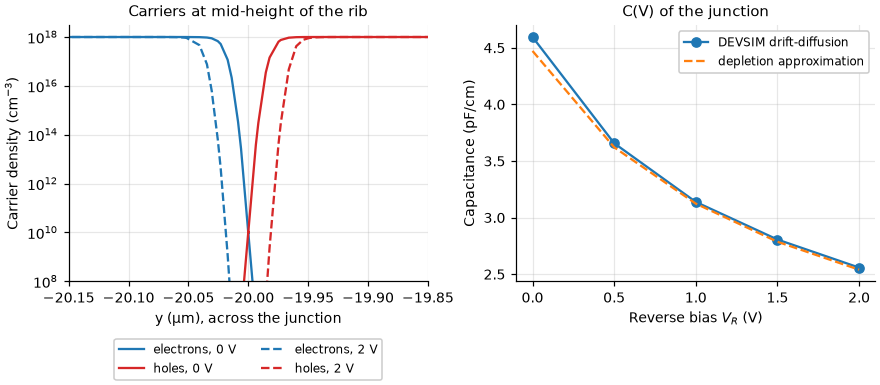

*Result of the carrier solve on that device. Left: electron and hole density along a cut at mid-height of the rib, at 0 V and
at 2 V reverse bias. The strip where both are below 10¹⁶ cm⁻³ is 17 nm wide at 0 V and 58 nm at 2 V, on a 10 nm mesh. Right:
small-signal capacitance per cm of device length at five biases, next to the depletion approximation from
`tcad.compare_capacitance`; the largest deviation is 2.8 %, at 0 V. Local DEVSIM run with gsim 0.10.0, 2026-11-25; the
numbers are the ones check 1 quotes.*

**What to check.**

1. **C(V) against the depletion approximation.** `tcad.compare_capacitance(junction, sweep, height_um=...)` puts the
   simulated capacitance next to the abrupt-junction formula in `gsim.common.stack.PNJunctionConfig` and reports the largest
   relative deviation. It is a sanity check for an abrupt, uniformly doped junction with no oxide fringing, not a calibration.
   Running the PN junction notebook's setup and sweep cells in this checkout (gsim 0.10.0, DEVSIM, five biases from 0 to 2 V)
   gave a largest relative deviation of 2.8 %, at 0 V, and 0.5 % to 1.0 % at the other four biases. This was measured while
   writing the guide, on one Windows machine, and is not a stored result. Rerun it before quoting it.
2. **Direction of the effect.** C(V) must fall and n_eff must rise with reverse bias. The notebook reports that
   carriers leave the centre of the mode, so n_eff rises and the loss falls with bias. `carrier_index_shift` returns
   a negative Δn for positive carrier densities (`gsim.common.carriers`).
3. **Is the window large enough?** `boundary_field_ratio(mode)` is the peak boundary field over the peak field. The notebook
   asserts it is below 0.01. A larger value means the window truncates the mode.
4. **Depletion edge resolution.** Hold the mesh fine over the strip the depletion edges sweep, using a refinement box, and
   repeat the sweep with a finer box. If C(V) or Δn_eff moves, the mesh was too coarse. Δn_eff is a small
   difference of two large numbers, so the carrier map must be resolved, not averaged. As an illustration, the same five-bias
   sweep without the refinement box above gave capacitances between 2.5 % below and 6.9 % above the boxed run, with the sign
   changing along the sweep (two local runs while writing the guide, same caveat as in check 1).
5. **Mesh independence of n_eff.** Repeat the mode solve on a second optical mesh. The femwell order is 2 by default;
   at order 1 the femwell and Palace n_eff differed by about 9e-3 on the same mesh in the project's cross-check
   (see [Validation and benchmarks](#validation-and-benchmarks)).
6. **Units of the figures of merit.** VπL = λ / (2 |dΔn_eff/dV|), divided by 10⁴ to turn V·µm
   into V·cm (`vpi_length_vcm`). Power loss is 4π |Im n_eff| / λ per unit length, or 10 log₁₀(e) times that
   in dB. Under femwell's exp(+iωt) convention a lossy mode has Im n_eff < 0, so use the magnitude. As an
   arithmetic check, a slope of 1e-5 per volt at 1.55 µm gives 7.75 V·cm, and |Im n_eff| = 1e-4 at 1.55 µm gives
   8.1 cm⁻¹, or 35.2 dB/cm. `vpi_length_vcm` reproduced the first number, and the loss formula in the notebook matches the
   second, in a local check.

**Pitfalls.**

- **Two permittivities for silicon.** The charge solve uses 11.1, the RF and optical stacks 11.9. They enter different
  physics. On a junction with no oxide to fringe through, the capacitance goes as the square root of the charge-solve
  value (the project's TCAD test checks this ratio).
- **Results from before 0.10.0.** gsim 0.10.0 assembles the charge-transport equations with signed edge couples. The
  [TCAD guide](../api/tcad.md#edge-couples-and-node-volumes) states that the capacitance falls by 9.3 % to 12.8 % on its test
  diode against earlier versions. Rerun saved TCAD results.
- **Physics limits.** Drift-diffusion with Shockley-Read-Hall recombination and doping-dependent mobility. There is no
  field-dependent mobility, impact ionisation or quantum correction. The Masetti mobility is its 300 K fit at every
  temperature.
- **Plasma-dispersion model.** The notebook uses published silicon fits at 1.55 µm. `nedeljkovic_1310()` is the 1.31 µm set.
  Use foundry-calibrated coefficients for a real process.
- **One live DEVSIM device.** DEVSIM keeps one process-wide namespace, so one charge-transport device is live at a time.
- **Regions must be declared.** Contacts, interfaces and insulators are declared, never inferred from the stack. Two touching
  doped regions without an interface are refused.
- **Window wall.** The optical window wall is a perfect conductor in the notebook. A window that is too small changes
  n_eff without an error. Check the boundary field ratio.

**Notebooks.** [TCAD: PN junction C(V)](../nbs/tcad_pn_junction.md) and
[TCAD: travelling-wave MZM](../nbs/tcad_twmzm.md), from doping to bandwidth. No separate phase-shifter notebook is planned.
**API.** [TCAD guide](../api/tcad.md), [Shared components guide](../api/common.md) (PN junction model, staircase cross-section,
TW-MZM figures of merit), [`tcad.Simulation`][gsim.tcad.Simulation], [`tcad.compare_capacitance`][gsim.tcad.compare_capacitance],
[`vpi_length_vcm`][gsim.common.twmzm.vpi_length_vcm].

## RF transmission lines

A coplanar waveguide or a microstrip on a chip has an impedance, a loss and a phase velocity, and a full-wave frequency sweep of a
length of line gives its S-parameters.

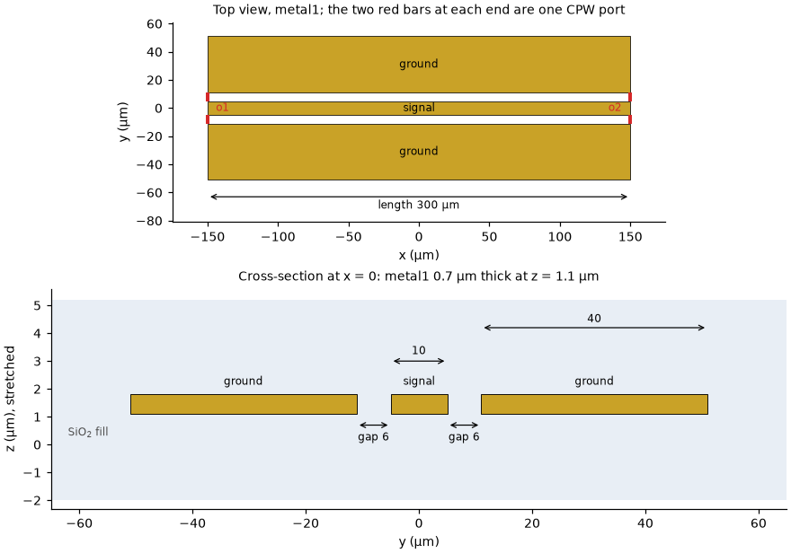

*The 300 µm ground-signal-ground line of the Palace getting-started page: a 10 µm signal conductor, 6 µm gaps and 40 µm grounds in
metal1 (0.7 µm thick, from z = 1.1 µm) inside the SiO₂ fill (z = −2 to 5.2 µm of `get_stack(substrate_thickness=2.0)`). The two red
bars at each end are the two elements of one lumped CPW port. The z axis of the cross-section is stretched. Drawn locally from
gdsfactory and the generic-PDK stack, 2026-11-25.*

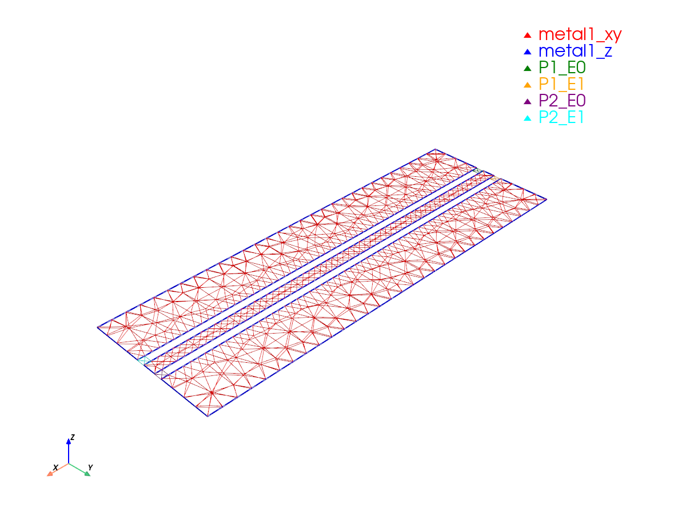

*The `coarse` mesh of that line, drawn with `plot_mesh(show_groups=["metal", "P"])`: the `metal1` surfaces and the port sheets
`P1_E0`, `P1_E1`, `P2_E0`, `P2_E1`, one pair of sheets per port. Stored image from the
[Getting started with Palace](../getting_started_palace.md) page.*

**When to use which solver.** Use Palace [`DrivenSim`][gsim.palace.DrivenSim]. A **lumped CPW port** (`add_cpw_port`) builds two
elements, one in each gap, driven with opposite sign. A **wave port** (`add_wave_port`) solves the 2D mode of the port face and
is a larger model: 10,362 tetrahedra at the `coarse` preset for this line, against 7,897 for the lumped one (Getting started page,
gsim 0.9.0). For the impedance of the cross-section alone, `BoundaryModeSim.add_impedance_path` or femwell `z0_power_current` need
a 2D mesh only. Mesh and inputs run locally; the solve runs on cloud with `run()`, or locally with a Palace binary.

**Settings.**

| Call | Setting | Default | What it changes |
| --- | --- | --- | --- |
| `set_driven` | `fmin`, `fmax` | `1e9`, `100e9` Hz | The sweep band |
| `set_driven` | `num_points`, `scale` | `40`, `"linear"` | Points in the band |
| `set_driven` | `adaptive_tol`, `adaptive_max_samples` | `0.02`, `20` | Adaptive sampling: reduced-order model from a few full solves |
| `set_driven` | `reference_impedance` | `50.0` Ω | Reference of the S-parameters |
| `add_cpw_port` | `layer`, `s_width`, `gap_width` | none | The line: signal width and gap width in µm |
| `add_cpw_port` | `length`, `offset`, `impedance` | `2.0`, `length / 2`, `50.0` | Port extent, inward shift, port impedance |
| `add_wave_port` | `max_size`, `mode` | `False`, `1` | Fill the airbox boundary on that side; mode to excite |
| `mesh` | `preset` | `None`, the same as `"default"` | `coarse`, `default`, `fine`: see [Mesh and resolution](#mesh-and-resolution) |
| `DrivenSim` | `absorbing_boundary` | `None` | Absorbing, but a PEC wall when the simulation has wave ports |

**Steps.**

1. Draw the line with one gdsfactory port at the centre of the signal conductor at each end, `port_type="electrical"`, on the
   conductor layer and with the signal width.
2. Set the stack (`substrate_thickness` is the depth of the oxide fill below z = 0) and the airbox.
3. Add the ports and the sweep, then `validate_config()`.
4. Mesh with `coarse` and look at it with `plot_mesh`. Check the geometry, ports and boundaries, not the numbers.
5. Mesh again at `default` and `fine`, and compare the quantity you report (see
   [Convergence study of any setting](#convergence-study-of-any-setting)).
6. Run on the cloud (commented out here), then check the run.

```python
import gdsfactory as gf

from gsim.palace import DrivenSim

gf.gpdk.PDK.activate()


@gf.cell
def gsg_line(length=300, s_width=10, g_width=40, gap_width=6, layer=gf.gpdk.LAYER.M1):
    """Ground-signal-ground line with one port at each end of the signal."""
    c = gf.Component()
    ground_top = c << gf.c.rectangle((length, g_width), centered=True, layer=layer)
    ground_top.move((0, (g_width + s_width) / 2 + gap_width))
    c << gf.c.rectangle((length, s_width), centered=True, layer=layer)
    ground_bottom = c << gf.c.rectangle((length, g_width), centered=True, layer=layer)
    ground_bottom.move((0, -(g_width + s_width) / 2 - gap_width))
    for name, x, orientation in (("o1", -length / 2, 180), ("o2", length / 2, 0)):
        c.add_port(name=name, center=(x, 0), width=s_width, orientation=orientation, port_type="electrical", layer=layer)
    return c


sim = DrivenSim()
sim.set_output_dir("./palace-gsg-line")
sim.set_geometry(gsg_line())
sim.set_stack(substrate_thickness=2.0)
sim.set_airbox(margin_x=0, margin_y=50.0, z_above=100.0, z_below=100.0)
for port in ("o1", "o2"):
    sim.add_cpw_port(port, layer="metal1", s_width=10, gap_width=6, length=5.0)
sim.set_driven(fmin=1e9, fmax=100e9, num_points=40)
print(sim.validate_config())
result = sim.mesh(preset="coarse")
print(result.mesh_stats["tetrahedra"])  # 7,897 on the Getting started page (gsim 0.9.0)
# results = sim.run(check_cache=True)  # cloud job; SParams with results.s21.db, results.plot()
```

**What to check.**

1. **Mesh pair.** The Getting started page reports, for this line with lumped ports (gsim 0.9.0), 7,897, 20,220 and 55,061
   tetrahedra at `coarse`, `default` and `fine` (50,992, 129,804 and 353,272 estimated field DOFs). `coarse` and `default` log
   `Small conductor feature detected (6.000 um) may be under-resolved`, because the gaps are 6 µm wide; `fine` does not. The
   warning is a heuristic, and a mesh without it is not thereby converged.
2. **Port type.** Compare the lumped-port and the wave-port result on the same line, as the
   [lumped-port](../nbs/palace_cpw_lumped.md) and [wave-port](../nbs/palace_cpw_waveport.md) tutorials do.
3. **Reciprocity and passivity.** S21 and S12 of a passive line agree, and |S11|² + |S21|² cannot exceed 1.
4. **Reference plane.** The S-parameters refer to the port faces. De-embed a length sweep to get the line alone: see
   [CPW length sweep and de-embedding](../nbs/palace_cpw_deembedding.md) and
   [Transmission-line analysis](../transmission_line_analysis.md).
5. **Z₀ cross-check.** Compare with a 2D impedance from `BoundaryModeSim` or `z0_power_current`. The femwell test against a
   coax gives bounds of 8 % (copper inner conductor, measured 3.2 % high) and 1 % (perfect conductor) at order 2, and it is a
   coax, not a planar line (see [Validation and benchmarks](#validation-and-benchmarks)).
6. **Run evidence.** Pass the Palace log to `validate_solution` ([Palace: checking a run](../palace-validation.md)). It reports
   solver convergence, not whether the physics is right.

**Pitfalls.**

- **Wave ports change the outer wall.** With wave ports gsim makes the outer wall PEC, because Palace solves the port mode with
  PEC outer edges. See [Numeric wave-port boundaries](../api/palace.md#numeric-wave-port-boundaries).
- **Port position.** `offset` defaults to `length / 2`, which puts the port flush with the conductor end. Changing `impedance`,
  `length` or `offset` needs a new `mesh()`, not only `write_config()`.
- **Stack.** By default the PDK's silicon substrate is left out (`include_substrate=False`) and gsim logs a warning. Pass
  `set_stack(include_substrate=True)` to mesh it as lossy silicon.

**Notebooks.** [CPW with lumped ports](../nbs/palace_cpw_lumped.md), [CPW with wave ports](../nbs/palace_cpw_waveport.md),
[microstrip](../nbs/palace_microstrip.md), [branch line coupler](../nbs/palace_branch_line_coupler.md),
[CPW via transition](../nbs/palace_cpw_via.md), [field visualisation](../nbs/palace_cpw_fields.md),
[differential interconnect, crosstalk and TDR](../nbs/palace_signal_integrity.md),
[wave ports overview](../palace_wave_ports.md). **API.** [Palace guide](../api/palace.md).

## Superconducting resonators

A superconducting coplanar resonator has a resonant frequency f and a loaded quality factor Q. Palace finds both from an
eigenmode solve, and shows the resonance as a notch or peak in a driven S21 sweep on the same mesh.

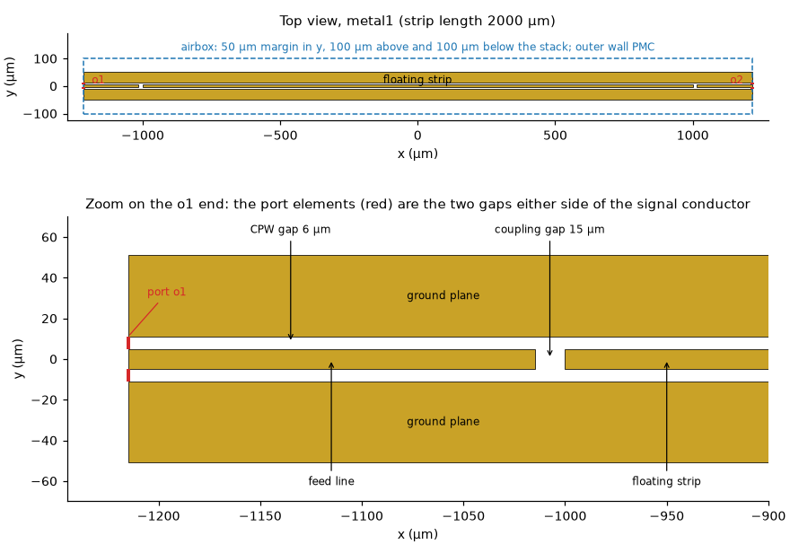

*The structure the snippet below builds, drawn from the page's own `coupled_strip` function: metal1 in gold, the two CPW ports in
red (the port elements are the two 6 µm gaps either side of the 10 µm signal conductor), and the airbox of the `set_airbox` call,
whose outer wall is a PMC because both simulations use `absorbing_boundary=False`. Top: the whole structure. Bottom: the o1 end.
This is a set-up drawing, not a result: no resonance is claimed for this structure. Drawn locally, 2026-11-25.*

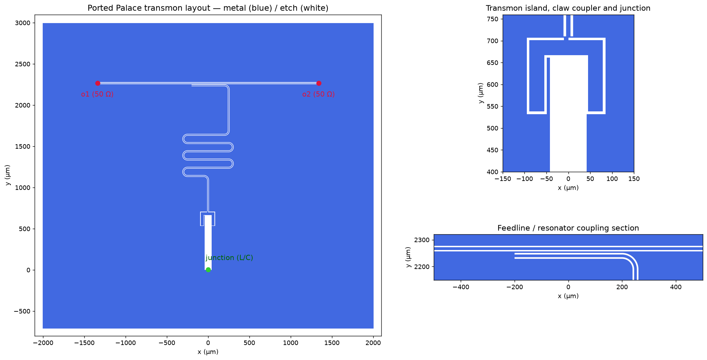

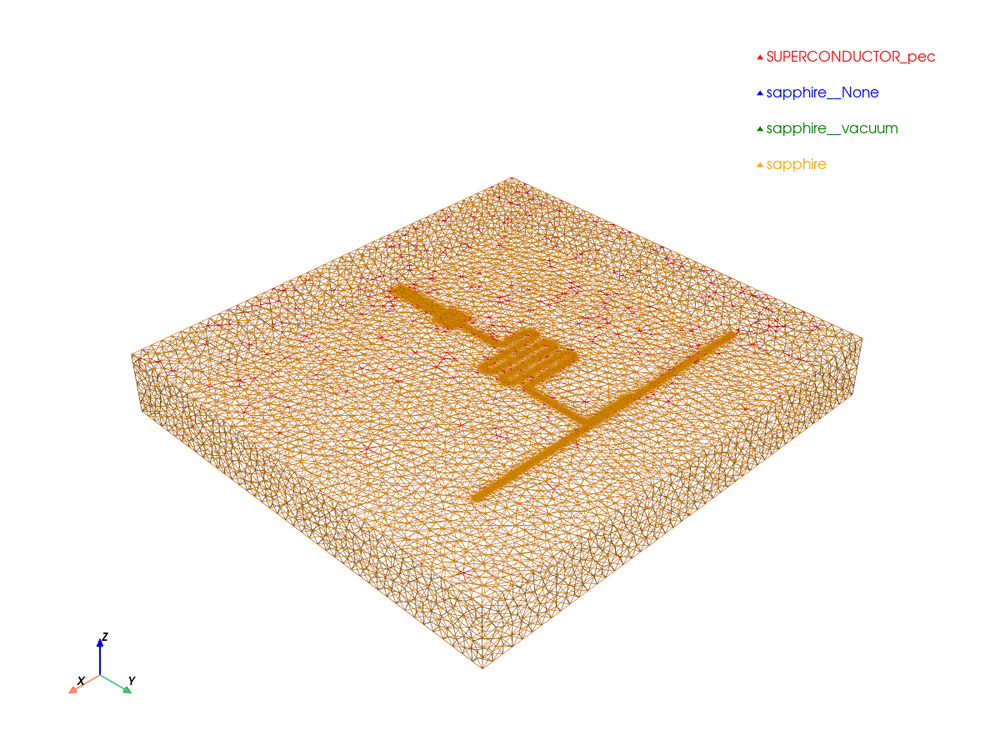

*A real device and its mesh, as stored images (`palace-transmon-layout.png`, then `palace-transmon-mesh.png`) for the
single-island transmon with a claw-coupled quarter-wave readout resonator of the
[transmon notebook](https://github.com/gdsfactory/gsim/blob/main/nbs/palace_transmon.ipynb), which is ported from the public
Palace transmon example. The images were not redrawn for this guide and their contents were not re-checked against a rerun.*

**When to use which solver.** Use [`gsim.palace`](../api/palace.md):
[`EigenmodeSim`][gsim.palace.EigenmodeSim] gives the complex resonant frequencies, so f and Q, of the structure with its ports as
loads. [`DrivenSim`][gsim.palace.DrivenSim] gives the S-parameters over a narrow band, so you can see the resonance as a notch or
peak in S21. An eigenmode solve and driven sweeps can share one mesh through `reuse_mesh`, so both answers come from one
discretization and Gmsh runs once. Meshing runs locally. The solves run on GDSFactory+ cloud with `run()`, or locally with
`run_local()` if a Palace binary is available. gsim has no kinetic-inductance model: a superconducting film is a perfect-conductor
sheet (PEC) here. See "What the model leaves out" below.

**Settings.**

| Class | Setting | Default |
| --- | --- | --- |
| `EigenmodeSim` | `num_modes` | `10` |
| `EigenmodeSim` | `target` | none; required, in Hz |
| `EigenmodeSim` | eigenvalue `tolerance` | `1e-9` |
| `EigenmodeSim` | linear `tolerance` | `1e-9` |
| `EigenmodeSim` | `absorbing_boundary` | `False` (PMC outer wall) |
| `DrivenSim` | `fmin`, `fmax` | `1e9`, `100e9` Hz |
| `DrivenSim` | `num_points` | `40` |
| `DrivenSim` | `adaptive_tol` | `0.02` |
| `DrivenSim` | `adaptive_max_samples` | `20` |
| `DrivenSim` | linear `tolerance` | `1e-6` |
| `DrivenSim` | `absorbing_boundary` | `None`: absorbing, except a PEC wall when the simulation has wave ports |
| both | field order | `2` |
| both | linear solver | GMRES with MUMPS multigrid |

`target` is documented as the frequency above which Palace searches for modes, so set it somewhat below the expected
resonance. The eigenvalue and linear tolerances are independent.

**Steps.** The example uses the generic PDK, so anyone can run it. It is a straight metal1 strip with a gap at each end, between
two feed lines, inside ground planes. The page does not claim a resonance for it: `expected_ghz` is a placeholder for your own
estimate. The snippet builds the inputs and stops before any cloud call.

```python
import gdsfactory as gf

from gsim.palace import DrivenSim, EigenmodeSim

gf.gpdk.PDK.activate()
LAYER = gf.gpdk.LAYER.M1


@gf.cell
def coupled_strip(length=2000.0, s_width=10.0, gap_width=6.0, coupling_gap=15.0, feed=200.0, ground=40.0):
    """Floating strip between two feed lines, with ground planes either side."""
    total = length + 2 * (coupling_gap + feed)
    offset = (s_width + ground) / 2 + gap_width
    c = gf.Component()
    c << gf.c.rectangle((length, s_width), centered=True, layer=LAYER)
    for sign in (-1, 1):
        stub = c << gf.c.rectangle((feed, s_width), centered=True, layer=LAYER)
        stub.move((sign * (length + feed) / 2 + sign * coupling_gap, 0))
        plane = c << gf.c.rectangle((total, ground), centered=True, layer=LAYER)
        plane.move((0, sign * offset))
    for name, x, orientation in (("o1", -total / 2, 180), ("o2", total / 2, 0)):
        c.add_port(name=name, center=(x, 0), width=s_width, orientation=orientation, port_type="electrical", layer=LAYER)
    return c


expected_ghz = 15.0  # placeholder: replace with your own estimate, for example c / (2 L sqrt(eps_eff))
settings = {"s_width": 10.0, "gap_width": 6.0, "length": 5.0}

eigen = EigenmodeSim(absorbing_boundary=False)
driven = DrivenSim(absorbing_boundary=False)  # same outer wall as the eigenmode solve
eigen.set_output_dir("./resonator-eigen")
driven.set_output_dir("./resonator-driven")

eigen.set_geometry(coupled_strip())
eigen.set_stack(substrate_thickness=2.0)
eigen.set_airbox(margin_x=0, margin_y=50.0, z_above=100.0, z_below=100.0)
for port in ("o1", "o2"):
    eigen.add_cpw_port(port, layer="metal1", **settings)
    driven.add_cpw_port(port, layer="metal1", excited=(port == "o1"), **settings)
eigen.set_eigenmode(num_modes=4, target=0.9 * expected_ghz * 1e9)  # target is required; Hz

eigen.mesh(preset="default", auto_size=True, planar_conductors=True)  # PEC sheets: no conductor loss or kinetic inductance
driven.reuse_mesh(eigen)  # copies the mesh; no second Gmsh run
driven.set_driven(fmin=0.95 * expected_ghz * 1e9, fmax=1.05 * expected_ghz * 1e9, num_points=200, adaptive_tol=1e-3)

print(eigen.validate_config())
print(driven.validate_config())
eigen.write_config()
driven.write_config()

eigen_files = eigen.run(check_cache=True)  # cloud job; dict of output files, including eig.csv
sparams = driven.run(check_cache=True)  # cloud job; S-parameters
```

What the lines do:

1. Both simulations are created with `absorbing_boundary=False`, so both have the reflecting (PMC) outer wall. See the pitfalls
   for why this has to match.
2. `set_eigenmode(num_modes=..., target=...)` is configured on the eigenmode simulation only.
   `target` has no default and is required before meshing or exporting.
3. The ports are declared on both simulations with the same kind and geometry. The driven simulation chooses which
   port it excites with `excited=True`. The eigenmode simulation uses the ports as loads.
4. `mesh(preset=..., planar_conductors=True)` meshes the eigenmode simulation. `reuse_mesh` copies that mesh to the driven
   one. Port declarations, geometry and stack come from the source; the solver settings stay per simulation.
5. `set_driven(...)` chooses a narrow band around the expected resonance. `adaptive_tol=1e-3` is the value the
   `DrivenConfig` docstring calls accurate; the default is `0.02`.

**What to check.**

1. **Number of modes.** Count the rows of `eig.csv` and compare with `num_modes`. A published notebook prints
   "Converged eigenmodes: N / requested" for this. Fewer rows than requested means the search did not return every mode.
2. **Which mode.** `eig.csv` lists modes by `m`, with columns `Re{f} (GHz)` and `Q`, as the
   [qubit chip notebook](../nbs/palace_qpdk_filled_qubit_test_chip.md) reads them. Identify the mode you want from its
   field (set `save`), not from its position in the list.
3. **Length estimate.** For a half-wave resonator, f is about c / (2 L sqrt(eps_eff)), and for a quarter-wave one about
   c / (4 L sqrt(eps_eff)). A common estimate for a CPW on a thick substrate is eps_eff = (eps_r + 1) / 2. This is a
   textbook approximation, not a result of gsim, so it can only catch gross errors: a large difference, for example a
   factor of two, points to the wrong mode or the wrong length.
4. **Mesh.** Repeat at the `coarse`, `default` and `fine` presets and compare f. The Palace guide says that a lack of mesh
   warnings does not establish convergence of resonance frequencies or Q. Use `sim.mesh()` statistics: tetrahedra,
   estimated field DOFs and worst element distortion κ.
5. **Eigenmode against the driven sweep.** The notch or peak in S21 should sit at the eigenmode frequency within the
   linewidth. A shift means the two simulations differ in outer wall, ports or stack, or the sweep is too coarse.
6. **Sweep resolution.** The band must be narrow enough to resolve the linewidth. The published CPW resonator notebook sweeps
   7.7 to 7.85 GHz with 1000 points for a resonance near 7.78 GHz. Tighten `adaptive_tol` for the final sweep.
7. **Run evidence.** Pass the Palace log to `validate_solution` ([checking a run](../palace-validation.md)). It reports
   solver convergence, not whether the physics is right.

**What the model leaves out.**

- **Conductor loss and kinetic inductance.** With `planar_conductors=True`, or with a conductor layer thinner than 0.02 um,
  the metal is a PEC sheet. It has no conductor loss, and no surface or kinetic inductance. For a thin superconducting film
  the kinetic inductance lowers the resonance relative to a PEC model. This is a textbook statement, not measured here.
  See [conductor models](../palace_conductors.md).
- **Q is a loaded Q of this model.** It includes the port loads and any dielectric loss tangent in the stack materials.
  With a reflecting outer wall there is no radiation loss to the box. It is not a prediction of a measured internal Q.
- **Coupling.** The coupling gap sets the external Q. Compare its trend against the driven notch, not against a single
  number.

**Pitfalls.**

- **Outer wall mismatch.** `EigenmodeSim` defaults to `absorbing_boundary=False` and `DrivenSim` to `None`, which absorbs
  unless wave ports are used. The outer wall stays per simulation after `reuse_mesh`, so two simulations on one mesh can
  see different walls and their results are then not comparable. Set `absorbing_boundary` explicitly on both.
- **Target missing.** `mesh()` on an eigenmode simulation without a `target` raises `ValueError`
  ("A positive eigenmode target frequency is required"), and `validate_config()` reports the same message.
- **Port settings after reuse.** `reuse_mesh` clears `excited` on the copied ports. Declare the excited port on the driven
  simulation yourself.
- **Stale mesh.** After a geometry, stack or port change, call `mesh()` on the source and `reuse_mesh()` again.
  `write_config()` of a receiver raises `ValueError` when the mesh no longer matches.
- **Wrong band.** A driven sweep that does not contain the resonance cannot show it. Take the band from the eigenmode
  result.
- **Placeholder stack.** The generic-PDK stack in the example is a stand-in: an oxide fill with the metal inside it. A
  superconducting chip needs its own stack (substrate material, vacuum above, a conductor layer of zero or small thickness).
  The QPDK notebooks build that stack by hand; follow them for a real device.
- **Cost.** Check `mesh()` statistics before a cloud run. For the example above, the local mesh with
  `preset="default", auto_size=True` has 161,214 tetrahedra and 1,025,210 estimated field DOFs (gsim 0.10.0, nothing
  solved). A single `preset="coarse"` mesh without `auto_size` had 39,632 tetrahedra and 253,440 estimated DOFs, but the
  mesher warned that its 10 um refinement is too coarse for the 6 um gaps. The two counts show how fast the cost grows when
  the mesh is made to resolve the gaps. They are not a prediction of run time or memory; see
  [Estimating cost before you submit](#estimating-cost-before-you-submit).
- **Qubits.** An eigenmode with a lumped junction inductance gives a linearized resonance only. See the qubit chip
  notebook text.

**Notebooks.** These two published notebooks use the Quantum PDK (QPDK), which is a separate package: `uv pip install qpdk`. The
geometry setup differs from the generic-PDK example above, but the Palace calls are the same:
[CPW resonator](../nbs/palace_qpdk_resonator.md) (driven sweep of a coupled resonator) and
[Qubit chip](../nbs/palace_qpdk_filled_qubit_test_chip.md) (eigenmode and driven sweep with junction inductances). A generic-PDK
example that runs to results has not been written. **API.** [Palace guide](../api/palace.md), in particular
[Reuse a mesh](../api/palace.md#reuse-a-mesh), [`EigenmodeSim`][gsim.palace.EigenmodeSim], [`DrivenSim`][gsim.palace.DrivenSim],
[`validate_solution`][gsim.palace.validation.validate_solution].

## Inductors and capacitance

A coil, a transformer or a pair of electrodes has an inductance matrix or a capacitance matrix, and Palace computes both from the
metal layout and the stack.

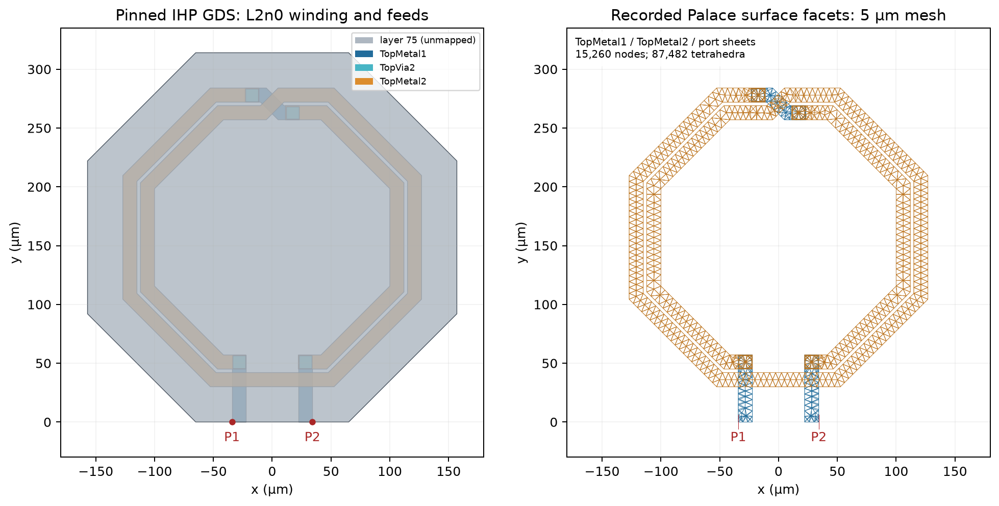

*The IHP L2n0 inductor of the open IHP PDK: the pinned GDS layout and a recorded Palace surface mesh, from the exploratory
material under `nbs/data/ihp_validation/` (see [Validation and benchmarks](#validation-and-benchmarks)). Stored image, not
redrawn for this guide.*

**When to use which solver.**

- **Inductance of a coil or transformer:** `MagnetostaticSim` (`add_current_source` per loop, then `load_inductance`). It gives
  the high-frequency external inductance of perfect conductors, with no internal or kinetic inductance.
- **Inductance and Q against frequency:** `DrivenSim` with two ports (the [inductor notebook](../nbs/palace_inductor.md) uses
  interlayer ports on the open IHP PDK) and a fit of an RLC model with `gsim.palace.fit_rlc`.
- **Capacitance matrix:** `ElectrostaticSim` (`add_terminal` by net, region or layer, then `load_capacitance`). Floating
  conductors are solved and eliminated with a Schur complement.

**Settings.**

| Class | Setting | Default | What it changes |
| --- | --- | --- | --- |
| `MagnetostaticSim` | `metallic_boundaries` | `True` | PEC outer wall; `False` gives a PMC wall, and the two runs bracket the open-space value |
| `MagnetostaticSim` | linear `tolerance`, preconditioner | `1e-8`, AMS | Conjugate-gradient solve |
| `ElectrostaticSim` | `unassigned_conductors` | `"ground"` | Conductors in no terminal; `"floating"` makes each a terminal |
| `ElectrostaticSim` | linear `tolerance` | `1e-6` | Linear solve |
| `mesh` | `refined_mesh_size`, `auto_size` | from the preset, `False` | At most half the trace width for magnetostatics |
| `mesh` | `merge_via_distance` | `2` µm | Vias closer than this are merged; `0` keeps every via |
| both | `order` | `2` | Field order |
| `DrivenSim` | `set_driven(fmin, fmax, num_points)` | `1e9`, `100e9`, `40` | For the inductor notebook: 10e9 to 200e9 Hz, 501 points |

**Steps.**

1. Draw the coil or the electrodes with one gdsfactory port on each side of every loop or electrode.
2. Set stack and airbox (each extent at least as large as the larger lateral side of the conductors for magnetostatics).
3. Declare the sources or terminals, and print `resolve_current_sources()` or `resolve_terminals()` before meshing.
4. Mesh, then run on the cloud or locally.
5. Load the matrix and run `problems()`.

```python
from gsim.palace import MagnetostaticSim

sim = MagnetostaticSim()  # PEC outer wall; metallic_boundaries=False for PMC
sim.set_geometry(transformer)  # ports P1/P2 and S1/S2
sim.set_stack()
sim.set_airbox(margin_x=100, margin_y=100, z_above=150, z_below=150)
sim.add_current_source("primary", plus_port="P1", minus_port="P2")
sim.add_current_source("secondary", plus_port="S1", minus_port="S2")
print(sim.resolve_current_sources())  # sheet, Direction and net, before meshing
sim.set_output_dir("./palace-sim")
sim.mesh(refined_mesh_size=1.0, max_mesh_size=30)
inductance = sim.load_inductance(sim.run())  # cloud job
inductance.mutual_inductance("primary", "secondary")  # in H, signed
assert not inductance.problems()
```

The snippet is the one in the [Palace guide](../api/palace.md); `transformer` is a layout you provide (see the
[coupled-coil example](../nbs/palace_magnetostatic.md)). It was not executed for this page.

**What to check.**

1. **Convergence.** A magnetostatic solve that did not converge still exits normally and writes a plausible matrix.
   `load_inductance` reads `palace.log` and raises if a solve did not converge. `problems()` checks physics only (reciprocity,
   energy, |k| ≤ 1).
2. **Wall.** Run with `metallic_boundaries=True` and `False`: the two bracket the open-space value, and their mean cancels the
   first-order wall error.
3. **Airbox and mesh.** `validate_config()` warns when an airbox extent is smaller than the larger lateral side of the meshed
   conductors. Set `refined_mesh_size` to at most half the trace width.
4. **Analytic references.** The [magnetostatic notebook](../nbs/palace_magnetostatic.md) asserts agreement with closed-form
   inductances of two concentric rings within 2 % and with a ribbon-bundle reference within 1 % (Palace v0.18.1, order 2). Its
   own text says the errors shrink with mesh refinement and come from below.
5. **Sign.** A unit current enters at `plus_port` and leaves at `minus_port`. Swapping them flips the sign of that row and column.
6. **Capacitance.** If no conductor is grounded, `to_ground` comes out near zero. Prefer port names or `region=` to `net<k>`
   in terminals, because `net<k>` changes when the layout is edited.

**Pitfalls.**

- **Closed loops screen the field.** Every conductor that is not a source is a perfect conductor. A ground ring or an
  unconnected underpass shields the coil, and `validate_config()` warns about each. The generic `gf.components.inductor` has an
  unconnected metal1 underpass that triggers this warning.
- **The gap is part of the loop.** The source sheet takes the place of the metal across the gap, so its width changes the
  inductance. Keep it small against the loop.
- **Filament formulas.** A perfect conductor crowds current toward the inside of each loop, so filament formulas along trace
  centrelines overestimate the mutual inductance of nearby loops by about 10 %.
- **Measured devices.** The L2n0 material is exploratory: its README calls the runs "recorded 1 GHz screening runs, not a
  mesh-converged validation". See [Validation and benchmarks](#validation-and-benchmarks).

**Notebooks.** [Inductor](../nbs/palace_inductor.md), [inductor port comparison](../nbs/palace_inductor_port_comparison.md),
[inductance matrix (magnetostatic)](../nbs/palace_magnetostatic.md). Capacitance: [Palace guide](../api/palace.md#capacitance).
**API.** [`MagnetostaticSim`][gsim.palace.MagnetostaticSim], [`CapacitanceMatrices`][gsim.palace.CapacitanceMatrices],
[`load_capacitance`][gsim.palace.load_capacitance].

## Thermal tuning

gsim does not cover thermal tuning yet: it has no heat solver, computes no temperature field for a heater and no thermo-optic
index change from one, and a thermal solver that is under review is not part of a release, so this guide makes no statement
about when or whether it will be. A search of `src/` and `docs/` for `thermal`, `heater` and `thermo-optic` finds only items that
do not simulate heating: `tcad` `materials(temperature_k=...)` sets the temperature of the carrier solve (default 300 K) and
does not heat the device; `phase_offset_rad` in `gsim.common.twmzm.mzm_transfer` is a static phase you choose; an analytic
material card given a `temperature` input is refused ("only supports wavelength inputs"); and a `heater` level in one PDK overlay
is a layer role for electrical meshing. If you have a temperature-shifted index or permittivity from another tool, you can pass it
by hand to `gsim.femwell.solve_modes(epsilon=...)` for the mode index against temperature (see
[Waveguide modes](#waveguide-modes) and [Carrier-depletion phase shifters](#carrier-depletion-phase-shifters)), or to
`fdtd.Simulation.materials(overrides={"si": <index>})` for a coupler at two indices. The temperature profile and the thermo-optic
coefficient are then your inputs, and gsim does not check them. No part of this workflow could be validated inside gsim.

## Mesh and resolution

**What it changes.** Every solver discretises space, and the discretisation is the first thing that limits accuracy and sets the
cost.

| Solver | Setting | Default | What it sets |
| --- | --- | --- | --- |
| FDTD | `solver(cell_size_nm=)` | `60` | The Yee grid; cost grows with the number of cells |
| FDTD | `geometry(mesh_size_nm=, geometry_tolerance_nm=)` | `1000`, `10` | The transfer mesh only, not the Yee grid |
| Meep | `solver(resolution=)` | `32` | Pixels per µm |
| Palace | `mesh(preset=)` | `"default"` | `refined_mesh_size`, `max_mesh_size` (µm) and `cells_per_wavelength` |
| Palace | `mesh(auto_size=, cells_per_feature=)` | `False`, `2` | With `auto_size`: smallest conductor feature over this sets the size |
| Palace | `mesh(refinement_boxes=, mesh_grading=)` | none | Local refinement and size grading |
| femwell, `BoundaryModeSim` | `mesh(refined_mesh_size=, max_mesh_size=)` | From the preset | Element size of the 2D cross-section mesh |
| TCAD | `solver(mesh_preset=, refined_mesh_size_um=, refinement_boxes=)` | `None` | Mesh of the doped cross-section |

The Palace presets are `coarse` (10 µm near conductors, 600 µm in the bulk, 5 cells per wavelength), `default` (5, 300, 10) and
`fine` (2, 70, 20). Explicit sizes override a preset and bypass auto-sizing.

**How to choose.** Use `coarse` to check that the geometry, ports and boundaries are what you meant, and not for results. Take
the element size near conductors from the smallest feature that carries current or field: at most half a trace width for a
magnetostatic solve, and a few elements across a 6 µm gap for a CPW. Hold the mesh fine where the physics changes fast, for
example across a junction (see [Carrier-depletion phase shifters](#carrier-depletion-phase-shifters)).

**How to check.** Run the same case on two meshes and compare the quantity you report. A mesh warning is a heuristic, and a
mesh without one is not thereby converged. See [Convergence study of any setting](#convergence-study-of-any-setting).

## Domain and absorbing boundaries

**What it changes.** The computational domain is a box around the device. Its walls reflect, absorb or impose a symmetry, and a
wrong wall changes the answer without an error.

| Solver | Setting | Default | What it sets |
| --- | --- | --- | --- |
| FDTD | `domain(padding=, pml_cells=)` | `1.0` µm, `32` | Padding around the geometry, and PML cells outside the physical domain |
| FDTD | `domain(x_bounds=, y_bounds=, z_bounds=)` | `None` | Explicit bounds in µm |
| Meep | `domain(pml=, margin_x=, margin_y=)` | `1.0`, `0.5`, `0.5` µm | PML thickness and the air gap between geometry and PML |
| Meep | `domain(z_bounds=)` | `"auto"` | PML-inner z interval; it must contain the stack and a fibre source |
| Palace | `set_airbox(margin_x=, margin_y=, z_above=, z_below=)` | none | Air around the layout and above and below the stack, in µm |
| Palace | `absorbing_boundary` | `None` driven, `False` eigenmode and electrostatic | Absorbing wall, or reflecting |
| Palace | `metallic_boundaries` | `True` magnetostatic, `False` driven | PEC wall instead of PMC |
| femwell | `set_cross_section(window=, window_z=)` | `None` | The window that clips the 2D domain |

In FDTD the PML is hatched outside the physical domain in `plot_2d_static()`. With the defaults it is 32 cells of 60 nm, 1.92 µm
(arithmetic). In Palace, without an airbox the outer boundary would touch the dielectric directly, and gsim warns when you mesh.
The outer wall of a driven model with lumped ports is absorbing by default, and with wave ports it is PEC (see
[Numeric wave-port boundaries](../api/palace.md#numeric-wave-port-boundaries)). An eigenmode solve has a reflecting wall, so
a driven sweep that you compare with it needs the same wall.

**How to choose.** Keep the walls far enough from the field that moving them changes nothing, and check that by moving them (the
airbox for Palace, the window for femwell with `boundary_field_ratio`, the margins and PML for FDTD and Meep).

## Ports sources and monitors

**What it does.** A port or source puts a known mode or field into the model, and a monitor reads what comes out.

- **FDTD.** `source(port=...)` excites one port per run, with the fundamental mode unless you pass `mode=`. Guided-port monitors sit on
  the other ports and use the same mode selection. Plane monitors (`monitors.add_plane`) record fields on a plane, for example
  above a grating. An n-port S-matrix is n runs.
- **Meep.** A mode source on a port, or a tilted Gaussian `source_fiber` in XZ 2D. `monitors = ["o2"]` names the monitor
  ports. The domain settings `source_port_offset` (0.1 µm) and `distance_source_to_monitors` (0.2 µm) set where they sit.
- **Palace.** `add_port` (one lumped element: in-plane, gap or interlayer), `add_cpw_port` (two elements, one per gap),
  `add_wave_port` (the 2D mode of the port face), `add_two_terminal_port` (a true one-port). The reference impedance is
  50 Ω by default. Every port is excited in turn, so a two-port model gives the full S-matrix.
- **Phase reference.** Phases refer to the port monitors or port faces. gsim does not de-embed them.

**How to check.** Look at the set-up plot to see where the source, the monitors and the ports are. Then check power and
reciprocity (see [Checks for every result](#checks-for-every-result)).

## Element order and tolerances

**What it changes.** Palace and femwell are finite-element solvers: a higher polynomial order gives a more accurate field on the
same mesh at a higher cost, and the tolerances decide when an iterative solve stops.

| Solver | Setting | Default |
| --- | --- | --- |
| Palace, all simulation types | field `order` | `2` |
| Palace driven | linear `tolerance`, `adaptive_tol` | `1e-6`, `0.02` |
| Palace eigenmode | linear and eigenvalue `tolerance` | `1e-9`, `1e-9` |
| Palace magnetostatic | linear `tolerance` | `1e-8` (AMS preconditioner) |
| Palace electrostatic | linear `tolerance` | `1e-6` |
| femwell `solve_modes` | `order` | `2` |

`adaptive_tol` is the relative error of the adaptive frequency sampling: `0` disables it, `0.02` is the fast default, `1e-3` is
called accurate and `1e-4` publication quality in the `set_driven` docstring.

**What the evidence says.** At order 1, femwell and Palace n_eff differed by about 9e-3 on the same mesh, and femwell power-current
Z₀ on a perfect-conductor coax read 8 % to 29 % high against within 0.4 % at order 2 (test comments, see
[Validation and benchmarks](#validation-and-benchmarks)). Keep order 2 unless you have a reason.

## Stopping and convergence

**What it changes.** A time-domain run stops when its energy has decayed, and an iterative frequency-domain solve stops at a
tolerance. A stop flag says that the solver finished, not that the physics is right.

| Solver | Setting | Default |
| --- | --- | --- |
| FDTD | `solver(energy_decay_fraction=)` | `1e-6` |
| FDTD | `solver(max_wall_seconds=)`, `max_timesteps` | `3600`, `None` |
| Meep | `stopping` | `"energy_decay"` (also `"field_decay"`, `"dft_decay"`, `"fixed"`) |
| Meep | `stopping_threshold`, `stopping_dt`, `stopping_min_time` | `0.01`, `20.0`, `100.0` |
| Meep | `max_time` | `2000.0` (µm/c after the sources) |

The FDTD grating-coupler notebook sets `energy_decay_fraction=0.0004` and asserts `result.convergence["converged"]`, with the
message to increase the run duration if it fails. A run that hits `max_wall_seconds` before it decays is not converged. For
Palace, `validate_solution` reports solver convergence, estimator status and adaptive sampling (see
[Validation and benchmarks](#validation-and-benchmarks)).

## Validation and benchmarks

This section lists the evidence in this repository about how far gsim results can be trusted, grouped by what kind of evidence it
is. Each entry says what was compared with what, what the stated result is, and what the comparison does not show. A stated result
is a number that a test, a notebook or a docs page in this repository gives. Unless the entry says otherwise, it was not re-run
for this guide. The guide does not summarise accuracy as one figure, because the evidence does not support one.

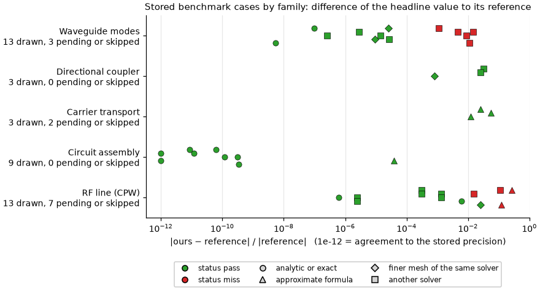

*Stored results of the cross-solver benchmark suite, in a separate repository and not part of this one (cases dated 2026-11-12
to 2026-11-18). One marker per case: the relative difference between the case's headline value and its reference, coloured by
the status stored with the case. The thresholds differ per case and are not drawn. Of the 41 cases drawn, 9 are misses: five
Meep mode-solver cases against femwell (the strip TE0 case records limited Meep grid resolution as the cause) and four RF
cases. Cases still pending or skipped (12) are counted, not drawn, and the paper-device cases are left out. This is a snapshot
of the stored files, not a re-run, and not an accuracy statement: the cases differ in what they compare.*

**One solver against another.**

- **[FDTD benchmark](../fdtd-benchmark.md)**
  - *Compared:* GDSFactory FDTD, a commercial CPU solver, a commercial GPU solver and Meep on a 20 µm silicon directional
    coupler with a 236 nm gap and SiO₂ cladding (geometry from a published study).
  - *Stated result:* At 1550 nm, 39.1 % cross and 60.9 % through transmission, each within 0.7 percentage points of the
    commercial CPU result.
  - *Does not show:* Agreement with a measurement. The solver outputs and scripts behind the charts are not in this
    repository, only the charts and the page text. One device, one wavelength is quoted.
- **`tests/femwell/test_cross_validation.py`**
  - *Compared:* femwell against Palace `BoundaryModeSim` on the same mesh and the same materials: n_eff of a silicon strip at
    1.55 µm, and the complex n_eff with a conductive core.
  - *Stated result:* Test bound 1e-3 relative. The test's comments record 4.1e-5 (optical) and 2.9e-4 (conductive core) as
    measured on that mesh, and 9e-3 for femwell at order 1.
  - *Does not show:* Agreement with the drawn device: both solvers get the same mesh and materials, so a shared mesh error
    cancels. It needs a Palace binary and femwell, carries the `palace_local` marker, is excluded from the default test run,
    and no workflow in `.github/workflows` selects it.

**A solver against an analytic reference.**

- **[Magnetostatic inductance notebook](../nbs/palace_magnetostatic.md)**
  - *Compared:* Palace `MagnetostaticSim` against closed-form self and mutual inductance of two concentric rings, and
    against a ribbon-bundle reference computed without finite elements.
  - *Stated result:* The notebook asserts agreement with the closed forms within 2 % and states agreement with the ribbon
    bundle within 1 %. It says the 1 % bound was set after the runs, so it acts as a regression gate. Run with Palace v0.18.1
    at order 2.
  - *Does not show:* Anything beyond thin rings. A 2 % bound is the test tolerance, not the observed error. The notebook
    states the errors shrink with mesh refinement, and come from below.
- **`tests/tcad/test_solve_runtime.py`** (marker `tcad_local`; run by the TCAD workflow)
  - *Compared:* TCAD small-signal C(V) against the abrupt-junction depletion approximation (Sze), on a 1e18 / 1e18 cm⁻³
    junction at 0, 0.5 and 1 V.
  - *Stated result:* The test accepts a largest relative deviation of 0.35.
  - *Does not show:* A tight match. 0.35 is a loose bound that allows for oxide fringing. A separate test checks that C
    scales as the square root of the permittivity.
- **[PN junction notebook](../nbs/tcad_pn_junction.md)**
  - *Compared:* The same comparison on its own device, five biases from 0 to 2 V, no oxide in the Poisson solve.
  - *Stated result:* Not stored. Running its setup and sweep cells while writing this guide gave a largest deviation of
    2.8 % (at 0 V) and 0.5 % to 1.0 % at the other biases, with gsim 0.10.0 on one Windows machine.
  - *Does not show:* A converged result. A coarser mesh without the notebook's refinement box moved the capacitance by up to
    6.9 % in the same check. Rerun to confirm.
- **`tests/femwell/test_z0_extraction.py`**
  - *Compared:* femwell power-current Z₀ against the analytic impedance of a coaxial line, copper inner conductor and
    perfect inner conductor.
  - *Stated result:* Test bounds 8 % (copper, measured 3.2 % high per the test comment) and 1 % (perfect conductor). The
    comments say order 1 reads 8 % to 29 % high on the perfect-conductor mesh, against within 0.4 % at order 2.
  - *Does not show:* A planar line such as a CPW. The check is on a coax.
- **Time convention of the FDTD export** ([FDTD guide](../api/fdtd.md#export-to-sax-and-touchstone))
  - *Compared:* Phase of a 10 µm silicon straight waveguide against a separate mode solver.
  - *Stated result:* A delay of 139 fs against 137 fs from the group index.
  - *Does not show:* More than one device. The guide says so, and `s_matrix` warns when a negative group delay appears.

**Checks of post-processing, not of the solver.**

- `tests/common/test_s_matrix.py` compares the S-matrix assembly and the SAX and Touchstone exports with closed forms and with
  independent libraries (`sax.models.straight`, `skrf.Network`). It tests the arithmetic of the export. It does not test an
  FDTD result.
- The [signal-integrity notebook](../nbs/palace_signal_integrity.md) runs analytic checks of mixed-mode algebra, port
  reordering, uniform-line impedance and a known reflection time. Its own conclusions say they validate the post-processing on
  those examples and not the IHP electromagnetic model. Figures from its recorded runs are in `docs/assets/plots/palace-si-*.png`;
  the raw runs are not bundled.
- The paper-reproduction notebooks (for example the [Lu broadband coupler](../nbs/fdtd_lu_broadband_coupler.md)) are
  reconstructions of published devices. The Lu notebook says that its saved spectrum is an example result and not a claim of
  mesh convergence, and that the paper's output-normalised splitting does not establish absolute throughput. The other three
  paper notebooks were not read for this guide.

**Run evidence.** [Checking a Palace run](../palace-validation.md) describes what `validate_solution` reports: solver
convergence, estimator status, adaptive sampling, process exit, port-mode continuity and input provenance. Its first paragraph
says it does not compare results with analytic, measured or published references. A converged run can still be wrong, for example
with a wrong mode or a mesh that does not resolve the geometry. Cloud regression tests, such as
`tests/palace/test_cloud_eigenmode_cavity.py`, compare a run with the stored output of an earlier run. They detect a change, not an
error.

**Measured devices.** There is no measured-device comparison in this repository that is presented as validation. The IHP L2n0
inductor material under `nbs/data/ihp_validation/` is exploratory. Its own README calls the runs "recorded 1 GHz screening runs,
not a mesh-converged validation". By the extraction it uses, the two measured dies give 1.674 and 1.672 nH, and the best recorded
two-port value is 0.802 nH, about a factor of two low. It is not accuracy evidence for Palace or for gsim, and the notebook that
reads it (`nbs/ihp_l2n0_openems_validation.ipynb`) is not part of the published documentation.

**What the evidence does not cover.**

- Photonic S-parameters of any device against a measurement.
- Ring resonators and any circuit built from FDTD S-matrices: only the export arithmetic is tested.
- Waveguide group index and loss from femwell against a measurement or an analytic waveguide.
- CPW and microstrip impedance and loss from Palace against a closed-form line or a measurement.
- Resonant frequency and Q of superconducting resonators against a measurement or an analytic resonator.
- Free-carrier effects (n_eff shift, VπL) against measured modulators. The TCAD checks above cover capacitance only.
- Thermal effects. gsim has no thermal solver; see [Thermal tuning](#thermal-tuning).

Treat results in these areas as unvalidated. Use the checks of each device section, and compare with your own measurements or an
independent reference before relying on a number.

## Checks for every result

1. **Units and conventions.** S-parameters from FDTD and Palace are stored as S(receive, source) in exp(+jωt). SAX uses
   (in, out) and exp(−iωt). femwell gives Im n_eff < 0 for loss.
2. **Power.** For a passive device the power out of any source cannot exceed 1. Above 1 is a set-up problem, not gain.
3. **Reciprocity.** A passive device without non-reciprocal materials has S(a,b) = S(b,a). Compare the two entries.
4. **Two meshes.** Repeat on a finer mesh or grid and compare the number you report (see
   [Convergence study of any setting](#convergence-study-of-any-setting)).
5. **Walls and window.** Move the domain walls, the airbox or the window and check that the number does not move.
6. **Mode and band.** Confirm that the mode you excited is the mode you meant, and that the band holds the feature you look for.
7. **An independent number.** Compare with a closed form, a second solver on the same set-up, or a measurement. The device
   sections name the checks that exist.
8. **Run evidence.** For Palace, read the `validate_solution` report. It tells you whether the solver converged.

## Convergence study of any setting

1. Choose the quantity you will report (a split ratio at 1.55 µm, n_eff, a resonance frequency, an inductance).
2. Change one setting only: the cell size, the resolution, the mesh preset, the airbox, the PML, the order or the tolerance.
3. Record the quantity for at least two values of that setting, finer than your working value.
4. Compare. If the change is below the error you can accept, the working value is fine. If not, keep refining.
5. Write down the setting values with the result. The captions of this guide give them.

Change one thing at a time. If you change the mesh and the airbox together, you cannot say which one moved the number.

## Parameter sweeps

- **Bias.** `tcad.Simulation.sweep(np.linspace(0.0, 2.0, 5), contact="cathode")` steps the bias, with `bias_step_v` (default
  `0.1` V) as the internal step. Positive bias on the n-side contact is reverse bias.
- **Frequency.** `DrivenSim.set_driven(fmin, fmax, num_points, scale, adaptive_tol)` sweeps in one run. With adaptive sampling
  Palace builds a reduced-order model from a few full solves and interpolates the rest. Narrow the band to the feature
  you want to resolve.
- **Wavelength.** FDTD `source(num_wavelengths=101)` records 101 wavelengths over `wavelength_span_um` in one run. Meep uses
  `num_freqs` (default 11).
- **Geometry.** A length or width sweep is one job per case. Start all jobs without waiting, then collect them:

```python
job_ids = [sim.run(wait=False, check_cache=True) for sim in sims]  # one cloud job per geometry
import gsim

results = gsim.wait_for_results(job_ids)  # polls the jobs together, downloads and parses the results
```

This is the pattern of the [width sweep notebook](../nbs/palace_width_sweep.md). For length sweeps and de-embedding see
[CPW length sweep and de-embedding](../nbs/palace_cpw_deembedding.md).

## Estimating cost before you submit

| Engine | Cost grows with | Where to read it |
| --- | --- | --- |
| FDTD | Yee cells: the physical domain over `cell_size_nm`, plus PML and guard cells | `metadata.json` from `write()` |
| Palace | Tetrahedra and estimated field DOFs, which depend on the mesh sizes and the order (default 2) | `mesh()` statistics |
| femwell and TCAD | The size of a 2D mesh; both run on a laptop | The mesh |

One FDTD run excites one port, so an n-port S-matrix is n runs. There is no single count that guarantees a Palace job fits in
memory (see [cloud sizing](../api/cloud.md#sizing-metadata)). Numbers from this page, all client estimates from a local
mesh or `write()` and not measured run times:

- FDTD, 1x2 MMI (60 nm cells): 9,969,264 cells and 810,662,160 bytes of monitor memory. Coupler of the isometric figure:
  18,471,600 cells and 1,263,369,600 bytes.
- Palace, 300 µm CPW with lumped ports (Getting started page, gsim 0.9.0): 7,897, 20,220 and 55,061 tetrahedra at `coarse`,
  `default` and `fine`.
- Palace, the resonator example at `default` with `auto_size=True`: 161,214 tetrahedra and 1,025,210 field DOFs, against
  39,632 and 253,440 for one `coarse` mesh without `auto_size`.
- Meep: the 2D grating coupler notebook records 264 s for its cloud run cell. The [Meep guide](../api/meep.md) lists what
  drives its cost.

## Cloud runs and caching

Meshing and input export run locally. FDTD, Meep and Palace solves run on GDSFactory+ cloud and need an account. The code on this
page stops before any cloud call, or marks the cloud line. `sim.run(check_cache=True)` first looks for a finished job with
byte-identical inputs and reuses its results instead of starting a new one; when none matches, a new job starts (see
[Result caching](../api/cloud.md#result-caching)). `run(wait=False)` returns a job id. Check the problem size before you submit.
If a job is rejected as too large, or fails with exit code 137 (SIGKILL, often out of memory), coarsen the mesh or shrink the
model: see [Palace size limits and out-of-memory failures](../api/cloud.md#palace-size-limits-and-out-of-memory-failures).
Meep and Palace can also run on your machine with `run_local()` if meep or a Palace binary is installed.

## Known pitfalls

| What you see | Why | What to do |
| --- | --- | --- |
| FDTD `s_matrix` raises and lists entries | One run measures one column | Run every port, or pass the `assume_*` flags |
| FDTD power out of a source above 1 | Set-up problem: mode, reference plane or grid | Check the mode and the grid |
| FDTD device behaves as if in air | The default `background` is `"Air"` | `materials(background="SiO2")` |
| FDTD has no index for silicon | gdsfactory 9.x layer `si` without a material card | `overrides={"si": <index>}` |
| FDTD refuses padding on a port side | Explicit axis padding must be zero there | Use `padding`, not `padding_x` |
| FDTD phase does not fit SAX | Different phase conventions | Use `matrix.sax_model()`, not Touchstone |
| Palace "A positive eigenmode target frequency is required" | No `target` | `set_eigenmode(num_modes=, target=)` |
| Palace eigenmode and driven results disagree | Different outer walls | Set `absorbing_boundary` on both |
| Palace `write_config()` raises `ValueError` on the mesh | The mesh no longer matches | `mesh()` again, then `reuse_mesh()` |
| Palace "Small conductor feature ... may be under-resolved" | Refinement is coarser than the feature allows | Finer preset or `auto_size`, compare |
| Palace job fails with exit code 137 | Out of memory | Coarsen the mesh or shrink the model |
| Meep deprecation warning on `margin_z` | `margin_z` is deprecated | `domain(z_bounds=(low, high))` |
| TCAD capacitance 9.3 % to 12.8 % lower than before | 0.10.0 uses signed edge couples | Rerun saved TCAD results |
| TCAD refuses two touching doped regions | No interface declared | `sim.interfaces.add(...)` |
| femwell n_eff changes with the window | The window clips the mode | `boundary_field_ratio(mode) < 0.01` |

## Questions and answers

**Do I need an account?** For FDTD, Meep and Palace cloud solves, yes. Meshing, input export, femwell and TCAD run locally, and
Meep and Palace can run locally with meep or a Palace binary.

**Which PDK do the examples use?** The generic PDK (`gf.gpdk`) and the open IHP PDK. The QPDK notebooks need `qpdk`.

**Can I simulate a ring or a whole circuit?** Simulate the coupler in the field and compose the loop in SAX (see
[Rings and circuits](#rings-and-circuits)). No end-to-end ring result is validated here.

**Can I simulate heaters?** No (see [Thermal tuning](#thermal-tuning)).

**Is a converged run a correct run?** No. Convergence says the solver finished. See [Validation and benchmarks](#validation-and-benchmarks).

**Where do the numbers on this page come from?** From the source of this version, from tests and notebooks, or from stored
results, each marked. A number the author measured while writing is marked as such, and should be re-run before you quote it.

## How the figures are made

Each figure has a caption that says what is drawn and where the numbers come from: a local run with its date, or a stored
benchmark case. The scripts that draw them are in `docs/guide/figures/` and write to `docs/guide/images/`, all with the shared
style and size check in `_common.py`:

- `make_modes.py` and `make_index.py` (femwell modes), `make_couplers_and_mmis.py` and `make_coupler_3d.py` (FDTD set-ups),
  `make_grating_coupler.py` (Meep XZ set-up), `make_rings_circuits.py` (layouts and SAX), `make_phase_shifters.py` (runs
  the PN junction notebook cells with DEVSIM), `make_pn_depletion.py` (closed form), `make_rf_line.py` (layout and stack),
  `make_superconducting_resonators.py` (reads the resonator snippet on this page), `make_validation.py` (stored benchmark cases).
- Figures of stored benchmark cases read the benchmark results folder when it exists (`GSIM_BENCHMARK_RESULTS`, default
  `simulation-benchmarks/results`) and otherwise the committed snapshot in `docs/guide/figures/data/`.
- The mesh, transmon and inductor images are stored images in `docs/assets/plots/`; they were made by the notebooks and pages that
  use them, and are not redrawn here.

Run a script from the repository root, for example `uv run python docs/guide/figures/make_modes.py`. The DEVSIM figures need the
`tcad` extra and a working DEVSIM.

[dc]: #directional-couplers-and-mmis
[gc]: #grating-couplers
[wm]: #waveguide-modes
[rc]: #rings-and-circuits
[ps]: #carrier-depletion-phase-shifters
[rf]: #rf-transmission-lines
[sr]: #superconducting-resonators
[ic]: #inductors-and-capacitance
[tt]: #thermal-tuning
