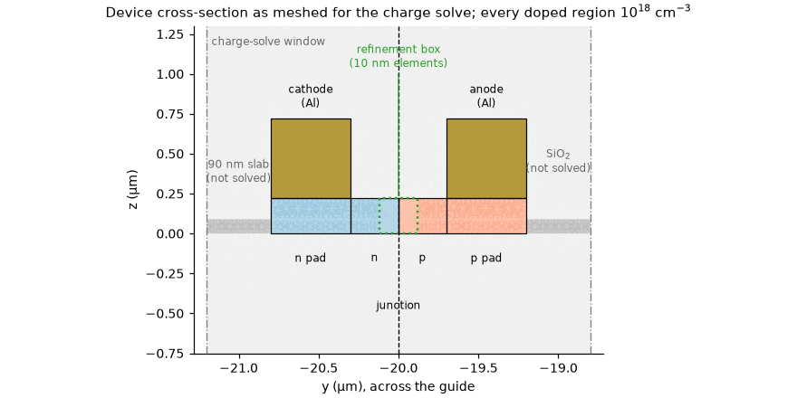
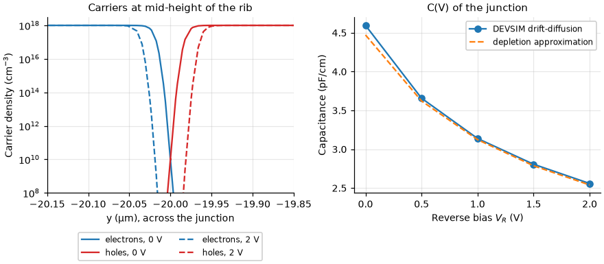

# Carrier-depletion phase shifters: VπL and loss

How to get the modulation efficiency VπL and the free-carrier loss of a lateral PN-junction phase shifter, and
what to check before quoting them.

## When to use / solver and why

This workflow is a chain of cross-section solves. All of them run locally and none needs the cloud:

1. **Carriers against bias.** [`gsim.tcad`](../api/tcad.md) solves Poisson and electron/hole drift-diffusion with DEVSIM on a
   2D cross-section of the doped silicon.
2. **Carriers to material properties.** Closed-form plasma-dispersion and mobility models in `gsim.common.carriers` turn each
   carrier map into an index shift Δn, an absorption Δα and an RF conductivity.
3. **Optical mode against bias.** `gsim.femwell`, a local finite-element mode solver, solves the guided mode on a mesh with
   the carrier-dependent permittivity, giving a complex n_eff per bias. It has no API guide page yet.
4. **Figures of merit.** `gsim.common.twmzm.vpi_length_vcm` turns n_eff(V) into VπL. The
   travelling-wave modulator report in `gsim.common.twmzm_report` adds the RF line.

TCAD and the mode solver are optional extras: `pip install "gsim[tcad,femwell]"`. A thermal phase shifter is a different
device; see [thermal tuning](thermal-tuning.md).

## Minimal setup

The complete worked example is the [travelling-wave MZM notebook](../nbs/tcad_twmzm.md), which also covers the RF line and
the bandwidth. The carrier solve alone is in the [PN junction notebook](../nbs/tcad_pn_junction.md). Both use the generic PDK.

The outline below is not self-contained: `component` and `stack` come from the notebook's device definition, and the doping
profiles, contacts and interfaces name regions of that device.

```python
import numpy as np

from gsim import tcad
from gsim.common.carrier_transfer import transfer_carriers
from gsim.common.carriers import (
    PlasmaDispersionModel,
    carrier_absorption_cm,
    carrier_index_shift,
    permittivity_perturbation,
)
from gsim.common.modes import select_line_mode
from gsim.common.twmzm import vpi_length_vcm
from gsim.femwell import boundary_field_ratio, epsilon_by_region, solve_modes

# 1. Carriers against reverse bias (DEVSIM, local).
sim = tcad.Simulation()
sim.geometry(component, stack=stack)
sim.domain(plane="x=0", window=(-21.2, -18.8), margin_y=0.5, z_above=1.0, z_below=1.0)
for region in ("n_pad", "n_rib"):
    sim.doping.add(tcad.StepDoping(region=region, dopant_type="donor", concentration_cm3=1e18))
for region in ("p_rib", "p_pad"):
    sim.doping.add(tcad.StepDoping(region=region, dopant_type="acceptor", concentration_cm3=1e18))
sim.contacts.add(name="cathode", semiconductor="n_pad", electrode="cathode_metal")
sim.contacts.add(name="anode", semiconductor="p_pad", electrode="anode_metal")
sim.interfaces.add(name="n_link", region_a="n_pad", region_b="n_rib")
sim.interfaces.add(name="junction", region_a="n_rib", region_b="p_rib")
sim.interfaces.add(name="p_link", region_a="p_rib", region_b="p_pad")
sim.solver(
    mesh_preset="coarse",
    refined_mesh_size_um=0.02,
    max_mesh_size_um=40.0,
    # (y_min, y_max, z_min, z_max, size): hold the mesh fine over the strip the depletion edges sweep
    refinement_boxes=[(-20.12, -19.88, 0.0, 0.22, 0.01)],
)
sim.mesh(output_dir="./tcad")
sweep = sim.sweep(np.linspace(0.0, 2.0, 5), contact="cathode")  # positive cathode bias = reverse bias

# 2-3. Carriers to permittivity to n_eff at each bias (femwell, local).
dispersion = PlasmaDispersionModel.nedeljkovic_1550()


def neff_at(carriers, optical_mesh, wavelength_um=1.55):
    base = epsilon_by_region(optical_mesh, stack, wavelength_um=wavelength_um)
    on_mesh = transfer_carriers(carriers, optical_mesh, at="elements", fill=0.0, regions=["n_rib", "p_rib"])
    dn = carrier_index_shift(on_mesh.electrons_cm3, on_mesh.holes_cm3, model=dispersion)
    dalpha = carrier_absorption_cm(on_mesh.electrons_cm3, on_mesh.holes_cm3, model=dispersion)
    eps = np.array([base[name] for name in on_mesh.region], dtype=complex)
    for i, name in enumerate(on_mesh.region):
        if name in ("n_rib", "p_rib"):
            eps[i] = permittivity_perturbation(
                n0=np.sqrt(base[name].real), dn=dn[i], dalpha_cm=dalpha[i], wavelength_um=wavelength_um
            )
    mode = select_line_mode(solve_modes(optical_mesh, epsilon=eps, wavelength_um=wavelength_um, metallic_boundaries=True))
    assert boundary_field_ratio(mode) < 0.01, "the window clips the mode"
    return complex(mode.n_eff)


# 4. V_pi L from the local slope of the index shift.
# n_eff = np.array([neff_at(point.carriers, optical_mesh) for point in sweep.points])
# vpi_l = vpi_length_vcm(sweep.voltages, n_eff.real - n_eff[0].real, wavelength_um=1.55)  # V*cm
```

`optical_mesh` is a cross-section mesh made with `BoundaryModeSim` (`set_cross_section`, then `mesh`), as in the notebook's
step 3. The notebook meshes its own window around the rib, holds the same fine element size across the junction as the charge
mesh, and keeps the mesh fixed across biases: only the element permittivity changes.



*The device behind the outline, drawn from the mesh of `sim.mesh()` (the device of the PN junction notebook, generic PDK): four
doped strips 220 nm tall over a 90 nm slab, every doped region at 10¹⁸ cm⁻³, an aluminium electrode on each pad, the junction at
the centre, the charge-solve window, and the refinement box that holds 10 nm elements across the junction. Regions that are
neither doped nor declared insulating, here the slab and the oxide, take no part in the carrier solve. Local run, 2026-11-25.*

Status of this outline: step 1 was executed in this checkout on the PN junction notebook's device, and it gives the same
C(V) as the notebook's own cells. The imports and the signatures used in step 2-3 were checked. `neff_at` follows the
notebook's `solve_optical_mode` function but was not executed as written here, because it needs an optical mesh. The
notebooks are the executed reference.

## Key settings and defaults

| Where | Setting | Default |
| --- | --- | --- |
| `tcad` `materials` | `temperature_k` | `300.0` K |
| `tcad` `materials` | `semiconductor_permittivity` | `11.1` (DEVSIM's value; the RF and optical stacks use `11.9`) |
| `tcad` `materials` | `mobility` | Masetti silicon (`MobilityModel.masetti_silicon()`) |
| `tcad` `solver` | `bias_step_v` | `0.1` V |
| `tcad` `solver` | `relative_error` | `1e-6` |
| `tcad` `solver` | `max_iterations` | `100` |
| `tcad` `solver` | `mesh_grading` | `None` (off) |
| `tcad` `solver` | `junction_freq_hz` | `1e9` |
| `solve_modes` | `num_modes` | `1` |
| `solve_modes` | `order` | `2` |
| `solve_modes` | `metallic_boundaries` | `False` |
| `solve_modes` | `n_guess` | `None` |

The values above were read from `sim.materials` and `sim.solver` of a freshly configured `tcad.Simulation`, and from the
signature of `solve_modes`. The notebooks set `metallic_boundaries=True` and `refined_mesh_size_um=0.02` explicitly.

The sweep takes positive bias on the n-side contact as reverse bias.

Without mesh grading, the mesh refines along every internal curve, and the element size grows about 2 per um from there. A
`refinement_boxes` entry holds a size over the strip the depletion edges move through. See the
[TCAD guide](../api/tcad.md#configure-and-solve).

## What to check



*Result of the carrier solve on that device. Left: electron and hole density along a cut at mid-height of the rib, at 0 V and
at 2 V reverse bias. The strip where both are below 10¹⁶ cm⁻³ is 17 nm wide at 0 V and 58 nm at 2 V, on a 10 nm mesh. Right:
small-signal capacitance per cm of device length at five biases, next to the depletion approximation from
`tcad.compare_capacitance`; the largest deviation is 2.8 %, at 0 V. Local DEVSIM run with gsim 0.10.0, 2026-11-25; the
numbers are the ones check 1 quotes.*

1. **C(V) against the depletion approximation.** `tcad.compare_capacitance(junction, sweep, height_um=...)` puts the
   simulated capacitance next to the abrupt-junction formula in `gsim.common.stack.PNJunctionConfig` and reports the largest
   relative deviation. It is a sanity check for an abrupt, uniformly doped junction with no oxide fringing, not a calibration.
   Running the PN junction notebook's setup and sweep cells in this checkout (gsim 0.10.0, DEVSIM, five biases from 0 to 2 V)
   gave a largest relative deviation of 2.8 %, at 0 V, and 0.5 % to 1.0 % at the other four biases. This was measured while
   writing this page, on one Windows machine, and is not a stored result. Rerun it before quoting it.
2. **Direction of the effect.** C(V) must fall and n_eff must rise with reverse bias. The notebook reports that
   carriers leave the centre of the mode, so n_eff rises and the loss falls with bias. `carrier_index_shift` returns
   a negative Δn for positive carrier densities (`gsim.common.carriers`).
3. **Is the window large enough?** `boundary_field_ratio(mode)` is the peak boundary field over the peak field. The notebook
   asserts it is below 0.01. A larger value means the window truncates the mode.
4. **Depletion edge resolution.** Hold the mesh fine over the strip the depletion edges sweep, using a refinement box, and
   repeat the sweep with a finer box. If C(V) or Δn_eff moves, the mesh was too coarse. Δn_eff is a small
   difference of two large numbers, so the carrier map must be resolved, not averaged. As an illustration, the same five-bias
   sweep without the refinement box above gave capacitances between 2.5 % below and 6.9 % above the boxed run, with the sign
   changing along the sweep (two local runs while writing this page, same caveat as in check 1).
5. **Mesh independence of n_eff.** Repeat the mode solve on a second optical mesh. The femwell order is 2 by default;
   at order 1 the femwell and Palace n_eff differed by about 9e-3 on the same mesh in the project's cross-check
   (see [validation](validation.md)).
6. **Units of the figures of merit.** VπL = λ / (2 |dΔn_eff/dV|), divided by 10⁴ to turn V·µm
   into V·cm (`vpi_length_vcm`). Power loss is 4π |Im n_eff| / λ per unit length, or 10 log₁₀(e) times that
   in dB. Under femwell's exp(+iωt) convention a lossy mode has Im n_eff < 0, so use the magnitude. As an
   arithmetic check, a slope of 1e-5 per volt at 1.55 µm gives 7.75 V·cm, and |Im n_eff| = 1e-4 at 1.55 µm gives
   8.1 cm⁻¹, or 35.2 dB/cm. `vpi_length_vcm` reproduced the first number, and the loss formula in the notebook matches the
   second, in a local check.

## Known pitfalls

- **Two permittivities for silicon.** The charge solve uses 11.1, the RF and optical stacks 11.9. They enter different
  physics. On a junction with no oxide to fringe through, the capacitance goes as the square root of the charge-solve
  value (the project's TCAD test checks this ratio).
- **Results from before 0.10.0.** gsim 0.10.0 assembles the charge-transport equations with signed edge couples. The
  [TCAD guide](../api/tcad.md#edge-couples-and-node-volumes) states that the capacitance falls by 9.3 % to 12.8 % on its test
  diode against earlier versions. Rerun saved TCAD results.
- **Physics limits.** Drift-diffusion with Shockley-Read-Hall recombination and doping-dependent mobility. There is no
  field-dependent mobility, impact ionisation or quantum correction. The Masetti mobility is its 300 K fit at every
  temperature.
- **Plasma-dispersion model.** The notebook uses published silicon fits at 1.55 µm. `nedeljkovic_1310()` is the 1.31 µm set.
  Use foundry-calibrated coefficients for a real process.
- **One live DEVSIM device.** DEVSIM keeps one process-wide namespace, so one charge-transport device is live at a time.
- **Regions must be declared.** Contacts, interfaces and insulators are declared, never inferred from the stack. Two touching
  doped regions without an interface are refused.
- **Window wall.** The optical window wall is a perfect conductor in the notebook. A window that is too small changes
  n_eff without an error. Check the boundary field ratio.

## Examples

- [TCAD: PN junction C(V)](../nbs/tcad_pn_junction.md)
- [TCAD: travelling-wave MZM](../nbs/tcad_twmzm.md), from doping to bandwidth.

No separate phase-shifter notebook is planned. See [choosing a solver](choosing-a-solver.md) and
[validation](validation.md).

## Related API

- [TCAD guide](../api/tcad.md)
- [Shared components guide](../api/common.md): PN junction model, staircase cross-section, TW-MZM figures of merit
- [`tcad.Simulation`][gsim.tcad.Simulation], [`tcad.compare_capacitance`][gsim.tcad.compare_capacitance]
- [`vpi_length_vcm`][gsim.common.twmzm.vpi_length_vcm]
