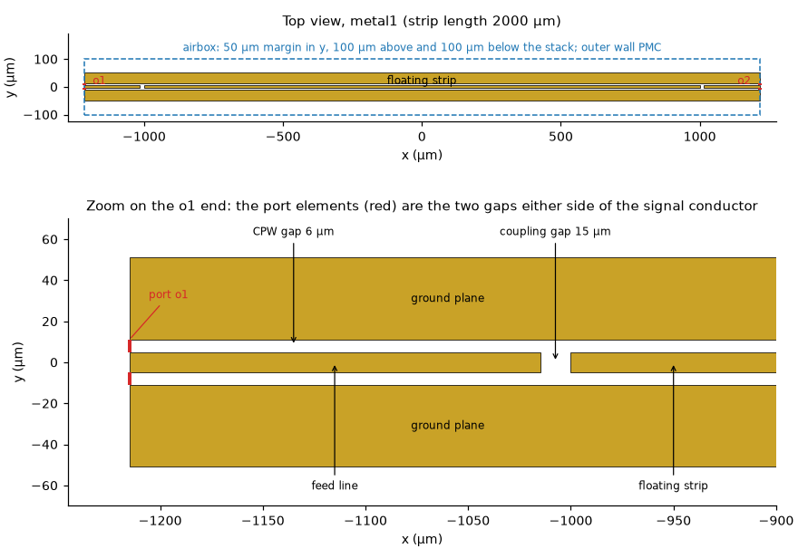

# Superconducting coplanar resonators

How to find the resonant frequency and the loaded quality factor of a coplanar-waveguide (CPW) resonator with Palace in
gsim, and how to read a notch resonance from the same mesh. Read [what the model leaves out](#what-the-model-leaves-out)
before you quote a Q.

## When to use / solver and why

Use [`gsim.palace`](../api/palace.md):

- [`EigenmodeSim`][gsim.palace.EigenmodeSim] gives the complex resonant frequencies, so f and Q, of the structure with its
  ports as loads.
- [`DrivenSim`][gsim.palace.DrivenSim] gives the S-parameters over a narrow band, so you can see the resonance as a notch or
  peak in S21.

An eigenmode solve and driven sweeps can share one mesh through `reuse_mesh`, so both answers come from one
discretization and Gmsh runs once. Meshing runs locally. The solves run on GDSFactory+ cloud with `run()`, or locally with
`run_local()` if a Palace binary is available.

gsim has no kinetic-inductance model. A superconducting film is a perfect-conductor sheet (PEC) here. See the model limits
below.

## Minimal setup

The example uses the generic PDK, so anyone can run it. It is a straight metal1 strip with a gap at each end, between two
feed lines, inside ground planes. The page does not claim a resonance for it: `expected_ghz` is a placeholder for your own
estimate. The snippet builds the inputs and stops before any cloud call.

```python
import gdsfactory as gf

from gsim.palace import DrivenSim, EigenmodeSim

gf.gpdk.PDK.activate()
LAYER = gf.gpdk.LAYER.M1


@gf.cell
def coupled_strip(length=2000.0, s_width=10.0, gap_width=6.0, coupling_gap=15.0, feed=200.0, ground=40.0):
    """Floating strip between two feed lines, with ground planes either side."""
    total = length + 2 * (coupling_gap + feed)
    offset = (s_width + ground) / 2 + gap_width
    c = gf.Component()
    c << gf.c.rectangle((length, s_width), centered=True, layer=LAYER)
    for sign in (-1, 1):
        stub = c << gf.c.rectangle((feed, s_width), centered=True, layer=LAYER)
        stub.move((sign * (length + feed) / 2 + sign * coupling_gap, 0))
        plane = c << gf.c.rectangle((total, ground), centered=True, layer=LAYER)
        plane.move((0, sign * offset))
    for name, x, orientation in (("o1", -total / 2, 180), ("o2", total / 2, 0)):
        c.add_port(name=name, center=(x, 0), width=s_width, orientation=orientation, port_type="electrical", layer=LAYER)
    return c


expected_ghz = 15.0  # placeholder: replace with your own estimate, for example c / (2 L sqrt(eps_eff))
settings = {"s_width": 10.0, "gap_width": 6.0, "length": 5.0}

eigen = EigenmodeSim(absorbing_boundary=False)
driven = DrivenSim(absorbing_boundary=False)  # same outer wall as the eigenmode solve
eigen.set_output_dir("./resonator-eigen")
driven.set_output_dir("./resonator-driven")

eigen.set_geometry(coupled_strip())
eigen.set_stack(substrate_thickness=2.0)
eigen.set_airbox(margin_x=0, margin_y=50.0, z_above=100.0, z_below=100.0)
for port in ("o1", "o2"):
    eigen.add_cpw_port(port, layer="metal1", **settings)
    driven.add_cpw_port(port, layer="metal1", excited=(port == "o1"), **settings)
eigen.set_eigenmode(num_modes=4, target=0.9 * expected_ghz * 1e9)  # target is required; Hz

eigen.mesh(preset="default", auto_size=True, planar_conductors=True)  # PEC sheets: no conductor loss or kinetic inductance
driven.reuse_mesh(eigen)  # copies the mesh; no second Gmsh run
driven.set_driven(fmin=0.95 * expected_ghz * 1e9, fmax=1.05 * expected_ghz * 1e9, num_points=200, adaptive_tol=1e-3)

print(eigen.validate_config())
print(driven.validate_config())
eigen.write_config()
driven.write_config()

eigen_files = eigen.run(check_cache=True)  # cloud job; dict of output files, including eig.csv
sparams = driven.run(check_cache=True)  # cloud job; S-parameters
```

What the lines do:

1. Both simulations are created with `absorbing_boundary=False`, so both have the reflecting (PMC) outer wall. See the pitfalls
   for why this has to match.
2. `set_eigenmode(num_modes=..., target=...)` is configured on the eigenmode simulation only.
   `target` has no default and is required before meshing or exporting.
3. The ports are declared on both simulations with the same kind and geometry. The driven simulation chooses which
   port it excites with `excited=True`. The eigenmode simulation uses the ports as loads.
4. `mesh(preset=..., planar_conductors=True)` meshes the eigenmode simulation. `reuse_mesh` copies that mesh to the driven
   one. Port declarations, geometry and stack come from the source; the solver settings stay per simulation.
5. `set_driven(...)` chooses a narrow band around the expected resonance. `adaptive_tol=1e-3` is the value the
   `DrivenConfig` docstring calls accurate; the default is `0.02`.



*The structure the snippet builds, drawn from the page's own `coupled_strip` function: metal1 in gold, the two CPW ports in red
(the port elements are the two 6 µm gaps either side of the 10 µm signal conductor), and the airbox of the `set_airbox` call, whose outer wall
is a PMC because both simulations use `absorbing_boundary=False`. Top: the whole structure. Bottom: the o1 end. This is a set-up
drawing, not a result: no resonance is claimed for this structure. Drawn locally, 2026-11-25.*

## Key settings and defaults

| Class | Setting | Default |
| --- | --- | --- |
| `EigenmodeSim` | `num_modes` | `10` |
| `EigenmodeSim` | `target` | none; required, in Hz |
| `EigenmodeSim` | eigenvalue `tolerance` | `1e-9` |
| `EigenmodeSim` | linear `tolerance` | `1e-9` |
| `EigenmodeSim` | `absorbing_boundary` | `False` (PMC outer wall) |
| `DrivenSim` | `fmin`, `fmax` | `1e9`, `100e9` Hz |
| `DrivenSim` | `num_points` | `40` |
| `DrivenSim` | `adaptive_tol` | `0.02` |
| `DrivenSim` | `adaptive_max_samples` | `20` |
| `DrivenSim` | linear `tolerance` | `1e-6` |
| `DrivenSim` | `absorbing_boundary` | `None`: absorbing, except a PEC wall when the simulation has wave ports |
| both | field order | `2` |
| both | linear solver | GMRES with MUMPS multigrid |

`target` is documented as the frequency above which Palace searches for modes, so set it somewhat below the expected
resonance. The eigenvalue and linear tolerances are independent.

## What to check

1. **Number of modes.** Count the rows of `eig.csv` and compare with `num_modes`. A published notebook prints
   "Converged eigenmodes: N / requested" for this. Fewer rows than requested means the search did not return every mode.
2. **Which mode.** `eig.csv` lists modes by `m`, with columns `Re{f} (GHz)` and `Q`, as the
   [qubit chip notebook](../nbs/palace_qpdk_filled_qubit_test_chip.md) reads them. Identify the mode you want from its
   field (set `save`), not from its position in the list.
3. **Length estimate.** For a half-wave resonator, f is about c / (2 L sqrt(eps_eff)), and for a quarter-wave one about
   c / (4 L sqrt(eps_eff)). A common estimate for a CPW on a thick substrate is eps_eff = (eps_r + 1) / 2. This is a
   textbook approximation, not a result of gsim, so it can only catch gross errors: a large difference, for example a
   factor of two, points to the wrong mode or the wrong length.
4. **Mesh.** Repeat at the `coarse`, `default` and `fine` presets and compare f. The Palace guide says that a lack of mesh
   warnings does not establish convergence of resonance frequencies or Q. Use `sim.mesh()` statistics: tetrahedra,
   estimated field DOFs and worst element distortion κ.
5. **Eigenmode against the driven sweep.** The notch or peak in S21 should sit at the eigenmode frequency within the
   linewidth. A shift means the two simulations differ in outer wall, ports or stack, or the sweep is too coarse.
6. **Sweep resolution.** The band must be narrow enough to resolve the linewidth. The published CPW resonator notebook sweeps
   7.7 to 7.85 GHz with 1000 points for a resonance near 7.78 GHz. Tighten `adaptive_tol` for the final sweep.
7. **Run evidence.** Pass the Palace log to `validate_solution` ([checking a run](../palace-validation.md)). It reports
   solver convergence, not whether the physics is right.

### What the model leaves out

- **Conductor loss and kinetic inductance.** With `planar_conductors=True`, or with a conductor layer thinner than 0.02 um,
  the metal is a PEC sheet. It has no conductor loss, and no surface or kinetic inductance. For a thin superconducting film
  the kinetic inductance lowers the resonance relative to a PEC model. This is a textbook statement, not measured here.
  See [conductor models](../palace_conductors.md).
- **Q is a loaded Q of this model.** It includes the port loads and any dielectric loss tangent in the stack materials.
  With a reflecting outer wall there is no radiation loss to the box. It is not a prediction of a measured internal Q.
- **Coupling.** The coupling gap sets the external Q. Compare its trend against the driven notch, not against a single
  number.

## Known pitfalls

- **Outer wall mismatch.** `EigenmodeSim` defaults to `absorbing_boundary=False` and `DrivenSim` to `None`, which absorbs
  unless wave ports are used. The outer wall stays per simulation after `reuse_mesh`, so two simulations on one mesh can
  see different walls and their results are then not comparable. Set `absorbing_boundary` explicitly on both.
- **Target missing.** `mesh()` on an eigenmode simulation without a `target` raises `ValueError`
  ("A positive eigenmode target frequency is required"), and `validate_config()` reports the same message.
- **Port settings after reuse.** `reuse_mesh` clears `excited` on the copied ports. Declare the excited port on the driven
  simulation yourself.
- **Stale mesh.** After a geometry, stack or port change, call `mesh()` on the source and `reuse_mesh()` again.
  `write_config()` of a receiver raises `ValueError` when the mesh no longer matches.
- **Wrong band.** A driven sweep that does not contain the resonance cannot show it. Take the band from the eigenmode
  result.
- **Placeholder stack.** The generic-PDK stack in the example is a stand-in: an oxide fill with the metal inside it. A
  superconducting chip needs its own stack (substrate material, vacuum above, a conductor layer of zero or small thickness).
  The QPDK notebooks build that stack by hand; follow them for a real device.
- **Cost.** Check `mesh()` statistics before a cloud run. For the example above, the local mesh with
  `preset="default", auto_size=True` has 161,214 tetrahedra and 1,025,210 estimated field DOFs (gsim 0.10.0, nothing
  solved). A single `preset="coarse"` mesh without `auto_size` had 39,632 tetrahedra and 253,440 estimated DOFs, but the
  mesher warned that its 10 um refinement is too coarse for the 6 um gaps. The two counts show how fast the cost grows when
  the mesh is made to resolve the gaps. They are not a prediction of run time or memory; see
  [cloud sizing](../api/cloud.md#sizing-metadata).
- **Qubits.** An eigenmode with a lumped junction inductance gives a linearized resonance only. See the qubit chip
  notebook text.

## Examples

These two published notebooks use the Quantum PDK (QPDK), which is a separate package: `uv pip install qpdk`. The geometry
setup differs from the generic-PDK example above, but the Palace calls are the same.

- [CPW resonator](../nbs/palace_qpdk_resonator.md): driven sweep of a coupled resonator.
- [Qubit chip](../nbs/palace_qpdk_filled_qubit_test_chip.md): eigenmode and driven sweep with junction inductances.

A generic-PDK example that runs to results has not been written. The snippet above stops before any cloud call.

See [choosing a solver](choosing-a-solver.md) and [validation](validation.md).

## Related API

- [Palace guide](../api/palace.md), in particular [Reuse a mesh](../api/palace.md#reuse-a-mesh)
- [`EigenmodeSim`][gsim.palace.EigenmodeSim], [`DrivenSim`][gsim.palace.DrivenSim]
- [`validate_solution`][gsim.palace.validation.validate_solution]
